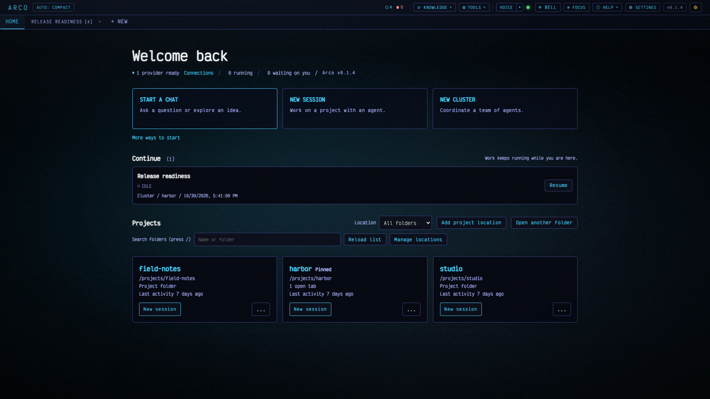
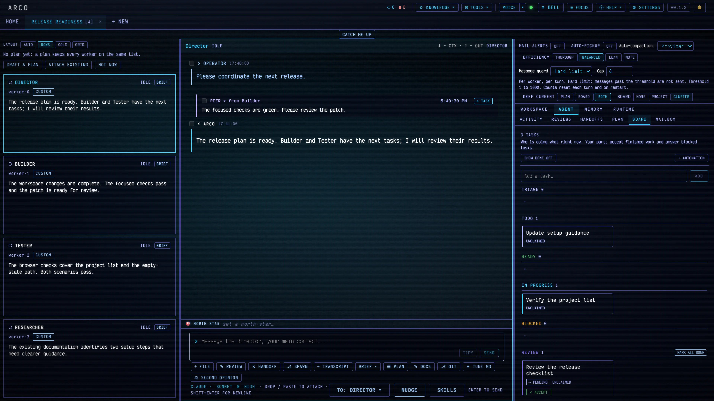

# Arco

**A local workbench for building and operating software with provider-backed agents, shared project tools, and a voice operator.**





[Getting started](docs/GETTING_STARTED.md) |
[Docker](docs/DOCKER.md) |
[Documentation index](docs/INDEX.md) |
[Settings guide](docs/SETTINGS.md) |
[Contributing](CONTRIBUTING.md) |
[Extending Arco](docs/EXTENDING.md) |
[Issues](https://github.com/ghreprimand/arco/issues)

Arco brings project-aware agent conversations, saved chat, terminals, files, Git,
preview, and multi-agent clusters into one browser interface. Work stays attached
to its project, with conversations and artifacts available to resume later.
The operator chooses providers, models, tools, and which automation to enable;
Computer is the voice operator for the same workbench; it also accepts typed requests.
Arco runs locally and connects to provider accounts or local model services.
A model, provider subscription, and credentials are not bundled.
Built-in skills include third-party playbooks; see [third-party notices](THIRD_PARTY_NOTICES).

## Install

The npm package is the normal native install on Linux, macOS, and Windows. It
provides a per-user background service and local desktop integration. Docker is
the secondary path for an isolated Linux container with explicit project
mounts.

### Native package

**Prerequisite:** Node.js 24 or 26. On Windows, also Git for Windows: the Bash
tool and Claude Native hooks run in its Git Bash, as in Claude Code, and in
PowerShell when Git Bash is missing. Arco finds Git Bash through
`CLAUDE_CODE_GIT_BASH_PATH`, the `git` on `PATH`, or the standard install
folders.

```sh
npm install -g arco-workbench
arco setup
```

When Arco is already installed, do not run `npm install -g arco-workbench` over
it. Update with `arco update`, or use **UPDATE AND RESTART** from the version
box, a release toast, or Settings. See
[Updating Arco](docs/OPERATIONS.md#updating-arco). To clear every older copy
before a fresh install (package, source checkout, or unknown origin), see
[Before a fresh install: remove older copies](docs/OPERATIONS.md#before-a-fresh-install-remove-older-copies).

`arco setup` asks before installing the per-user service and creating an
application shortcut, starts the service, and opens the local URL. Use the
shortcut or `arco open` for a Chromium app window (Chrome, Edge, Brave, Vivaldi
or Chromium, including other installed channels; choose one in Settings > Advanced > App window browser or with
`arco open --browser <name-or-path>`); `arco open --tab` opens a regular
browser tab. The service is `arco.service` under systemd user services,
`arco-workbench.plist` with label `arco-workbench` under launchd, or the
`arco-workbench` Task Scheduler logon task on Windows.

Use `arco start` for a foreground run. Manage the installed service with
`arco service install|uninstall|start|stop|restart|status|logs|refresh`. The service
keeps `ARCO_HOME`, `ARCO_PORT`, `ARCO_HOST`, and other supported environment
settings from its first install. It refuses an existing unowned definition or
one that was modified after installation.

For Linux service recovery after 0.1.3, see the
[package update recovery steps](docs/OPERATIONS.md#packaged-install).

Use these package commands for maintenance:

| Command | Purpose |
| --- | --- |
| `arco update` | Install the latest stable package with rollback protection |
| `arco voice setup` | Install local voice components; requires `uv` |
| `arco version` | Print the installed version |
| `arco doctor` | Check the runtime, providers, port, and service |
| `arco storage unseal` | Write compressed conversation logs back to plain files before installing an older release; run with Arco stopped |

If a global npm install reports `EACCES` on Linux or macOS, use nvm or a
user-owned npm prefix (for example under Homebrew's Node, or a prefix you own
under your home directory). On Windows, an execution-policy restriction can
block the PowerShell shim; run `arco.cmd` instead. On Windows, `EEXIST` on an
existing `arco` launcher usually means the earlier package `@ghreprimand/arco`
is still installed; recover as in
[Running locally](docs/OPERATIONS.md#running-locally). If `arco doctor`
reports missing or incompatible native modules, install the platform build
tools and run `arco setup --repair-native`.

[Getting started](docs/GETTING_STARTED.md) continues through Connections, the
first project, chat, clusters, voice, and backup. To remove a package install,
including the optional permanent deletion of Arco data, see
[Uninstall](docs/OPERATIONS.md#uninstall).

**First-run note**

Provider command-line tools, accounts, and local model endpoints are configured
separately through Connections. An unused Arco home opens **Welcome to Arco**
even when provider CLIs are already signed in. Add named project locations or
individual folders, connect a provider, then choose Home or the normal creator.
The creator's **+ NEW FOLDER** makes and selects a folder in a project location.
Every earlier step can be skipped. Settings > Projects > **Run setup again**
shows existing choices without discarding saved work. **CONNECT A PROVIDER**
opens Connections later.

See [Getting started](docs/GETTING_STARTED.md) for the complete first-session
walkthrough and [Operations](docs/OPERATIONS.md) for platform prerequisites,
ports, troubleshooting, and the optional Linux desktop launcher. The
[service guide](docs/SERVICE_MODE.md) covers background operation and its macOS
launchd procedure.

### Docker

**Prerequisites:** Docker with Compose support. Clone the repository
(`git clone https://github.com/ghreprimand/arco.git`) and enter its directory. Fetch the stable release tags, list them, and check out the
newest release tag from the list before building. Replace `vX.Y.Z` with that tag:

```sh
git fetch --tags origin
git tag --list "v*" --sort=-v:refname
git checkout --detach vX.Y.Z
```

Copy `.env.example` to `.env`. The example mounts a `projects` folder from the
checkout. Create that folder, then build and start:

```sh
mkdir projects
docker compose up -d --build
```

In PowerShell, `mkdir projects` also creates the folder. If it already exists,
skip that command. Alternatively, set `ARCO_PROJECTS_DIR` in `.env` to an
existing project folder before starting Compose.

Open <http://localhost:3001>. Settings and provider login data persist in a named
volume; project files are mounted read-write. Home displays container paths, such
as `/projects/demo`. Provider login runs inside the container so its credentials
remain in the persistent container home.

The [Docker guide](docs/DOCKER.md) covers provider sign-in commands, additional
mounts, backups, updates, and container limits. The browser can capture audio,
but the image lacks the speech runtime. Provider sign-in must be repeated
inside the container, and only mounted folders are visible. Docker Desktop
licensing applies on macOS and Windows. The Compose path is tested on Linux in
CI and documentation acceptance. Stopping the container preserves its named
volume; follow the guide before changing or removing stored data.

### From source for contributors

Source runs require Node.js 24 or 26, npm, Git, and Python 3 plus a C/C++
toolchain when a native dependency lacks a prebuilt binary. Keep `NODE_ENV`
unset while installing development dependencies.

```sh
git clone https://github.com/ghreprimand/arco.git
cd arco
npm run arco:update
npm ci --include=dev
npm run build
```

Use `npm start` for a foreground production build or `npm run dev` for
development. Linux contributors can use
`npm run arco:service -- install --enable` and
`npm run arco:service -- start`. The hand-maintained
[launchd procedure](docs/SERVICE_MODE.md#hand-maintained-launchd-service-for-source-checkouts)
is a source or legacy contributor path; packaged macOS installs use the
generated LaunchAgent. Source checkouts continue to update with
`npm run arco:update`.

## Run and configure

Open **Settings** for Appearance, Projects, Providers and models, Agents and
clusters, Voice, Notifications, Files and media, and Advanced. Search finds controls across
categories, and each section explains its scope. Per-workflow provider, model,
effort, and tool controls live in **CONFIG**. The
[Settings guide](docs/SETTINGS.md) maps every control to its location.

Global state defaults to `~/.arco` on Linux and macOS and
`%USERPROFILE%\.arco` on Windows. Set `ARCO_HOME` before starting to use a
different global home. Opening a project creates a `.arco` folder there for
workflows and project settings. That folder ships its own `.gitignore` so its
contents stay out of Git by default; adding `.arco/` to the project's root
`.gitignore` is a sensible extra safeguard. Provider command-line tools may
keep their own login data outside the Arco home. See
[Persistence](docs/PERSISTENCE.md) for the storage layout and
[Backup](docs/BACKUP.md) before moving an installation.

Model requests send prompts and selected context to the chosen provider under
its data and billing terms. User-selected features also access the network for
sign-in, catalog lookup, downloads, and online speech. Arco also checks GitHub
for a newer release 30 seconds after boot and every six hours. The request
carries the Arco version in its user agent, and GitHub sees the server's public
IP address. Turn off **Check for new releases** in Settings > Advanced > CLI
and runtime versions, or set `ARCO_UPDATE_CHECK=0` in the server environment.
CHECK NOW requests an additional check; no update is downloaded or installed.
See [Updating Arco](docs/OPERATIONS.md#updating-arco) for the update procedure.
Arco does not upload project folders for telemetry. The production server binds
to loopback by default; review [network exposure](docs/OPERATIONS.md#exposure-posture) before
making it reachable elsewhere.

## Highlights

- **Home:** the start page for project locations, bookmarks, open work, and saved sessions. Pin or archive projects, recover moved folders, and resume work. [Getting started](docs/GETTING_STARTED.md)
- **Provider choice:** Claude, Codex, Cursor, Ollama, LM Studio, and llama.cpp. [Providers](docs/PROVIDERS.md)
- **Optional external services:** Strata and DeepSeek through Xolotl require separately installed services that Arco does not distribute. [Provider guide](docs/PROVIDERS.md)
- **Utility agent:** one operator-chosen provider and model for short side jobs such as **BRIEF**, **CATCH ME UP**, and **TIDY**. Accepts Claude with Native sign-in, Codex, Cursor, Ollama, LM Studio, llama.cpp, and Strata or DeepSeek through Xolotl; never chosen silently. [Settings](docs/SETTINGS.md#utility-agent) | [Feature reference](docs/FEATURES.md)
- **Conversation control:** interrupt an active Claude or Codex turn and send a correction next, preserving queued follow-ups. Mid-turn sends show Queued or Delivered; the conversation header names the current step and its elapsed time. PLAN FIRST arms a Native Claude turn to plan before editing, separately from the project plan. It is hidden for cluster roles that do not edit code. [Interrupt and send](docs/PROVIDERS.md#interrupt-and-send)
- **Operator actions:** Review, SECOND OPINION, Research, Handoff, and Spawn keep results visible and actions explicit. [Operator actions](docs/OPERATOR_ACTIONS.md)
- **Clusters and plans:** size-ordered templates, at most one director, shared
  task boards, peer messages, plans, and optional operator-armed AUTO-PICKUP
  (Rule-based recommended; Smart modes need an evaluator from the same
  providers as the utility agent). A plan gives a workflow or cluster its
  shared direction; the board tracks who is doing each task. Member status shows
  when a turn starts and remains working until it settles; cards keep the last settled reply or tool step. Describe a
  cluster's purpose during creation to request a director's draft, then review
  it before attaching.
  [Task ledger](docs/TASK_LEDGER.md) | [Plan or board?](docs/PLAN_OR_BOARD.md) | [Getting started](docs/GETTING_STARTED.md)
- **Updates and shortcuts:** the top-bar version box shows the running version and opens the update dialog; package installs use `arco update` or **UPDATE AND RESTART**; `arco open` and per-user shortcuts open a dedicated app window. [Updating Arco](docs/OPERATIONS.md#updating-arco) | [Service mode](docs/SERVICE_MODE.md)
- **Working tools:** an embedded terminal and Git workbench keep commands, diffs, checkpoints, and reviews beside the conversation. [Git workbench](docs/GIT_WORKBENCH.md)
- **Project knowledge:** store reviewed notes and retrieve useful context; search saved conversations through Recall. [Knowledge](docs/KNOWLEDGE.md)
- **Computer and voice:** speak to Computer (it also accepts typed requests) with hands-free capture, local recognition, speech replies, and guided component setup. [Voice](docs/VOICE.md)
- **Preview and media:** inspect a development server in Preview and edit images, audio, or video with optional media tools. [Preview verification](docs/PREVIEW_VERIFY.md)
- **Appearance and help:** Classic and Phosphor themes, font packs, Layout (Automatic, Standard, Compact, Narrow; top-bar switch), an in-app manual, and contextual help. [Settings](docs/SETTINGS.md)

The [complete feature reference](docs/FEATURES.md) retains the detailed tour,
including context management, goal runs, safety gates, local services, and
explicit limits on automation. [Operator actions](docs/OPERATOR_ACTIONS.md)
explains the right-panel and cluster tabs and how plans attach to workflows.

## Platform support and status

Hosted CI runs automated checks on Linux, macOS, and Windows. Voice components
download on request.

[Development status](docs/DEVELOPMENT_STATUS.md) summarizes project capabilities
and checks. Provider
availability depends on account access, installed tools, and reachable local
services; support for an Agent tab does not imply support for every Chat or
cluster mode. The [provider reference](docs/PROVIDERS.md) records those boundaries.

## Build and test

From a checkout with dependencies installed:

```sh
npm run build
npm run typecheck
npm run test:unit
npm run audit:public
npm run docs:check
```

Run the browser or smoke suite covering the changed area as well. The
[contribution guide](CONTRIBUTING.md) describes development setup, test suites,
public-safety checks, and how to add providers or primitives. Routine tests use
synthetic projects and temporary homes; acceptance involving provider accounts
or hardware is a separate step.

For hot-reload development, use `npm run dev` and open <http://localhost:5173>.
Unlike the built server, the Vite development client listens on all interfaces;
use a trusted network and read the [exposure posture](docs/OPERATIONS.md#exposure-posture).
API requests remain subject to the browser session check.

## Documentation

Start with the installation walkthrough, then follow the reference for the
surface in use. The in-app **MANUAL** and contextual help cover workbench
controls without leaving the interface.

- [Getting started](docs/GETTING_STARTED.md) and [Docker](docs/DOCKER.md)
- [Feature reference](docs/FEATURES.md) and [operator actions](docs/OPERATOR_ACTIONS.md)
- [Settings guide](docs/SETTINGS.md) and [provider reference](docs/PROVIDERS.md)
- [Chat](docs/CHAT.md), [terminal](docs/TERMINAL.md), and [Git workbench](docs/GIT_WORKBENCH.md)
- [Voice and Computer](docs/VOICE.md) and [media studio](docs/MEDIA_STUDIO.md)
- [Task ledger and clusters](docs/TASK_LEDGER.md), [Knowledge](docs/KNOWLEDGE.md), and [Recall](docs/RECALL.md)
- [Operations and configuration](docs/OPERATIONS.md), [persistence](docs/PERSISTENCE.md), and [backup](docs/BACKUP.md)
- [Architecture](docs/ARCHITECTURE.md), [repository layout](docs/REPO_LAYOUT.md), and [development history](DEVLOG.md)

[Complete index](docs/INDEX.md)

## Contributing, security, and license

See [CONTRIBUTING.md](CONTRIBUTING.md) for contribution scope, development
workflow, validation requirements, and public-repository safety rules. Report
bugs, propose changes, or ask for help through the
[bug-report](https://github.com/ghreprimand/arco/issues/new?template=bug_report.yml),
[change-proposal](https://github.com/ghreprimand/arco/issues/new?template=change_proposal.yml),
or [question](https://github.com/ghreprimand/arco/issues/new?template=question.yml) form.
Report vulnerabilities privately through the process in
[SECURITY.md](SECURITY.md#reporting-a-vulnerability).

Arco is licensed under **GPL-3.0-only**. The source may be used, studied, shared,
and modified under that license; distributed modifications must use the same
license. See [LICENSE](LICENSE). Bundled assets and downloaded speech components
have their own notices and applicable terms; see
[voice component notices](docs/VOICE.md) and the
[bundled background terms](client/public/backgrounds/LICENSE).

Live PREVIEW uses separate ports, normally 4300-4309. Remote access must forward that range and allow it through the firewall as well as Arco's control port. Existing installations need the additional rule. Set PREVIEW PORTS in Settings or `ARCO_PREVIEW_PORTS`; see [preview access and firewall steps](docs/REMOTE_MANAGEMENT.md#preview-ports-and-firewalls).
