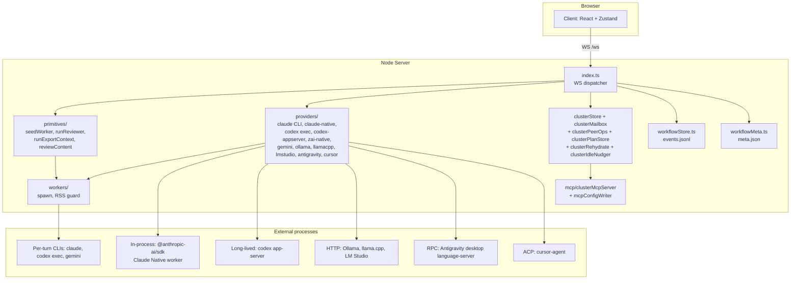
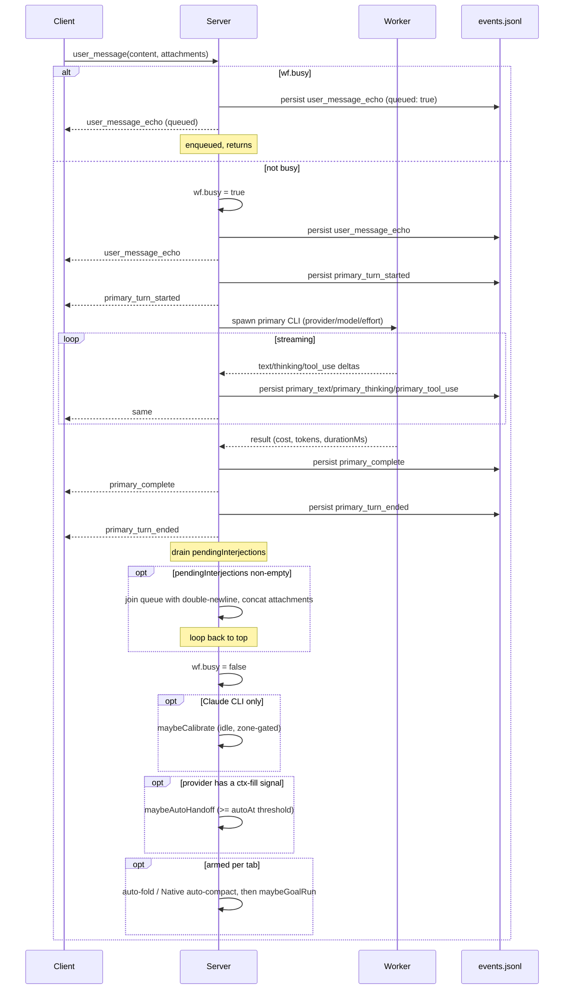

# Arco - architecture reference

Durable map of the system as it actually ships. This is the anchor doc - every other doc in `docs/` is a deep-dive on one slice of what's described here. Updated when the architecture changes, not when a specific bug is fixed.

For "don't regress X because of Y" warnings, see [`GOTCHAS.md`](GOTCHAS.md). For chronological change history, see [`../DEVLOG.md`](../DEVLOG.md). For terms used throughout, see [`GLOSSARY.md`](GLOSSARY.md).

---

## Reading order

If you're new to the codebase, read in this order:

1. **This file** (ARCHITECTURE.md) - the system map
2. [`GLOSSARY.md`](GLOSSARY.md) - terminology
3. [`PROTOCOL.md`](PROTOCOL.md) - every WebSocket message, what it does (with siblings [`PROTOCOL_PRIMITIVES.md`](PROTOCOL_PRIMITIVES.md) - operator-primitive messages, and [`PROTOCOL_CLUSTER.md`](PROTOCOL_CLUSTER.md) - cluster-mode messages)
4. [`HTTP_API.md`](HTTP_API.md) - every HTTP endpoint with request/response shapes
5. [`PROVIDERS.md`](PROVIDERS.md) - per-provider deep dive (Claude CLI + Native, Codex exec + app-server, Z.ai native + appserver, Gemini, Ollama, llama.cpp, LM Studio, Strata, Antigravity, Cursor acp + print)
6. [`PRIMITIVES.md`](PRIMITIVES.md) - Review, Handoff, Spawn deep dives
7. [`PERSISTENCE.md`](PERSISTENCE.md) - `events.jsonl`, `meta.json`, `.arco/` layout
8. [`CLIENT.md`](CLIENT.md) - Zustand store, component tree, render pipeline
8a. [`TASK_LEDGER.md`](TASK_LEDGER.md) - the durable, cwd-scoped project task ledger (a projection over `events.jsonl`)
9. [`OPERATIONS.md`](OPERATIONS.md) - running locally, ports, launcher, recovery
9a. [`BACKUP.md`](BACKUP.md) - `npx tsx scripts/arco-backup.ts snapshot`: what state is captured / skipped / redacted, and the archive format
10. [`GOTCHAS.md`](GOTCHAS.md) - non-obvious invariants
11. [`../CONTRIBUTING.md`](../CONTRIBUTING.md) - dev workflow + how to add a provider/primitive

### Feature / subsystem docs

Beyond the core reading order, each operator-facing subsystem has its own reference doc. Read the relevant one before touching that surface:

- [`DEEPSEEK.md`](DEEPSEEK.md) - prepared DeepSeek Exact/Light via Xolotl, guarded lifecycle, memory and source-version tracking
- [`STRATA.md`](STRATA.md) - Strata large MoE runbook, model profiles, RAM/VRAM tiers, web/vision and recovery
- [`CHAT.md`](CHAT.md) - projectless Chat tabs, web toggle, attachments, Incognito privacy boundary
- [`VOICE.md`](VOICE.md) - canonical Computer/voice reference: capture and speech, selectable agents, context/privacy, tools, live activity, conditional scripts, recovery and verification
- [`TERMINAL.md`](TERMINAL.md) - integrated operator PTY (`/terminal` WS channel, off the seq'd protocol)
- [`PREVIEW_VERIFY.md`](PREVIEW_VERIFY.md) - headless-Chromium Preview capture (screenshot + console/network + layout/a11y), feeds the `preview-capture` Review variant
- [`RECALL.md`](RECALL.md) - cross-workflow transcript search / recall
- [`KNOWLEDGE.md`](KNOWLEDGE.md) - operator knowledge base
- [`MEDIA_STUDIO.md`](MEDIA_STUDIO.md) - image / audio / video viewer + editor (FFmpeg, optional Demucs)
- [`COOKBOOK.md`](COOKBOOK.md) - fit-scored local-model catalog, download + auto-register
- New-project scaffolding behavior is described by the shipped implementation.
- [`LSP.md`](LSP.md) - language-server integration
- [`MCP_REGISTRY.md`](MCP_REGISTRY.md) - MCP server registry
- [`DIAGNOSTICS.md`](DIAGNOSTICS.md) - diagnostics surface
- [`TASK_LEDGER.md`](TASK_LEDGER.md) - durable cwd-scoped project task ledger (a projection over `events.jsonl`)
- [`LOCAL_SERVICES.md`](LOCAL_SERVICES.md) - local-services management
- [`REMOTE_MANAGEMENT.md`](REMOTE_MANAGEMENT.md) - remote management console and setup guidance
- [`NOTIFICATIONS.md`](NOTIFICATIONS.md) - operator notifications
- [`CHECKPOINTS.md`](CHECKPOINTS.md) - workspace checkpoints
- [`BACKUP.md`](BACKUP.md) - `npx tsx scripts/arco-backup.ts snapshot` (what state is captured / skipped / redacted)
- [`SERVICE_MODE.md`](SERVICE_MODE.md) - running Arco as a service
- [`GIT_WORKBENCH.md`](GIT_WORKBENCH.md) - Git workbench surface
- [`RESUME_INDEX.md`](RESUME_INDEX.md) - resume-index for the session picker

Private planning and research documents are excluded from this public reference set.

---

**Interrupt and send for Claude and Codex.** `user_message.kind:'interrupt'`
cancels only the active primary and keeps its busy claim through provider
teardown. Priority queue selection (`ws/messageQueue.ts`) runs the correction
before older queued messages. The CLI waits for child exit, Claude Native waits
for `runTurn`, and Codex app-server waits for interrupted-turn completion. The
Agent composer provides a button and `Ctrl/Cmd+Enter`. See [Interrupt and send](PROVIDERS.md#interrupt-and-send).

## What Arco is, in one paragraph

Arco has two single-conversation tab kinds. `kind:'workflow'` is the coding
workbench with a project cwd, tools, primitives, and the right panel.
`kind:'chat'` is a projectless conversation rendered by `ChatModeView`: it gets
an Arco-owned storage cwd under `~/.arco/chats/<workflowId>` solely for
durable events/meta, skips project discovery and checkpoints, and runs under
`WorkerConfig.interactionMode:'chat'`. Chat supports Claude, Codex, Z.ai,
Cursor, Ollama, llama.cpp, LM Studio, Strata, and DeepSeek; Gemini and Antigravity are not offered.
Native/local APIs receive no project tools; CLI backends are additionally isolated and
read-only where their transport cannot remove every built-in tool. The single
exception is the per-tab **web-access toggle** (`WorkflowConfig.chatWebAccess`,
armed from the chat header): on Claude, Codex, Ollama, Strata, and DeepSeek it adds web search + fetch and
nothing else - Ollama routes them through Arco's local SearXNG-backed runtime;
there is still no filesystem, shell, MCP or project. It defaults on for a
saved Chat and off for Incognito, and `chatWebArmed` in `server/src/chatMode.ts`
is the one place that decides.

The hands-free **Computer** is another explicit Chat exception: Codex,
Claude Native, Ollama and Strata expose only the shared bounded `arco_*`
operator tools, relayed to the owning browser. Its header panel selects
provider/model/effort/history, keeps separate contexts, and fully clears context
at a clean turn/queue boundary (50% subscription / 75% local by default).
Strict no-history is supported by Claude Native, Ollama, and pathless ephemeral
Codex app-server threads; Strata remains saved-only. See [VOICE.md](VOICE.md).

Saved Chat metadata is enumerated globally by `GET /api/chats`; reopening sends
the server-reconstructed config back through `create_workflow` with
`resumeWorkflowId`, then normal event replay restores the transcript. Incognito
Chat is the separate memory-only branch: no storage cwd registration, metadata,
events, Recall row, or browser localStorage. Claude/Codex CLI persistence is
disabled upstream too. Its async execution tree and delayed workflow/worker-id
lines are suppressed at the console tee before stdout, journald, or the
structured log; notifications, hub reporting, durable PID registration, and
Claude argv/temp-file framing are disabled. Cursor and llama.cpp are unavailable
because their local persistence/logging cannot meet the strict boundary.

Arco is a tabbed multi-provider coding workbench. Each tab owns one long-lived **primary agent** (Claude / Codex / Z.ai / Gemini / Ollama / llama.cpp / LM Studio / Strata / DeepSeek / Antigravity / Cursor - eleven providers) running against one **working directory**. **Claude has two transports** - `cli` (default, per-turn `claude` spawn) and `native` (long-lived in-process worker via `@anthropic-ai/sdk`); **Codex has two** - `exec` (default, per-turn `codex exec --json`) and `appserver` (long-lived `codex app-server` per tab); **Z.ai has two** - `native` (default, long-lived direct Chat Completions worker) and `appserver` (fallback through Codex app-server's Z.ai proxy); **Cursor has two** - `acp` (default, long-lived `cursor-agent acp` ACP worker) and `print` (stateless `cursor-agent -p --mode ask` one-shot, auto-routed for read-only primitive spawns). Operators chat directly with that primary; ordinary chat messages are not secretly routed and Arco does not silently pick models for them. Three operator-triggered **primitives** layer on top - **Review** (cross-family second opinion, transcript-scoped or plan-scoped), **Handoff** (rotate to a fresh session within the same tab), **Spawn** (fork the conversation to a new tab) - plus two structured one-off composer surfaces (**DOCS** / **GIT**). A **cluster** is a parent tab kind that hosts N member workflows pinned to one cwd; members hand notes via a budgeted peer-tool substrate between operator turns. Same-provider model and effort changes happen live without rotation; provider swaps require a Handoff. Every workflow-scoped event is stamped with a monotonic `seq` and persisted to `events.jsonl` so reconnecting clients get lossless replay. There is no hidden orchestrator authority, no silent autonomous routing, and no LLM-curated memory: model-assisted proposals or dispatch are eligible only when operator-armed, visible, logged, reversible, and applied through explicit approval or bounded task tools.

---

Strata is a separate OpenAI-compatible HTTP connection (`strata.ts`), reusing
the worker in `lmstudio.ts`. Live context/modalities come from its `/models`;
Arco owns the tool loop while Strata owns inference/encoder memory. Prepared
local profiles can switch through operator-registered user services on the next
turn, preserving those services' limits. See [STRATA.md](STRATA.md).

DeepSeek is a separate Xolotl connection (`deepseek.ts`), sharing the HTTP
worker but using its own prepared registry and guarded systemd launcher
(`deepseekProfiles.ts`). Its Exact/Light profiles remain discoverable offline;
service switching and unload share the local-operation guard with Strata and
FREE VRAM. No engine is spawned beneath an Arco worker. See [DEEPSEEK.md](DEEPSEEK.md).

## Topology

```
┌────────────────────────────────────────────────────────────────────────┐
│                          Browser (Vite/React 19)                       │
│  ┌──────────────────────────┐    ┌────────────────────────────────┐    │
│  │ ChatPanel + TerminalInput │    │ RightPanel                     │    │
│  │ (left 2/3)                │    │  Files / Activity / Review /   │    │
│  │                           │    │  Handoffs / Plan / Tasks /     │    │
│  │                           │    │  History / Preview / Config /  │    │
│  │                           │    │  GitHub                        │    │
│  └──────────────────────────┘    └────────────────────────────────┘    │
│                            ▲             ▲                              │
│                            │ Zustand     │ localStorage                 │
│                            ▼             │  (persisted: jobs, theme,    │
│                       appStore.ts        │   activeTab/wf, splitter,    │
│                            │              │   taskChildren, history)    │
│                            │ useWebSocket.ts                            │
└────────────────────────────┼────────────────────────────────────────────┘
                             │  WS /ws  (typed by shared/src/protocol.ts)
                             │
┌────────────────────────────┼────────────────────────────────────────────┐
│  Node.js + ws              ▼                                            │
│  ┌──────────────────────────────────────────────────────────────────┐  │
│  │ server/src/index.ts                                              │  │
│  │  - WS dispatcher (one Session per ws)                            │  │
│  │  - Workflow registry (in-memory Map<wfid, WorkflowState>)        │  │
│  │  - HTTP routes (/api/sessions, /api/transcript, /api/auth-*,     │  │
│  │    /api/auth/claude-native/*, /api/git/*, /api/preview/*,...)   │  │
│  └──────────────────────────────────────────────────────────────────┘  │
│              │                          │                               │
│              ▼                          ▼                               │
│  ┌─────────────────────┐    ┌──────────────────────────────────┐        │
│  │ primitives/         │    │ providers/                       │        │
│  │  seedWorker         │    │  claude (CLI)                    │        │
│  │  runReviewer        │    │  claude-native/        │        │
│  │  exportContext      │    │  codex (exec)                    │        │
│  │  reviewContent      │    │  codex-appserver/       │        │
│  │                     │    │  gemini / ollama / ollamaTools   │        │
│  │                     │    │  llamacpp + llamacppManager      │        │
│  │                     │    │  antigravity / antigravityRpc    │        │
│  │                     │    │  zai-native / zai-appserver      │        │
│  │                     │    │  lmstudio (/v1 OpenAI-compat)    │        │
│  │                     │    │  cursor (ACP) / cursor print     │        │
│  └─────────────────────┘    └──────────────────────────────────┘        │
│              │                          │                               │
│              ▼                          ▼                               │
│  ┌──────────────────────────────────────────────────────────────────┐  │
│  │ workers/ (process supervision: spawn, RSS guard, tree-kill)      │  │
│  └──────────────────────────────────────────────────────────────────┘  │
│              │                                                          │
│              ▼                                                          │
│  ┌──────────────────────────────────────────────────────────────────┐  │
│  │ workflowStore.ts (events.jsonl) + workflowMeta.ts (meta.json)    │  │
│  └──────────────────────────────────────────────────────────────────┘  │
└─────────────────────────────────────────────────────────────────────────┘
                             │
                             ▼
                Per-turn subprocess CLIs (CLI Claude, Codex exec, Gemini)
                Long-lived subprocess (Codex app-server)
                In-process @anthropic-ai/sdk (Claude Native)
                HTTP (Ollama, llama.cpp via singleton llamacppManager, LM Studio via OpenAI-compat /v1)
                Language-server RPC (Antigravity desktop app; debug port:9222 is liveness-only)
```



**Monorepo** - npm workspaces:

| Workspace | Role | Entry point |
|---|---|---|
| `shared/` | TypeScript protocol types - every WS message and shared helper. Split per-domain under `shared/src/protocol/` (`reviews.ts`, `clusters.ts`, `previewCapture.ts`, ...); `shared/src/protocol.ts` is a thin barrel re-exporting `./protocol/index.js` | `shared/src/protocol/index.ts` |
| `server/` | Node.js + ws server. Spawns providers, persists events, dispatches WS messages | `server/src/index.ts` |
| `client/` | Vite + React 19 + Zustand frontend | `client/src/main.tsx` |

All workspaces compile through `tsc`; the client uses Vite for dev/HMR.

---

## Mental model

A few concepts repeat throughout the system; nailing them down up front saves time later.

- **Chat** - a projectless conversation (`kind:'chat'`), not an Agent tool posture.
  Saved chats use `~/.arco/chats/<wfid>` as a persistence cwd and reopen through
  PAST CHATS. Incognito is memory-only and is lost on close/refresh/restart.
  Provider support and local/provider privacy boundaries: [CHAT.md](CHAT.md).

- **Workflow** - one workflow tab = one primary agent + one cwd. Identified by a stable `workflowId` (UUID). Persists across server restarts; recovered from `meta.json` on disk. See [GLOSSARY](GLOSSARY.md).
- **Cluster** - a parent tab kind that hosts N member workflows pinned to one cwd (see [Cluster mode](#cluster-mode) below). Persists at `~/.arco/clusters/<clusterId>/`; members are full workflows in their own right.
- **Primary agent** - the single long-lived agent that owns the conversation in a workflow. The provider/model/effort triple is part of `WorkflowConfig`; same-provider model/effort can be swapped live. **Transport** is per-tab (`claudeTransport: 'cli' | 'native'`, `codexTransport: 'exec' | 'appserver'`, `zaiTransport: 'native' | 'appserver'`; Cursor's `print` path is routed by `sandbox: 'read-only'`, not a config field). Codex tabs also carry `codexContextPolicy: 'max' | 'standard'`; absent means MAX.
- **Primary turn** - one operator prompt -> one round of agent work. Bracketed by `primary_turn_started` / `primary_turn_ended`. The composer's `busy` flag mirrors this on the client.
- **Primitive** - one of three operator-triggered server-side flows: Review (transcript-scoped or plan-scoped), Handoff, Spawn. They're not the primary turn; they spawn separate workers. The structured DOCS / GIT composer surfaces ride the primary-turn machinery rather than spawning workers.
- **Worker** - a subprocess (or HTTP/CDP client) running one slice of work. Workers come and go; the workflow outlives them.
- **Observer** - a connected WebSocket subscribed to a workflow. Multiple browser tabs can observe the same workflow; broadcasts fan out to all of them.
- **Seq** - a per-workflow monotonic counter stamped onto every persisted event. Drives lossless replay on reconnect.
- **Session** (CLI session) - the native session inside Claude/Codex (UUID-keyed). Arco stores its ID in `meta.cliSessions[]` and pins one as `primarySessionId`. Handoff archives the active one and starts fresh.
- **Seed** - the first user message in a fresh session, used by Handoff/Spawn to inject context. Shows in chat as a one-line `HANDOFF SEED · click to expand` pill instead of a 300-line bubble.

---

## Server lifecycle

### Boot

`server/src/index.ts` from process start to listening:

1. Probe provider CLIs for installed versions and capabilities (`probeCapabilities` - a pre-`listen` top-level await, so it's always resolved before the server accepts connections); log results. Schedule a re-probe every 4 hours.
2. Probe Antigravity CDP availability - does **not** spawn the desktop app yet (lazy on first use).
3. Reap orphan worker PIDs (`reapOrphanWorkers`) and orphan terminal PTYs (`reapOrphanTerminals`) from any prior crash - both synchronous, before `listen`, so no orphan survives a boot.
4. Register HTTP routes. Highlights:
   - `GET /healthz` (alias `/health`) - liveness; `GET /readyz` - readiness (503 until boot recovery settles)
   - `GET /api/chats` - saved Chat summaries for PAST CHATS
   - `GET /api/sessions?path=<cwd>` - unified Claude + Codex native sessions for the Resume picker
   - `GET /api/transcript?provider=...&sessionId=...` - JSONL -> ChatMessage[] for resume hydration
   - `GET /api/workflows?path=<cwd>` - Arco workflows on disk (tooling)
   - `GET /api/workflows/artifact|handoff?path&workflowId&name` - review artifacts + handoff documents (separate endpoints so the path-traversal guard stays tight)
   - `POST /api/upload` - file uploads
   - `POST /api/auth-login?provider=<name>` - per-provider auth trigger
   - `GET /api/auth-status` - combined auth snapshot
   - `GET /api/capabilities` - CLI versions + supported efforts/models
   - `GET /api/usage` - Claude 5-hour / weekly usage probe
   - `GET /api/toolbox?provider&transport&cwd` - provider-native skill catalog
   - `GET /api/settings` + `PATCH` - operator settings
   - `GET /api/plans/*` - plan store CRUD
   - `POST /api/shutdown` - graceful exit
   - `POST /api/restart` - graceful exit + respawn dev tree
5. Open WebSocket endpoint at `/ws`. Heartbeat ping every 15s. The `httpServer.on('upgrade')` fan-out also routes two non-`/ws` WS paths: the per-workflow **preview proxy** (`/api/preview/<wfid>/*`, Vite/Next HMR) and the operator **`/terminal`** channel (Workbench - the raw PTY byte stream for the integrated terminal, deliberately off the seq'd `/ws` protocol and out of `events.jsonl`; see [`TERMINAL.md`](TERMINAL.md)). Both inherit `/ws`'s loopback-bind access posture.
6. Listen on `ARCO_PORT` (default 3001), bound to `ARCO_HOST` (default `127.0.0.1` - see [`OPERATIONS.md`](OPERATIONS.md#remote-access) for why and when to override).
7. Inside the `listen` callback (post-listen, async): recover workflows from disk (`recoverWorkflowsFromDisk` walks each known cwd's `.arco/workflows/`), ensure the model + llama.cpp catalogs, and install the global settings watcher. Recovery is deliberately post-listen - the seq buffer for each recovered workflow is primed at boot by `crashRecovery.ts` so seq continuity holds even before recovery completes.
8. Install `SIGTERM` / `SIGINT` handlers: SIGKILL all live worker PIDs, flush `events.jsonl`, exit.

### WebSocket connection lifecycle

When a client connects:

1. New `Session` record created (sessionId, empty `workflowIds`).
2. Server sends `connected` immediately with `sessionId`.
3. Server broadcasts current `quota_status` (per-provider throttle state).
4. If any unacknowledged `capabilities_changed` events are pending, send them now.
5. Client responds with `rehydrate_workflows` listing every persisted workflow and the `lastSeq` it has for each.
6. For each entry, `handleRehydrateWorkflows` decides:
   - **Replay**: if the client's `lastSeq` is ≥ `firstSeq` on disk, stream every event with `seq > lastSeq` then send a `workflow_state_snapshot` with the current head seq.
   - **Snapshot-only fallback**: if events have rotated off disk (`firstSeq > lastSeq + 1`), send a snapshot with `snapshotOnly: true` and `snapshotReason: 'events-rotated'`. The client then force-sets its `lastSeq` to match the server's.
7. Workflow's WS observer set is updated to include this new connection. Multiple tabs share the observer set - broadcasts fan to all of them.

### Workflow lifecycle

A `WorkflowState` lives in an in-memory `Map<workflowId, WorkflowState>` keyed by UUID. Fields (abridged):

```ts
{
  config: WorkflowConfig,           // provider, model, effort, cwd, etc.
  busy: boolean,                    // a primary turn is in flight
  manager: WorkerManager,           // process supervision for this workflow
  primary?: PrimaryHandle,          // active primary turn handle, if busy
  primarySessionId?: string,        // CLI session UUID (Claude/Codex only)
  pendingInterjections: QueuedMessage[],  // queued mid-turn user messages
  observers: Set<WebSocket>,        // every connected client watching this wf
  sessionWatcher?: ChokidarWatcher, // Claude JSONL watcher (Claude only)
  calibration?: { ratio, overhead, lastGroundTruth },
  planId?: string,                  // attached plan, if any
  //... activity tracking, calibration zones, auto-handoff state
}
```

**Creation** (`handleCreateWorkflow`): operator submits a `WorkflowConfig`. If `resumeSessionId` is set, the server checks every `meta.json` for an existing workflow already owning that session and reuses its `workflowId`. Otherwise a fresh UUID is minted. `initWorkflowStore(cwd, wfid)` primes the events buffer, creates the artifacts directory, and drops `.arco/.gitignore`.

**Persistence**: `meta.json` (atomic writes via `server/src/atomicFile.ts` - the single write-temp/fsync/rename primitive every store shares) records identity, session ledger (`cliSessions[]`), archived sessions (`history[]`), calibration state, attached plan, auto-handoff settings. `events.jsonl` (append-only) records every workflow-scoped server message stamped with `{seq, ts,...message}`. See [PERSISTENCE.md](PERSISTENCE.md).

**Eviction**: workflows are **not** auto-evicted from memory. They live until the operator explicitly calls `remove_workflow`, which deletes both the in-memory state and the disk directory. Disconnected clients leave the workflow alive for their next reconnect.

### Primary turn lifecycle



Key file refs:

- `server/src/primitives/seedWorker.ts` - `runPrimaryTurn` is the single entry point for primary work. Spawns the provider, translates `worker_*` events into `primary_*` (phase=`passthrough`), and emits `primary_turn_started` / `primary_turn_ended`.
- `server/src/ws/turnEngine.ts:handleUserMessage` (dispatched from the `index.ts` WS switch) - queues mid-turn messages, resolves transport (incl. the ultracode->CLI force), kicks off `runPrimaryTurn`, drains the interjection queue when the turn settles, then runs the post-settle armed actions (auto-fold / auto-handoff / Native auto-compact / goal run).
- Cancel: `handleCancel` calls `wf.manager.killAll` and unconditionally broadcasts `turn_cancelled` + `primary_turn_ended`. The trailing `_ended` is an escape hatch - if the worker had gone "ghost" (silently settled due to an emission ordering bug or server restart mid-turn), nothing else would emit it and the client would stay stuck on busy.

### Primitives

Three core operator-triggered flows plus two structured one-off composer surfaces, tabled below. `server/src/primitives/` also holds the later bounded primitives - Compare (`runCompare`), Deep Research (`runResearch`), AI doc-editing (`runDocEdit`), and MD tune-up (`runMdTuneup`); see [PRIMITIVES.md](PRIMITIVES.md).

| Primitive | File | Trigger | Output | Persisted in |
|---|---|---|---|---|
| Primary turn (implicit) | `seedWorker.ts` (`runPrimaryTurn`) | `user_message` | `primary_*` events | `events.jsonl` + native CLI session |
| Review (transcript or plan-scoped) | `runReviewer.ts` + `reviewContent.ts` | `review_request` (with `contextRef.kind = last-turn / last-n / current-session / full / git-diff / since-event / plan-whole / plan-phase / plan-items`) | `review-<ts>.md` artifact | `events.jsonl` (events only; artifact on disk) |
| Handoff | `exportContext.ts` (`runExportContext` mode=original-worker / fresh-summarizer; Native parents take the `runOriginalWorkerNative` branch) | `handoff_request` | `handoff-<ts>.md` artifact + new CLI session | `events.jsonl`, `meta.history[]`, `meta.primarySessionId` |
| Spawn | `exportContext.ts` (same primitive, parent reflects; honors `cutoffEventSeq` from HISTORY-tab spawn-from-event) | `spawn_from_here_request` | new workflow + handoff doc seeded into it | new workflow's `events.jsonl` |
| DOCS / GIT (composer one-off) | `git.ts` + `DocsUpdateDialog` / `GitDialog` (client) | regular `user_message` after the dialog builds the structured prompt | (no artifact - runs through the primary turn) | `events.jsonl` (as part of the next primary turn) |
| HISTORY-tab actions | dispatched through Review / Spawn / `create_label_request` | `create_label_request` (`operator_label`); `review_request {kind:'since-event'}`; `spawn_from_here_request {cutoffEventSeq}` | persisted `operator_label` events; reused Review/Spawn outputs | parent's `events.jsonl` |

All three primitives accept a `broadcast` callback so events can be stamped to any workflow. Each persists output as a markdown artifact under `<cwd>/.arco/workflows/<wfid>/`. See [PRIMITIVES.md](PRIMITIVES.md) for sequence diagrams and per-primitive deep dives.

### Provider abstraction

`server/src/providers/` contains one module per provider plus shared types:

- `types.ts` - `ProviderProcess` interface and `ProviderEvents`
- `index.ts` - factory: `createProviderProcess(id, config)` dispatches to the right module
- `claude.ts` - Claude **CLI transport** (default; per-turn `claude` spawn). Plus `claude-native/` (long-lived in-process worker via `@anthropic-ai/sdk` with OAuth subscription auth and the Claude-Code wire fingerprint, used when `claudeTransport: 'native'`).
- `codex.ts` - Codex **`exec` transport** (default; per-turn `codex exec --json`). Plus `codex-appserver/` (long-lived `codex app-server` per tab with structured `turn/interrupt` cancel + `turn/steer` mid-turn input, used when `codexTransport: 'appserver'`).
- `zai-native/` - Z.ai Native transport (default for `zai`): long-lived per-workflow direct Chat Completions worker that preserves GLM `reasoning_content` in provider history. `zaiTransport: 'appserver'` keeps the Codex app-server proxy fallback.
- `gemini.ts`, `ollama.ts`, `ollamaTools.ts` - additional providers + the local-tool runtime. (`gemini-native/` holds only an `auth.ts` + `catalog.ts` stub - no worker yet; the native Gemini transport is unshipped, see.)
- `llamacpp.ts` + `llamacppManager.ts` + `llamacppRecovery.ts` - singleton manager owns the `llama-server` daemon, OpenAI-compatible chat-completions endpoint, in-place auto-recovery for reasoning runaway / stall / tool-cap / context fill
- `lmstudio.ts` - LM Studio provider via its OpenAI-compatible `/v1` endpoint
- `cursor/` - Cursor via `cursor-agent` over the Agent Client Protocol (ACP). Default `acp` transport is a long-lived per-workflow JSON-RPC 2.0 worker (`worker.ts` / `acpJsonRpc.ts`); `print.ts` is the stateless `cursor-agent -p --mode ask` read-only one-shot used for reviewer / fresh-summarizer / DOCS / research / compare primitives (routed when `config.sandbox === 'read-only'` so a primitive never hijacks the live ACP session). `catalog.ts` enumerates the family×effort model roster via a short-lived `cursor-agent models` spawn - Cursor bakes reasoning effort into the model id (`-low` / `-high` / `-xhigh` / `-max`), so there is no separate effort surface. Cluster peer tools ride an in-process loopback StreamableHTTP MCP (`mcp/clusterMcpLoopback.ts`), since Cursor ACP honors MCP only over http/sse, not stdio.
- `antigravity.ts`, `antigravityManager.ts`, `antigravityRpc.ts` - RPC-backed provider for the desktop app
- `gemini-stream.ts`, `codex-stream.ts` - streaming JSONL parsers

Every provider implements `spawn(prompt) -> events` and emits a uniform event stream: `init`, `text`, `thinking`, `tool_use`, `result`, `error`, `system_notice`. The `seedWorker` (and `runReviewer`, `runExportContext`) wrap these into the protocol's `worker_*` and `primary_*` messages.

**Chat tabs** reach every provider as `WorkerConfig.interactionMode:'chat'`; each transport enforces the no-project-tools boundary itself, and `chatWebArmed` (`server/src/chatMode.ts`) is the single decider for the web-only exception. Per-transport detail: [PROVIDERS.md-mode execution contract](PROVIDERS.md#chat-mode-execution-contract) and [CHAT.md](CHAT.md).

The provider is selected by `WorkflowConfig.primaryProvider`. **Transport** is per-tab via `WorkflowConfig.claudeTransport` / `codexTransport` / `zaiTransport`, cascading from `settings.json`'s `claude.transport` / `codex.transport` / `zai.transport`. Reviewers and handoff seeds always run on the default transport (`cli` for Claude, `exec` for Codex; Z.ai seeds use the configured native/appserver path where routed through the primary turn) regardless of the per-tab choice. Live model/effort swaps within a provider are supported (`update_primary_config` WS message). Provider swaps require a Handoff because provider session/history state is provider-specific. See [PROVIDERS.md](PROVIDERS.md).

**Live Anthropic catalog:** `server/src/providers/claude-native/catalog.ts` polls `https://api.anthropic.com/v1/models` hourly via the worker's OAuth tokens, distills to the picker shape, and serves it via `GET /api/claude-native/catalog`. The CONFIG-tab clickable model+effort picker reads from this; the Native worker calls `getCachedModelCapabilities(modelId)` per request to gate supported context-management features. The only context-management edit Native ever sends is `compact_20260112`, and only when the operator has enabled SERVER-SIDE COMPACTION on the tab and the catalog advertises it; `clear_thinking_20251015` and `clear_tool_uses_20250919` are catalog-distilled but never sent.

**Append-only Native prefix (Fable 5.1).** The Native worker freezes `system` + `tools` on its first request and delivers every later config change (north star, output style, cluster plan, posture, plan mode, MCP attach) as an appended `role:'system'` message, and keeps thinking blocks across turns. Fable/Mythos 5.1 and Opus 5.5 reject an edited prefix or pruned thinking; everything else gains a surviving prompt cache. `appendOnlyPrefix.ts`; see PROVIDERS.md. Native web research uses Anthropic server tools (`web_search` / `web_fetch` plus `code_execution` for dynamic filtering), and retained context is counted after completed server-tool evidence is pruned.

**Live Codex catalog:** `server/src/providers/codex-appserver/catalog.ts` mirrors the Claude pattern - spawns a short-lived `codex app-server` once per hour to call JSON-RPC `model/list`, caches in-memory, served via `GET /api/codex/catalog`. Distilled fields (`supportedReasoningEfforts`, `description`, `defaultReasoningEffort`, `supportsImageInput`, `additionalSpeedTiers`) drive both the picker and the effort-gating mappers (`mapEffort`, `mapEffortToReasoning`): efforts pass through 1:1 (`low` ... `max` / `ultra` on GPT-6), and one the model doesn't advertise downgrades to the highest supported effort instead of 400ing. The context window is resolved separately from the account's `$CODEX_HOME/models_cache.json` (`providers/codexContextWindow.ts`): MAX policy passes the catalog's `max_context_window` as `model_context_window` on both transports.

### Worker safety

Subprocess supervision in `server/src/workers/`. Invariants are tracked in [GOTCHAS.md](GOTCHAS.md); the machinery shape is:

- `MAX_WORKER_OUTPUT_BYTES = 50MB` per turn (override through `ARCO_MAX_WORKER_OUTPUT_BYTES`, 1 MB floor), capped in per-provider accumulators. The cap permits ordinary long-running provider output while bounding runaway responses. Keep it aligned with the tree-RSS guard; output size and process memory are separate limits.
- `RSS_KILL_BYTES = 32GB` (override via `ARCO_RSS_KILL_BYTES` env var) - tree-RSS auto-kill via `WorkerManager.startActivityPoll`. Per-workflow opt-out via `meta.disableRssGuard`
- `detached: true` on every spawn so the process tree survives WS disconnects; `killProcessTree` takes down descendants on cancel or server exit
- Linux `/proc`-based activity probe (`processActivity.ts`, polled 1.5s) drives the CPU-pulse UI and silent-exit supervision
- PID registry persisted to `~/.arco/worker-pids.json` so crash recovery can SIGKILL orphans on next boot
- **Stuck-worker breaker ** - `server/src/workers/stuckBreaker.ts` is a cross-turn, cross-provider error-persistence detector: the same tool input + same `outputHash` + failing status recurring with no success interleaved latches the workflow paused and surfaces a structured `worker_stuck` event; a later success clears the latch. Diagnostic/pause only - never edits work
- **In-turn tool-loop guardrail (H9, Native)** - `providers/claude-native/toolLoopGuard.ts` catches a repeated identical tool call inside one turn's own dispatch loop (`ARCO_TOOL_LOOP_GUARD`)

### Security floors

Deterministic, always-on guards (not the model's judgment) that bound what a Native turn can do; all operator-undoable or override-gated:

- **MCP env allowlist** - `npx`/`uvx` MCP children spawn through a scrubbed env: they no longer inherit the Claude OAuth token or the GitHub PAT.
- **Hardline command floor** - the Native Bash tool refuses Arco self-restart / self-kill and `rm -rf` of the repo / home / root, via `detectHardlineCommand` / `checkHardlineCommand` in `providers/claude-native/pretoolGuards.ts`.
- **Sensitive-path write floor** - Native Write/Edit refuse a small set of sensitive paths.
- **OSV malware pre-check** - MCP registry-add runs an OSV malware check (block-with-override, fail-open).
- **Operator skill security audit** - operator-triggered invisible-unicode + threat scan over skills (`POST /api/skills/audit` + the editor AUDIT button). Diagnostic only - it flags, never blocks.

### Auth

Per-service. Status discovered at boot and cached:

- `GET /api/auth-status` returns combined snapshot (per-provider `loggedIn`, `email`, `subscriptionType`, `installedModels`, `error`)
- `POST /api/auth-login?provider=<name>` triggers the appropriate flow:
  - **Claude** - shells `claude auth login --claudeai`
  - **Gemini** - opens a terminal emulator with `gemini auth login` (interactive OAuth). Falls back through `TERMINAL` env var -> `konsole`/`gnome-terminal`/`kgx`/`kitty`/`alacritty`
  - **Codex** - shells `codex login`
  - **GitHub** - `gh auth login`
  - **Ollama** - no login; just probes `OLLAMA_URL_BASE/api/tags`
  - **Antigravity** - operator's responsibility; Arco probes the CDP endpoint via `AntigravityManager`
  - **Cursor** - opens a terminal emulator running `cursor-agent login` (browser OAuth). Status is read fresh from `~/.config/cursor/auth.json` (session JWT); there is no `cursor-agent auth status` command. A long-lived ACP child keeps its start-time credentials, so a `Please sign in to continue` answer is converted into the `[AUTH:cursor]` card and the cached worker is retired
  - **Z.ai** - no login flow; `ZAI_API_KEY` or the Settings key (config-value interpolation supported)
  - **Claude Native** - its own OAuth flow via `/api/auth/claude-native/*` (tokens in `~/.arco/auth.json`)

The auth overlay blocks the UI only when no primary-capable provider is authed; specific tabs may still error if their pinned provider is unauthed.

### Project trust

Opening a repo Arco hasn't seen before suppresses its project-local `AGENTS.md`, project skills, and `.arco/settings.json` from the Native system prompt until the operator vouches for it. The gate emits `project_trust_prompt`; the operator decides via `set_project_trust`; the result (`project_trust_set`) is a deterministic entry in a flat `trust.json` (nearest-ancestor wins). The gate never auto-trusts. Code: `server/src/projectTrust.ts`, `ws/projectTrustHandlers.ts`. `claudeMdDiscovery.ts`'s output is gated behind this.

### Quotas

`server/src/quota.ts` tracks per-provider throttle state. Providers detect throttling from stderr / API responses (Claude rate-limit text; Codex/Gemini 429 + Retry-After) and call `markThrottled(provider, errorText, resetsAt?)`. The state listener broadcasts `quota_status` on every change and on every WS connect. UI's `QuotaBadge` reflects this. Lazy recovery: once `resetsAt` passes, `isAvailable` flips automatically.

### System notices

`worker_system_notice` is the back-channel for transient provider issues (rate-limit warnings, retry backoff, API overload). The seed worker translates them into `system_notice` broadcasts which appear as in-chat alerts. Also used for context-fill warnings (`[CONTEXT] 75% - handoff recommended`) and calibration progress.

---

## Client lifecycle

### Boot

`client/src/main.tsx` runs `bootstrapCachedTheme` synchronously before React mounts, reading the cached `themeId` from localStorage and applying CSS vars to `:root`. This avoids a 100-500 ms flash of the default `matrix` palette on page load.

`App.tsx` then forks:

- **Tab singleton gate** - `useTabSingleton` checks broadcast-channel coordination to prevent a duplicate Arco tab from cannibalizing observer state. If another tab is already alive, this tab shows `DuplicateTabOverlay`.
- **`AppBody`** - initializes `useWebSocket`, polls `/api/auth-status` every 2 minutes while logged in, fetches `/api/settings` / `/api/capabilities` / `/api/usage` once on mount. Provider skills are cwd/transport/account-specific, so `ToolboxMenu` fetches `/api/toolbox` lazily when opened.

The **SYNCING overlay** fires when the WS is up but persisted jobs haven't received their `workflow_state_snapshot` yet. Fresh workflows skip it entirely.

### State (Zustand store)

`client/src/stores/appStore.ts` holds two tiers:

1. **Global singletons** - `connected`, `sessionId`, `capabilities`, `usage`, `shutdown`, `authStatus`, `settings`, `quotaState`, `cliChanges`, etc.
2. **Per-workflow `JobState`** - keyed by workflowId in `jobs`. One per tab.

`JobState` (the workhorse) carries:

- `messages` - optimistic client-side adds + streaming bubbles. Capped at `MAX_CHAT_MESSAGES = 500`.
- `sessionChat` - Claude JSONL entries (context-robustness layer). NOT persisted; rebuilt on reconnect from the server's session_entry stream.
- `busy` - server-authoritative; mirrors `primary_turn_started`/`_ended`
- `turnStartedAt` - wall-clock for the live elapsed counter
- `lastTurnTokens` - drives the context-fill bar
- `workers`, `totalWorkers` - sub-process state (status, output capped at 256KB each)
- `reviews`, `handoffs` - reified incrementally from event stream
- `lastSeq`, `snapshotReceived` - replay machinery
- `contextUsage` - byte-count fill estimate + calibration metadata
- `activity`, `primaryBackgroundJobs` - capped activity feed for the right pane
- `attachments`, `drafts` - store-level so they survive tab-switch remounts

Persistence: debounced localStorage at 1 Hz max. Hard caps on message and worker output sizes prevent oversized responses from exhausting browser memory. See [CLIENT.md](CLIENT.md) for full store shape.

### WebSocket reconnect

`client/src/hooks/useWebSocket.ts` opens a persistent WS with exponential backoff (500 ms -> 2 s cap). On open, it sends `rehydrate_workflows` listing every persisted job and its `lastSeq` so the server can replay any missed events. `lastSeq` is updated via `Math.max` on every server-stamped message - robust to out-of-order delivery.

Incoming frames are dispatched by `client/src/ws/handleServerMessage.ts` - a big switch (~100 cases) handling every server message type defined under `shared/src/protocol/`. See [PROTOCOL.md](PROTOCOL.md) for the full catalog.

### Component tree

Top-level structure rendered from `App.tsx`:

```
App
├── SystemHeader (title, auth chip, shutdown/reconnect buttons)
├── TabBar (workflow + cluster tabs + "+" for new)
├── WorkflowView | WorkflowCreator | GitHubPanel | ClusterTab
│   └── WorkflowView (when a workflow tab is active)
│       ├── ChatPanel (left 2/3)
│       │   ├── ChatRow (virtualized list)
│       │   │   ├── ChatMessage
│       │   │   ├── HandoffSeedPill / SpawnSeedPill / PriorSessionsPill
│       │   │   ├── ToolCallPill
│       │   │   └── ArtifactPill
│       │   └── TerminalInput (composer + REVIEW / HANDOFF / SPAWN / DOCS / GIT buttons + RUN AS picker)
│       └── RightPanel (right 1/3, tabbed)
│           ├── FileExplorer
│           ├── ActivityPanel
│           ├── ReviewsPanel
│           ├── HandoffsPanel
│           ├── PlanPanel
│           ├── TasksPanel (Native Task subagent fan-out)
│           ├── HistoryTab (timeline + labels + since-event Review / cutoff Spawn + REWIND CONVERSATION fork action + REWINDS filter)
│           ├── PreviewPanel
│           ├── ConfigPanel
│           └── GitHubPanel
│   └── ClusterTab (when a cluster tab is active)
│       ├── MemberPane × N (horizontal flex of per-member ChatPanel+composer)
│       └── ClusterRightPanel (grouped WORKSPACE / AGENT / MEMORY / RUNTIME tabs)
└── Modals (SettingsPanel, FileViewerModal, WorkerDetailModal, ArtifactModal,
            SyncingOverlay, AuthOverlay, ShutdownOverlay, DuplicateTabOverlay,
            ReviewDialog, HandoffDialog, SpawnDialog,
            DocsUpdateDialog, GitDialog, ClusterMemberPicker, MailboxModal,
            TranscriptSendDialog)
```

The 2/3 - 1/3 splitter width and active right-tab persist to localStorage. See [CLIENT.md](CLIENT.md) for component-level detail.

### Chat rendering pipeline

`ChatPanel.tsx` virtualizes the chat log (TanStack `useVirtualizer`). Its `displayMessages` memo merges two sources:

- `job.sessionChat` - Claude JSONL entries via the server's session_entry stream
- `job.messages` - optimistic client-side adds, streaming bubbles, system notices, and queued mid-turn user messages

The merge dedupes user echoes by 120-char content prefix within a 5-second proximity window, trims the streaming bubble's prefix when sessionChat has materialized it, and sorts the final list by timestamp. For non-Claude providers (where `sessionChat` is always empty), the early-return path also sorts by timestamp so frames that arrive out of order on the wire still render chronologically.

Handoff and Spawn seeds are detected by the stable `[HANDOFF U+2014` / spawn-suffix prefixes; everything up to and including the most recent seed collapses into a "PRIOR SESSIONS" pill so the default view is just the current agent's conversation.

### Composer state

`TerminalInput.tsx` shows two modes based on:

```
isBusy = (job.busy === true) || hasActiveWorkers || hasStreaming
```

- **Idle** - fresh prompt, Enter sends a `user_message`
- **Busy / queue mode** - placeholder reads "Type to queue as interjection"; queued messages hide from chat until the server's `user_message_echo` arrives

A diagnostic chip (`b·w·s`) shows next to the CANCEL button when `isBusy` is true so you can see at a glance which of the three flags is keeping the composer in queue mode.

---

## Persistence overview

Per-workflow, under `<workflow-cwd>/.arco/workflows/<wfid>/`:

- `events.jsonl` - append-only NDJSON log of every workflow-scoped server message, stamped with `{seq, ts,...message}`. Coalesced writes (100 ms debounce or 64 KB threshold). Crash-loss is bounded at ~100 ms; seq gaps tell the client to fall back to snapshot-only.
- `meta.json` - workflow identity, session ledger, calibration state, plan attachment, auto-handoff settings. Atomic tmp+rename writes.
- `artifacts/review-<ts>.md` - Review primitive output (YAML frontmatter + body)
- `handoffs/handoff-<ts>.md` - Handoff primitive output

Operator-global, under `~/.arco/`:

- `chats/<wfid>/` - saved Chat tabs' persistence cwd (the normal `.arco/workflows/<wfid>/` layout nested inside); Incognito never creates one
- `settings.json` - operator preferences
- `models.md` - model catalog (populates dropdowns)
- `known-cwds.json` - crash-recovery registry of which cwds host workflows
- `worker-pids.json` - live worker PIDs for orphan reaping
- `cli-snapshots/` - provider CLI version snapshots for change detection
- `antigravity-data/` - isolated Antigravity user-data-dir
- `clusters/<clusterId>/` - cluster state (`meta.json`, `mailbox/<recipientWfid>/<msgId>.json` file-per-message pending mailbox). The cluster plan body now lives in the per-cwd plan store (`<cwd>/.arco/plans/<planId>.md`); the legacy `clusters/<clusterId>/plan.md` is read-only and lazily migrated. Members' durable conversation history lives in their per-workflow `events.jsonl`; the mailbox is the transient delivery layer.
- `bakeoffs/<cwd-hash>/` - durable worktree-bake-off manifests plus managed linked worktrees. Attempts are ordinary workflows; only an explicit operator promotion merges one into the source checkout.
- `skills/`, `handoff*.prompt.md`, `llamacpp.json` - operator-managed skills, handoff prompt overrides, llama.cpp GGUF catalog (project-level mirrors live under `<cwd>/.arco/`).

`.arco/workflows/` is `.gitignore`-d on first init. See [PERSISTENCE.md](PERSISTENCE.md) for full layout, file formats, and atomic-write patterns.

---

## Token semantics

Two distinct numbers; both surface in `TokenBadge.tsx` / `TokensFooter`:

- **`ctx` (per-turn)** - provider-aware. **Claude**: `tokens.input + tokens.cacheCreate` (the three input flavours are disjoint, this sum matches the auto-compact threshold). **Codex**: just `tokens.input` - OpenAI's `input_tokens` IS the full prompt size; `cached_input_tokens` is a subset shown for transparency, not added to the total. The provider-aware split lives in `client/src/utils/format.ts:contextTokens(usage, provider?)`. **Ollama** reports `input_tokens` post-cache (the daemon's `prompt_eval_count` after prefix-cache hit), so `ctx` displays the actual delta the daemon paid this turn rather than the full message stack - accurate, but the multi-turn growth curve flattens quickly once the cache is hot. **Gemini, Antigravity** default to the Claude shape; they don't populate cache fields today, so the result is just `input`.
- **`out` (cumulative)** - `tokens.output` summed across every turn of the workflow. "Work produced." No billing consequence on Max subscription.

**Compaction in Lite.** The Handoff button is still the operator-driven escape hatch, but Native Claude tabs also have server-side compaction available:

1. `compact_20260112` (server-managed summarization at threshold) - **off by default**; the CONFIG-tab "SERVER-SIDE COMPACTION" toggle sets `WorkflowConfig.claudeNativeCompact: true` (new tabs seed from the global `claudeNativeCompactDefault`). Rides `compact-2026-01-12`; gated on the model's catalog capability flag. Operator COMPACT (`native_compacted`) is the separate, Arco-owned in-place summary.
2. **Auto-handoff** - Arco rotates to a fresh session at threshold. Threshold (`autoAt`) defaults to 90%, warning (`warnAt`) to 75%; both per-tab from the CONFIG pane, persisted in `meta.json`. The global `autoHandoffDefaults` setting seeds new tabs and is materialized onto legacy tabs that have no per-tab value so server state matches the CONFIG UI. Auto-handoff only runs for providers with a trusted context-fill signal: Claude CLI/Native, Codex (both transports), Z.ai, and Ollama. Codex and Z.ai app-server use the latest rollout `last_token_usage` snapshot, not aggregated turn usage; Z.ai native uses the final direct Chat Completions `prompt_tokens` value.
3. **Cursor ACP** - Cursor automatically summarizes long conversations. Arco's idle-only COMPACT button (or `/compress`) sends Cursor's native `/compress` as an isolated ACP prompt, bypassing the normal cluster/north-star prefix so the slash dispatcher recognizes it. ACP exposes no trusted retained-context count today, so the footer says `CTX: Cursor-managed` and Cursor is intentionally excluded from threshold auto-handoff.
4. Operator Handoff button - always available regardless of the above.

`clear_thinking_20251015` and `clear_tool_uses_20250919` are not default-on. They save context, but the Opus 4.8 A/B test showed `clear_tool_uses` can clear live web-search evidence and make Native diverge from Claude CLI behavior.

CLI Claude transport manages its own context internally; Arco does not second-guess it.

### Native context management

Three Native-only mechanisms (CLI / Codex unaffected) layered under the budget meter; all deterministic:

1. **Token-budget meter** - `providers/claude-native/contextBudget.ts` emits a `context_budget` event (`{pct, crossed}`, where `crossed` flags the warn / auto / fold thresholds the turn just passed). The Fold and auto-fold triggers read it.
2. **Fold + auto-fold** - `providers/claude-native/foldDigest.ts` does a deterministic in-place transcript trim that preserves the active working set, emitting `context_folded`. The operator fires it manually via the composer FOLD button (`fold_workflow`) or arms per-tab `WorkflowConfig.autoFold` (default OFF; `foldAt` seeds below `autoHandoff.warnAt`) in CONFIG; auto-fold config rides the `update_primary_config` message.
3. **Tool-result eviction** - `providers/claude-native/toolResultEviction.ts` spills the per-turn aggregate of large `tool_result`s and emits `tool_evicted`. A deterministic compaction floor also protects local providers.

### Ultracode (Claude, sticky subagent fan-out)

A per-tab sticky `WorkflowConfig.ultracode` toggle (default OFF, Claude-only). When on, the turn is forced onto the CLI transport (the `WorkflowTool` fan-out harness lives only in the `claude` binary, not Native's raw SDK) at `xhigh` effort with the `ultracode:` prompt keyword. The CLI fans subagents out to `<sessionId>/subagents/workflows/wf_*/...` transcripts the parent stream never sees, so `server/src/ultracodeFleetWatcher.ts` (turn-scoped, `POLL_MS=1500`) baselines pre-existing runs and emits `ultracode_fleet_progress { total, running, done, agents[] }` - transient telemetry (like `context_usage`; snapshot-replace, NOT persisted to `events.jsonl`) driving the Activity-tab FLEET panel. Read-only / deterministic / reversible (passes the four-question fence - never steers). Companion per-tab `webSearchMaxUses` sets the Native web_search / web_fetch per-turn budget (default 15).

### Context estimation + calibration

- **Claude CLI** uses the CLI session's latest `/context`-style snapshot when available, with byte-count estimation + calibration as fallback. Per-model constants live in `server/src/contextEstimator.ts`:
  - Sonnet: `BYTES_PER_TOKEN = 9.0`, `OVERHEAD_TOKENS = 17_000`
  - Opus 1M: `BYTES_PER_TOKEN_OPUS = 8.0`, `OVERHEAD_TOKENS_OPUS = 30_000` (both from Opus 1M `/context` ground truth). Autocompact reserve (33k on Opus 1M) is intentionally NOT modeled as overhead - it's a reserve, never consumed.
- **Claude CLI ground-truth calibration** - `server/src/contextCalibrator.ts` runs `claude --resume <sid> --print "/context"`, parses the markdown report, updates per-session `ratio` + `overhead`, and persists to `meta.json`. Zones E/A/B/C = 8-15% / 20-30% / 45-55% / 70-80% - calibration fires on the first turn that crosses into an uncalibrated zone. Idle-only; refused mid-turn (two `claude` processes on the same JSONL corrupts state). On first observation `fromPercent = 0` so a mid-range resume catches every uncalibrated zone ≤ current.
- **Claude Native retained-context count** - the worker prunes completed server-tool evidence / citation metadata / hidden thinking after a final answer, then calls `messages.countTokens` on the retained prompt shape with client tools only. Response `usage` from server-web-tool turns remains visible in Activity as processing telemetry (`prompt`, `fresh`, `cache-read`, `cache-write`, server-tool bytes) but does not drive the CTX bar.
- **Operator-triggered recalibrate** - clicking the CTX cluster sends a `recalibrate_request` WS message; server bypasses zone gating but keeps the busy guard, runs `--print /context`, and broadcasts a fresh `context_usage`. Inline `[CALIBRATE]` system notices report progress. Claude CLI only; Native uses countTokens instead of pty calibration.
- Server-side `MODEL_WINDOWS` (in `contextEstimator.ts`) maps Claude models only because the byte-count estimator reads Claude JSONL files. Codex and Z.ai app-server ctx-fill runs from rollout token snapshots and prefers the provider-reported `model_context_window` (captured from the codex-stream and forwarded via `primary_complete.modelContextWindow` / `codex_token_snapshot.modelContextWindow`). Z.ai native ctx-fill uses the final direct Chat Completions `prompt_tokens` value plus `zaiModelContextWindow`. Before the stream reports a value, the footer uses the selected account/model catalog under the tab's MAX/STANDARD policy, then the static `client/src/utils/format.ts:codexModelWindow` fallback (272K for unknown models). At 2026-09 catalog values Astra's STANDARD is ~258K effective and MAX ~828K. The CTX-bar dot indicator flips ● (reported) vs ○ (estimate). Codex/Z.ai native compact clears Arco's local auto-handoff signal and CTX fallback until the next provider snapshot arrives, preventing stale pre-compact percentages from firing auto-handoff.

---

## Provider CLI flags

The command-line surface for each provider's primary turn (full detail in [PROVIDERS.md](PROVIDERS.md)):

**Claude (primary):** `claude -p --output-format stream-json --verbose --include-partial-messages --model <m> --effort <e> [--input-format stream-json] [--session-id <uuid> | --resume <uuid> | --no-session-persistence] [--dangerously-skip-permissions] [--system-prompt <p>] [--append-system-prompt <s> | --append-system-prompt-file <f>] [--tools <csv>] [--fallback-model <m>] [--add-dir <paths>] [--mcp-config <f>] [--disallowedTools <csv>]`. No `--tools` flag = the CLI's full toolset; Chat passes `--tools ""` (or `WebSearch,WebFetch` when web is armed) + `--strict-mcp-config`. Ultracode forces `--effort xhigh`.

**Claude (workers):** same base + `--no-session-persistence` and a `--tools <csv>` allowlist where the primitive restricts tools.

**Gemini:** `gemini -p '' --output-format stream-json -m <model> [-r <index>] [--yolo] [--include-directories <a,b>]`. Prompt via stdin. No `--approval-mode`, `--effort`, or `--fallback-model`.

**Codex (primary):** `codex exec --json --color never --skip-git-repo-check -s <sandbox> -m <model> [-i <image>...] [-c reasoning_effort="<e>"] [-c model_context_window=<n>] [-c web_search="live|disabled"] [--ephemeral] [-C <cwd>]`. Sandbox from `WorkerConfig.sandbox` (defaults to `read-only` for primary). `web_search` is Chat-only; `--ephemeral` is Incognito-only.

**Codex (resume):** `codex exec resume <uuid> <prompt>`. **Does NOT accept `--color`, `-s <mode>`, `-C <cwd>`, or `--add-dir`** - `buildArgs` branches on `isResume` and drops them. Sandbox maps to `--full-auto` (workspace-write) or `--dangerously-bypass-approvals-and-sandbox` (danger-full-access). `cwd` rides on `spawn({ cwd })`. `-c` overrides (effort, context window) are shared with `exec`.

**Codex stream:** `codex-stream.ts` matches `item.type: 'command_execution'` as `tool_use` (Codex 0.121.0's bash-call shape in `--json` mode).

**Ollama:** `POST $OLLAMA_URL_BASE/api/chat` NDJSON streaming with structured `messages` (system + transcript-as-user/assistant pairs + final user). Native tool calling via /api/chat's `tools` field (server-side runtime in `ollamaTools.ts`: Read/Glob/Grep/Write/Bash/WebSearch/WebFetch). Multi-turn memory comes from `appendSystemPrompt` carrying the rendered workflow transcript so Ollama's prefix cache hits cleanly across turns. Reasoning blocks routed via `ThinkSplitter` (handles paired and orphan-close `<think>` tags). `keep_alive: '10m'` per request - model auto-evicts during idle gaps. Effort `low` injects `/no_think` for fast-mode; `high` keeps native thinking on. Override base URL with `OLLAMA_URL_BASE` (default `http://localhost:11434`).

**Cursor:** No per-turn spawn. A long-lived `cursor-agent acp --model <model> --force` child holds the ACP session warm across turns; turns are driven by `session/prompt` JSON-RPC requests, live model swaps via `session/set_model`, resume via `session/load`. The read-only print path spawns `cursor-agent -p --output-format text --mode ask --force --trust` (prompt over stdin) per primitive.

**Antigravity:** No argv. Arco talks to the desktop app through its local language-server RPC endpoint, using an isolated user-data-dir at `~/.arco/antigravity-data/` by default or the normal signed-in profile when `ANTIGRAVITY_USE_DEFAULT_PROFILE=1` is set. The localhost debug port is only used as a liveness probe. See Providers below and [PROVIDERS.md](PROVIDERS.md) for the full design.

---

## Antigravity (RPC-backed desktop app)

Drives Google's Antigravity desktop app through its local language-server RPC endpoint. Lazy-spawns the desktop binary on first use against an isolated user-data-dir so it doesn't collide with the operator's own Antigravity installation; set `ANTIGRAVITY_USE_DEFAULT_PROFILE=1` to reuse the normal signed-in profile for subscription-gated desktop models. No subprocess pid in the worker tree, no reliable context accounting, no mid-turn cancellation.

**Reviewer** - one-shot reviewer spawns pass no `resumeSessionId`, so the RPC layer starts a fresh cascade. `runReviewer` collects the returned text and writes the normal Arco review artifact under `.arco/workflows/<wfid>/artifacts/`.

**Primary** - first turn starts a new cascade; subsequent turns pass the stored cascade id as `resumeSessionId`. Replies and tool activity are read from `GetCascadeTrajectorySteps`. Primary turns prepend `[Project directory: <cwd>]\n\n` to the prompt. `WorkerManager.spawn` skips the safety-footer for antigravity (the `[Arco safety reminders...]` blob derails Gemini into Arco talk).

**Process probe** - `AntigravityManager` still launches the desktop binary with `--remote-debugging-port=<port>` and probes `/json/version` to know whether the app is running. That port is not used for prompt transport, DOM scraping, or composer automation.

The RPC transport is the supported Antigravity integration; the older CDP approach is not used.

---

## Operator actions

The six core actions (every workflow surface reduces to these):

| Action | UI surface | WS message | Handler |
|---|---|---|---|
| **New project** | `WorkflowCreator.tsx` | `create_workflow` | `handleCreateWorkflow` |
| **Resume** | unified picker in `WorkflowCreator` (Claude `~/.claude/projects/...`, Codex `~/.codex/sessions/...`) | `create_workflow` with `resumeSessionId` | `handleCreateWorkflow` |
| **Review** | composer ✎ REVIEW button -> `ReviewDialog`. Plan tab adds paired plan-scoped surfaces (REVIEW PLAN / VERIFY WORK at top; ▷ REVIEW PHASE PLAN / ▷ VERIFY PHASE WORK per H3 heading; CUSTOM REVIEW picker) with `prefilledPlanRef`. HISTORY tab anchors a `since-event` review with `prefilledSinceEventRef` | `review_request` (with transcript / since-event / plan-* `contextRef`) | `handleReviewRequest` |
| **Handoff** | composer ⤭ HANDOFF button -> `HandoffDialog` | `handoff_request` | `handleHandoffRequest` |
| **Spawn from here** | composer ⎇ SPAWN button -> `SpawnDialog`. Plan tab adds per-task ▷ SPAWN pills + per-section ▷ SPAWN PHASE pills; HISTORY tab anchors with `cutoffEventSeq` | `spawn_from_here_request` | `handleSpawnFromHere` |
| **Live model/effort swap** | CONFIG tab (right pane) | `update_primary_config` | `handleUpdatePrimaryConfig` |

Plus two structured-prompt surfaces that ride the primary-turn machinery:

| Surface | UI | Dispatch |
|---|---|---|
| **DOCS one-off prompt** | composer ✎ DOCS button -> `DocsUpdateDialog` | `user_message` (in-tab) or `create_workflow` + seed (new tab via RUN AS) |
| **GIT one-off prompt** | composer ⎇ GIT button -> `GitDialog` | optional `POST /api/git/checkout` first; then `user_message` (in-tab) or `create_workflow` + seed (new tab via RUN AS) |

Provider is **not** editable in CONFIG - provider swap requires a Handoff because the CLI session UUID is provider-specific.

CONFIG also exposes the Codex **CONTEXT** policy (MAX / STANDARD, both effective values shown), the **goal run** arming control, and per-tab toggles for **transport** (Claude `cli` / `native`, Codex `exec` / `appserver`, Z.ai `native` / `appserver`; cascading from `settings.json` TRANSPORT DEFAULTS), **output style** (`normal` / `lite` / `terse` - honored by Claude Native, Codex app-server, and Z.ai; reviewers and seeds force `normal`), **server-side compaction** (Native, `compact_20260112`, default OFF), **auto-handoff** threshold/warning, per-tab **auto-fold** (Claude Native, default OFF), the **tool-posture** pill (Claude Native, full / coding / chat / review), the **approval gate** (`reviewSafeMode`, Native, default OFF - see below), the inline operator-armed **plan-mode** checkbox above the composer (Native, single-turn arming), the **north-star** objective field (see below), the sticky **ultracode** toggle (Claude, forces CLI+xhigh+Workflow-tool at turn time), the Native **thinking visibility** picker (`omitted` / `summarized`), and the Native **web-lookups/turn** budget (`webSearchMaxUses`). Configuration controls are described in the CONFIG-tab sections in [CLIENT.md](CLIENT.md).

Cluster tabs add their own operator surfaces - `+ ADD WORKER`, DETACH, RENAME, ROLE, broadcast composer, NUDGE modal, AUTO-PICKUP toggle, idle nudger toggle, the per-cluster **efficiency-level chip** (thorough / balanced / lean, owned by `clusterEfficiency.ts`), the BOARD-tab create-task composer + AUTOMATION controls, plan editor with PROMOTE TO CLUSTER / `cluster_plan_tick`, cluster-routed Review. See [Cluster mode](#cluster-mode) above.

### North star (persistent per-tab objective)

A per-tab free-text objective (`WorkflowConfig.goal`, operator-write / model-read-only, byte-capped 2048 by `capGoal`). `goalBlock(goal)` (`server/src/providers/goalBlock.ts`) is null-when-empty (zero-token default) with a load-bearing anti-autonomy trailer, folded per-provider into every transport that folds the cluster plan - Native pushes it right after `FORCED_FIRST_BLOCK`, the rest mirror `outputStyleAddendum`. Operator entry points: the CONFIG **NORTH STAR** field, the `/goal <text>` composer command, and the always-visible `NorthStarBar` chip. `update_primary_config { goal }` persists to `meta.json` then announces `goal_set { goal, byteLen }` (persist-then-announce). Unlike output-style's forced `normal`, all primitives (Review / Handoff / DOCS / GIT / Spawn / Task-child) **inherit** the goal. Pure context, zero model authority.

### Goal run (operator-armed north-star auto-continue)

`/goal run <n>` or the CONFIG control arms `WorkflowConfig.goalRun` (default OFF, `n` default 10, max 500; refused without a north star). After each settled turn `maybeGoalRun` (`ws/turnEngine.ts`, last of the post-settle armed actions) dispatches one deterministic continuation turn through the ordinary operator-message path, until a stop trips: iterations or optional token budget spent, turn error, provider throttled, context ≥92%, or north star cleared. A busy tab or non-empty queue is a skip, not a stop. Every tick is a real turn plus a persisted `system_notice` and `goal_run_state`; the `RUN n/N` chip in `NorthStarBar` is one-click stop. Counters are not persisted - a restart ends the run. Pure logic in `server/src/goalRun.ts`. The fence: the loop continues because budget remains, never because a model judged the work unfinished.

### Posture-based toolsets (Claude Native)

A per-tab posture pill (`full` / `coding` / `chat` / `review`) scopes which Native tools the model sees for the next turn (`full`/unset = no filtering). Set via `set_tool_posture`, acked by `tool_posture_set`. The posture is session-local on `WorkflowState.toolPosture` and persisted in `events.jsonl` (for review), **not** `meta.json`. Logic in `providers/claude-native/toolPosture.ts`; handler in `ws/postureHandlers.ts`.

### Approval gate (Claude Native)

When the operator arms the per-tab `reviewSafeMode` toggle (CONFIG, default OFF, Claude Native only), a sensitivity classifier parks sensitive proposed tool calls: the worker emits `gate_required` and stalls that call until the operator approves (`gate_reply`, optionally editing the tool input first), revokes (`gate_revoke`), or sets a standing "approve all like this" (`gate_standing`, deterministically re-evaluated against a non-lossy signature). Resolution broadcasts `gate_resolved`. Unresolved gates and standing approvals persist in a sidecar at `<cwd>/.arco/workflows/<wfid>/gate-approvals.json` (`providers/claude-native/gateStore.ts` + `gateReview.ts`; handlers in `ws/gateHandlers.ts`), so they survive a system restart. Client surface: the `GateApprovalNotice` card.

### Restore points / forks (Native-first)

Clicking REWIND CONVERSATION on a HISTORY-tab event sends `revert_to_point_request`; the server appends a `leaf_move` event and sets `meta.leafSeq`, and the next turn forks a child of that leaf. The move is reversible; undo is another `leaf_move`. Branch-aware replay is byte-identical when `leafSeq` is unset; a lossy reconstructed rewind is surfaced, never silent. Rewind is rejected on CLI and Codex transports. `branch_summary` is reserved and un-emitted; forks ship via `leaf_move`. Code: `providers/claude-native/worker.ts` + `resumeSummary.ts`, `ws/workflowHandlers.ts`, `client/src/components/HistoryTab.tsx`.

### ARCHIVE explorer (standalone artifact window)

A chromeless browser window (`?app=explorer`, launched from the ⌸ ARCHIVE header button) that surfaces project artifacts read-only, zero model authority. Three lenses: ARTIFACTS (per-project cards + recent-across-all-projects strip via `explorerArtifacts.ts`), RECENTS (the agent-writes ledger `recentFilesLedger.ts` at `~/.arco/recent-files.jsonl` + an exhaustive changed-within scan `explorerChanged.ts`), and TREE. Backed by `/api/explorer/*` in `server/src/http/explorerRoutes.ts` - every listing endpoint is $HOME-jailed and fail-soft (always 200, degrading to an empty collection on error). Client in `client/src/explorer/`. The agent-writes ledger is fed fire-and-forget from the persisting broadcast chokepoints (`Write` / `Edit` / `NotebookEdit` completions, Review artifacts) and by manual `POST /api/files/write`.

---

## Theming

Role-based CSS vars (`--color-accent-primary`, `--color-bg`, `--color-fg-muted`, `--color-warning`, etc.) resolved at runtime from `client/src/themes/definitions/<id>.ts` (42 named palette themes; `VALID_THEME_IDS` has 43 ids counting the `provider-auto` sentinel). **Never hard-code hex literals.** The default theme is `matrix`. Theme apply happens in `client/src/themes/apply.ts` - idempotent: mutates CSS vars on `:root`, sets `data-theme` attribute on `<html>`, lazy-loads Google Fonts (once per session), fires `arco:theme-changed` custom event. Font selection is decoupled from the palette: `client/src/themes/fontPacks.ts` defines ~29 operator-selectable font packs (incl. a legibility-focused set). Global **theme-brightness** shifts (`settings.bgBrightness` / `settings.textBrightness` - independent signed background + text lightness) and a **crisp text** toggle (`settings.crispText`, kills phosphor text-glow except the ARCO wordmark) are operator display tweaks layered on top - see `CLIENT.md`. Theme manifests may optionally carry a complete xterm Core + ANSI palette; Red Planet and Everforest use it to preserve their supplied terminal color schemes.

Shaders live under `client/src/themes/shaders/` (~29 fragment shaders). `ThemedBackgroundShader` renders one per theme; CSS gates animations via `data-anim-scan` / `data-anim-pulseHalo` / `data-anim-flicker` attributes set by apply. The shader system uses `highp` precision and bounded hash inputs to prevent long-uptime freezes (see commit `8a5af37`).

See [CLIENT.md](CLIENT.md) for the full theme + shader system.

---

## Cluster mode

Five-phase rollout, SHIPPED 2026-05-10. A cluster is a parent tab kind that hosts N member workflows pinned to one cwd. Members can hand notes to each other between operator turns via a budgeted peer-tool substrate. As shipped, the operator is still the only thing that advances any member's turn except explicit operator-armed automations; future model-assisted routing must be visible, logged, reversible, and applied through normal task APIs or explicit operator approval.

**Substrate.** `~/.arco/clusters/<clusterId>/` holds:
- `meta.json` - `ClusterState` (cwd, member workflowIds, operator-set name,
  per-member role/tier/focus, sparse `memberAccessModes`, automation settings,
  attached `planId?`, `taskBoardMode?`).
- `mailbox/<recipientWfid>/<msgId>.json` - file-per-message pending mailbox (16 KB content cap, 32 KB for operator transcript-sends; 50-message per-recipient pending cap, oldest dropped). `clusterMailbox.drain` removes the file when delivered; the durable record lives in the recipient's `events.jsonl` (`peer_message_received`).
- `isolates/<wfid>/workspace/` - durable private scratch cwd for an ISOLATED
  Claude Native member. It is outside the project tree and mode `0700`.
- Cluster plan: attached by `planId` in `meta.json`; the body is canonical in the per-cwd plan store at `<cwd>/.arco/plans/<planId>.md`, unified through `clusterPlanBridge.ts`. Legacy `~/.arco/clusters/<id>/plan.md` is read-only and lazily migrated (32 KB cap, 28 KB soft warn).

**Portable snapshots.** A live cluster can be saved locally, exported as a
verified `.arcocluster` regular-files-only bundle, or encrypted locally and
uploaded manually to the management hub vault. `+NEW -> CLUSTER` restores
from LOCAL, CLOUD, or IMPORT FILE into an operator-selected project cwd. The
bundle carries Arco config/plan/history, not project files, credentials,
provider session stores, mailboxes, or task-board contents. Restore always
forks fresh IDs and leaves all runtime arming off.

**Peer tools.** `peer_list / peer_send / peer_read`. Members address each other by 8-char `workflowId` prefix. Per-sender 15-message/turn cap (resets on `primary_turn_started`). Three rejection classes: `unknown_peer`, `content_too_large`, `budget_exhausted` - all emit `peer_send_rejected` events. `clusterPeerOps.ts` is the single implementation, used by every transport.

**Member access postures.** STANDARD gets the normal project + cluster
surface. BLIND keeps the project cwd but receives no plan/board/roster/role/
focus/efficiency/progress context and only the `peer_send` / `peer_read`
cluster tools. ISOLATED is Claude-Native-only: it uses the private scratch cwd,
removes project-derived prompts/resources and shell/project tools, and retains
only those two mailbox tools. An isolated sender may attach up to 8
scratch-rooted files / 256 KB total through `peer_send artifact_paths`; drain
copies them into the recipient's `.arco/peer-artifacts/<msgId>/`.

**Provider wiring.**
- **Native Claude** - in-process tool registration gated on `worker.config.clusterId`.
- **CLI Claude** - `--mcp-config <path>` writes a per-spawn `arco-cluster` stdio MCP child via `server/src/mcp/clusterMcpServer.ts`, translating MCP tool calls into REST against `/api/clusters/:id/peer/*`.
- **Codex `exec` + `app-server`** - same MCP child registered via Codex's `-c mcp_servers.arco-cluster.*` TOML overrides (no `--mcp-config` flag in Codex CLI). The `app-server` transport's MCP child lives for the appserver's lifetime, not per-turn; cluster-context-change recycle in `acquireWorker`.
- **Ollama / llama.cpp** - local members run peer tools through Arco's in-process tool runtime (no MCP child). `isClusterMemberProvider` accepts `claude` / `codex` / `zai` / `ollama` / `llamacpp` / `cursor`; the membership guard `assertAllMembersClaudeOrCodex` (name is historical - it now delegates to `isClusterMemberProvider`) rejects anything outside that set (Gemini / Antigravity have no peer-wiring path Arco can drive). Local members are capped at **one per cluster by default** (the cap guards against local-model resource fights); set `ARCO_CLUSTER_ALLOW_MULTIPLE_LOCAL=1` to lift it.
- **Cursor** - peer tools ride an in-process loopback StreamableHTTP MCP server (`mcp/clusterMcpLoopback.ts`) whose URL is handed to Cursor in `session/new` / `session/load` `mcpServers`; Cursor ACP honors MCP only over http/sse, not stdio. Fresh-only membership; the server list is refreshed each turn so a mid-life board attach/detach reflects on the next tool call.

**Plan + role propagation.** Native injects via forced system blocks (`FORCED_FIRST_BLOCK -> cluster plan -> cluster role -> appendSystemPrompt -> systemPrompt -> output style`). CLI Claude and Codex `exec` fold the same blocks into `WorkerConfig.appendSystemPrompt` under a 16 KB soft cap; Codex app-server uses a bounded 48 KB fold so its JSON-RPC path can carry the full 32 KB maximum plan plus small cluster blocks. App-server also sends stable role, Director contract, and code-mode tool mapping as `developerInstructions`, so Codex's built-in `/root` framing cannot outrank the assigned Arco role.

**UI.** `ClusterTab` (left: N-pane horizontal flex of `MemberPane`; right: grouped `ClusterRightPanel`). Groups mirror the standalone right panel: WORKSPACE (`MEMBERS`, `FILES`), AGENT (`ACTIVITY`, `REVIEWS`, `HANDOFFS`, `PLAN`, `BOARD`, `MAILBOX`), MEMORY (`HISTORY`), RUNTIME (`PREVIEW`, member-scoped `CONFIG`, `GITHUB`). Operator surfaces:
- `+ ADD WORKER` (spawn N fresh inheriting the cluster's template, or pick a same-cwd standalone tab).
- `REPLACE` per member (new workflow/provider session in the same roster
  position; cloned config; optional provider/model/effort/account override;
  independent history/task-transfer switches).
- STANDARD / BLIND / ISOLATED access picker for fresh and replacement workers.
- `DETACH` button per member (wires `cluster_member_remove`; same wire as the bottom-row ×).
- `RENAME` + per-member `ROLE` pencil edits.
- Sticky broadcast composer fans out via `cluster_broadcast` - idle members start a fresh turn now, busy members enqueue as follow-up.
- `NUDGES` chip in the header toggles the operator-armed idle nudger.

**Board overhaul (client-only).** New clusters default-attach a **project board** (cluster meta `taskBoardMode: 'project'`; modes `none` / `project` / `cluster`; `cluster_task_board_attach_set` / `cluster_task_board_mode_set` WS msgs; `cluster_state` carries `taskBoardMode` / `taskBoardKey` / `taskBoardAttached`). The BOARD tab (`ClusterTaskBoardTab.tsx`) renders the cwd task ledger as horizontal kanban columns by status, with dnd-kit drag-to-restatus (4 px activation; touch-drag via TouchSensor; `done` / `archived` moves confirm), a create-task composer (always `todo`), and an editable card drawer (title / notes / priority / deps / delete). A plan->task bridge (`PlanBodyRenderer` onPromoteTask "-> TASK") and a peer->task bridge (`MailboxModal` onMakeTask, board-attached clusters only) seed tasks; a delivered peer message in the transcript can be promoted to a board task. The dispatcher, swarm, and orchestration-assist controls collapse under a closed AUTOMATION header. See [task ledger](TASK_LEDGER.md) for task behavior and [cluster protocol](PROTOCOL_CLUSTER.md) for the message flow.

** polish.** History rehydrate re-emits undelivered `peer_message_sent` on first `cluster_subscribe` per server lifetime. Detach button on each `MemberRow`. Unified `ClusterActivityTab` between PLAN and REVIEWS shows peer messages + member adds/removes + role changes + plan changes + nudges. Operator-armed idle nudger fires `cluster_member_nudged` when `idle ≥ IDLE_FLOOR_SECONDS AND pending ≥ 1`, capped at 3 per operator turn, suppressed during any cluster member's busy state - toast-only; **never sends prompts to workers**.

**Progress-tracking mode.** A per-cluster `progressTracking` knob (`'plan' | 'board' | 'both'`, default `'both'`) selects which surface members are told to keep current. `clusterProgress.ts::buildProgressDoctrine(mode, hasPlan, hasBoard)` composes a deterministic system-prompt clause bundle (plan / board / reconcile clauses), gated on surface existence, injected as a forced block per transport via `WorkerConfig.clusterProgressDoctrine`. Operator sets it via the `cluster_progress_set { clusterId, mode }` WS message; persisted in cluster `meta.json` only when non-default, echoed in `ClusterStatePayload.progressTracking` only when non-default. Unlike efficiency's no-op `'thorough'`, the default `'both'` is intentionally non-empty.

**Hard fences (autonomy four-question test).** Every cluster surface passes:
1. Operator-initiated (cluster create, member add/remove, plan/role edit, nudger toggle - all clicks).
2. Deterministic (no LLM judgment - peer budget caps, mailbox caps, idle predicate are all hardcoded).
3. `events.jsonl` visible (peer messages, role changes, plan changes, nudges all persist via `broadcastWorkflow`).
4. Reversible (detach + cluster delete + nudger toggle all single-click).

See [GOTCHAS.md](GOTCHAS.md) for load-bearing invariants, [TASK_LEDGER.md](TASK_LEDGER.md) for task-kernel details, and [PROTOCOL_CLUSTER.md](PROTOCOL_CLUSTER.md) for cluster task-dispatch messages. The `cluster*` and `project/` modules are listed in the "Server modules at a glance" table below.

### Director / workers task-dispatch control plane

Built on top of the cluster and task-ledger substrate. The shipped control plane has four layers:

**Task kernel.** Durable, cwd-scoped task store at `<cwd>/.arco/project/tasks.json` (projection over `events.jsonl`). Statuses: `triage / todo / ready / in_progress / blocked / review / done / archived`. Tasks carry durable comments, dependency links (a child stays `todo` until all parents are `done`), and run/attempt history. `done` and `archived` are operator-only; workers may move tasks to `review` but never `done`. Storage: `server/src/project/taskLedger.ts`. Protocol: `shared/src/protocol/tasks.ts`.

**Worker lifecycle peer-tools.** `cluster_task_show / create / link / unlink / comment / heartbeat / block / complete` (plus existing `cluster_task_list / claim / update` aliases) wired across Native + MCP/REST. Heartbeat staleness detection: a run whose heartbeat age exceeds the stale threshold is eligible for recovery. Consecutive-failure breaker (`server/src/ws/taskLedgerHandlers.ts`).

**Operator-armed dispatcher.** `cluster_dispatch_once` (one-shot explicit sweep) + an armed daemon (`cluster_dispatch_toggle` / `cluster_dispatch_settings_update`) with deterministic eligibility, per-cluster/per-member concurrency caps, `dispatch_fired` / `dispatch_skipped` events, and claim + run creation before a synthetic worker turn. Default OFF; persisted in cluster meta; no double-dispatch on restart. Optional `autoWorktree` (default OFF) creates managed git worktrees under `~/.arco/worktrees/` for tasks with `worktreeRequired: true`, injecting path + branch into the worker prompt. Recovery via `task_run_recover` (modes: reclaim / terminate / reassign / fail), protected by a per-cwd advisory lock.

**Swarm helper.** `cluster_swarm_create` -> root blackboard task + N worker tasks + verifier (depends on all workers) + synthesizer (depends on verifier). Convenience scaffold only; operator can edit the resulting task graph freely.

**Orchestration assist (Stage K).** Operator-armed panel on the cluster BOARD tab. Dispatch sends a `cluster_orchestration_assist_request`; the server (or, in the current stub, the requester's `draft`) stores a proposal in `server/src/project/orchestrationProposals.ts` at `<cwd>/.arco/project/`. Proposal kinds: `task_graph / assignments / recovery / synthesis / swarm`. Client previews the proposal in the ASSIST panel inside `ClusterTaskBoardTab.tsx`; accept-selected applies through the normal task-kernel APIs emitting ordinary `task_ledger_event`s; reject mutates nothing. Suggested provider/model/effort stay inert unless explicitly accepted. Hard fence: no model-set `done`, no silent dispatch - everything operator-armed / logged / reversible.

---

## Plan store

`server/src/planStore.ts` manages long-form markdown briefs scoped per cwd. Plans live at `<cwd>/.arco/plans/`:

- `index.json` - fast list of `{id, title, createdAt, updatedAt}` summaries
- `<planId>.md` - markdown body (max 256 KB)

Plans survive across workflows (they live in the cwd, not the workflow). The operator can attach a plan to a workflow via the Plan tab in the right pane. On each primary turn, if `wf.planId` is set, the plan body is prepended to the prompt invisibly (operator's transcript stays clean). Plan edits since the last turn trigger re-injection so the agent picks up changes.

Plans are explicitly attached, not auto-bound - the same plan can be attached to multiple workflows.

**Cluster plan.** A cluster attaches exactly one active plan by `planId` in its `meta.json`; the body lives in the per-cwd plan store (`<cwd>/.arco/plans/<planId>.md`), unified through `clusterPlanBridge.ts` (the legacy `clusterPlanStore.ts` body at `~/.arco/clusters/<id>/plan.md` is read-only and lazily migrated). Cluster members can flip checkboxes via the `cluster_plan_tick` peer tool and pull the full body via `cluster_plan_read` (the per-turn injected copy may be an outline on string-form transports). PROMOTE TO CLUSTER on a worker plan copies its body to the cluster plan and detaches the worker plan to avoid a stale snapshot.

---

## Server modules at a glance

`server/src/` has more than just `index.ts` and the providers/primitives/workers directories. The supporting modules - small, focused - are listed here so an agent reading code knows what each one's role is without having to chase imports.

| Module | Role |
|---|---|
| `sessionJsonl.ts` | Watches Claude session JSONL files (`~/.claude/projects/<cwd-hash>/<sessionId>.jsonl`). Emits `session_entry` events to clients on each new line. Tracks `entrypoint` field to detect non-`sdk-cli` writes (the concurrent-writer guard). |
| `contextEstimator.ts` | Byte-count context-fill estimation. Per-model constants (`MODEL_WINDOWS`, `BYTES_PER_TOKEN`, `OVERHEAD_TOKENS`). Reads JSONL byte size, applies ratio + overhead, returns a percentage. |
| `contextCalibrator.ts` | Ground-truth calibration via `claude --resume <sid> --print "/context"`. Parses Claude's markdown report, computes per-session `ratio`/`overhead`, persists to `meta.calibration`. Zone-gated (zones E/A/B/C); idle-only. |
| `usage.ts` | Probes Claude's 5-hour and weekly usage from the OAuth API (`https://api.anthropic.com/api/oauth/usage`). Caches at 2-minute TTL. Drives the `UsageBar` in the SystemHeader. |
| `auth.ts` | Per-provider auth status + login triggers. Handles the terminal-spawn for Gemini/Codex OAuth flows (with TERMINAL fallback chain). Wraps `gh auth status` for GitHub. |
| `quota.ts` | Per-provider throttle state. Process-local (not persisted; restart re-flips on observed errors). `markThrottled(provider, error, resetsAt?)` and `markAvailable(provider)`. Lazy passive recovery via `resetsAt`. |
| `capabilities.ts` | Probes each provider CLI's `--version` and help output. Snapshots persist to `~/.arco/cli-snapshots/`. Computes `cliChanges[]` between boots. |
| `crashRecovery.ts` | Boot-time scan of `~/.arco/known-cwds.json` for workflows active in the last 24h; pre-inits workflowStore so seq continuity holds across restart. |
| `workers/pidRegistry.ts` | Tracks live worker PIDs in `~/.arco/worker-pids.json`. `reapOrphanWorkers` SIGKILLs everything still listed on boot (those processes are dead by definition). The terminal PTY pool has its own parallel registry at `terminal/ptyPidRegistry.ts`. |
| `catalog.ts` | Loads `~/.arco/models.md` (operator-edited model catalog) and `~/.arco/calibration.md` (append-only calibration log). |
| `settings.ts` | `~/.arco/settings.json` reader/writer. Cross-machine operator preferences (theme, default provider, etc.). |
| `toolbox.ts` | Provider-native skill discovery. Claude CLI: zero-cost `system/init` probe joined with plugin/personal/project `SKILL.md` metadata. Codex: app-server `plugin/list` readiness barrier + authoritative `skills/list`, account/CODEX_HOME-aware. Returns exact native invocation strings (`/name` vs `$name`); unsupported transports say so rather than borrowing another provider's catalog. |
| `github.ts` | Thin typed wrapper around the GitHub REST API. Uses `gh auth token` to fetch the CLI's active token (no PAT prompt). Re-fetches per call (no caching). |
| `git.ts` | Drives the `⎇ GIT` composer button. `getGitStatus(cwd)` shells out to `git rev-parse / status / for-each-ref / remote / symbolic-ref` to assemble a `GitStatus` snapshot. `checkoutBranch(cwd, branch, create?)` validates branch names (`/^[A-Za-z0-9._/-]+$/`), refuses on dirty trees, and supports both plain switch and create-from-base. Surfaces via `GET /api/git/status` and `POST /api/git/checkout`. |
| `llamacppCatalog.ts` | Operator-managed GGUF catalog at `~/.arco/llamacpp.json`. Reader/writer + `isLlamacppModelDef` validation (alias and ggufPath required strings; bad JSON returns empty catalog so a malformed file doesn't crash the server). Atomic-write pattern (`write ->.tmp.<pid> -> rename`). Drives the `LlamacppCatalogEditor` UI in SettingsPanel. |
| `artifacts.ts` | Extracts `arco-artifact` fenced blocks from primary turn text. Invalid JSON silently dropped (artifact extraction must never break chat flow). |
| `workers/limits.ts` | `MAX_WORKER_OUTPUT_BYTES` and `RSS_KILL_BYTES` constants + the per-process tree-RSS check. |
| `workers/processActivity.ts` | Linux `/proc`-based activity probe (1.5s polled). Drives the CPU-pulse UI and silent-exit supervision. ENOENT means the process exited; reported as dead. |
| `previewProxy.ts` | Per-workflow HTTP+WS proxy at `/api/preview/<wfid>/*`. Two entry paths: explicit prefix (matched against the iframe URL) and Referer fallback (catches Vite's absolute-path sub-resources). `tryHandlePreviewRequest` / `tryHandlePreviewUpgrade` strip hop-by-hop headers (RFC 7230) and force `connection: close` + `cache-control: no-store` to prevent Firefox poisoning the cache with empty-MIME responses. |
| `terminal/ptyManager.ts` | Workbench Per-workflow operator PTY session pool. `spawn`/`attach`/`detach`/`write`/`resize`/`kill` + a bounded scrollback ring. Sessions outlive windows (session ≠ connection); cwd guarded by `resolveWithinCwd`. Operator-only - never a model tool. See [`TERMINAL.md`](TERMINAL.md). |
| `terminal/terminalChannel.ts` | The dedicated `/terminal` WS path (raw PTY byte stream). Wired into `index.ts`'s upgrade fan-out; off the seq'd `/ws` protocol + out of `events.jsonl`. Envelope: attach/input/resize/kill ↔ data/exit/error. |
| `previewAutoDetect.ts` | Watches `worker_tool_use` (Bash-command sniff via `DEV_SERVER_RE`) and `worker_text` (URL extraction via `URL_PORT_RE`). Races a Layer-1 HTTP probe of common dev ports against a Layer-2 `/proc`-based PID-tree listening-port discovery (`workers/procListening.ts`). First port to commit wins; cross-workflow port-conflict filter prevents one tab from stealing another's bound port; `manual: true` binds are never overridden. |
| `workers/procListening.ts` | Linux-only. Walks the descendants of a root PID, reads each `/proc/<pid>/fd/*` socket inode, cross-refs `/proc/net/tcp{,6}` LISTEN entries. Used by Layer 2 of preview auto-detect to attribute listening ports to the agent's Bash subprocess tree. |
| `claudeMdDiscovery.ts` | Walks `<cwd>` upward looking for `AGENTS.md` and merges with `~/.claude/AGENTS.md`. Output is folded into the Native worker's `appendSystemPrompt` so Claude Native sees the same project guidance the CLI does - gated behind `projectTrust.ts` (project-local guidance is suppressed for untrusted repos until the operator vouches). |
| `projectTrust.ts` | DD7 project-trust gate - `decideTrust` over a flat `trust.json` (nearest-ancestor wins). Suppresses an untrusted repo's `AGENTS.md` / skills / `.arco/settings.json` from the Native prompt until the operator vouches (`project_trust_prompt` -> `set_project_trust` -> `project_trust_set`, in `ws/projectTrustHandlers.ts`). Never auto-trusts. |
| `skillAudit.ts` | H35 operator-triggered skill security audit (invisible-unicode + threat scan). `POST /api/skills/audit` + the editor AUDIT button. Diagnostic only - flags, never blocks. |
| `skillUsage.ts` | skill-usage telemetry sidecar (`use_count` / `last_used`) at `skill-usage.json`. |
| `primitiveDrift.ts` | primitive drift guard - re-resolves the Review / Handoff / Spawn model against the live catalog at dispatch; emits a `system_notice` on drift. |
| `chatMode.ts` | Chat-tab contract: `CHAT_PROVIDERS` / `INCOGNITO_CHAT_PROVIDERS` / `CHAT_WEB_PROVIDERS`, `chatWebArmed`, `chatSystemPrompt`, `~/.arco/chats` root, `listSavedChats` (backs `GET /api/chats`). |
| `goalRun.ts` | Goal-run arming normalization, deterministic stop decision (`evaluateGoalRun`), continuation prompt text, token accumulator. |
| `providers/codexContextWindow.ts` | Codex MAX/STANDARD context-policy resolver over the account's `models_cache.json`; fails safe to Codex's own default. |
| `providers/goalBlock.ts` | Null-when-empty north-star system block (operator-write / model-read-only, anti-autonomy trailer); folded per-provider into every transport that folds the cluster plan. |
| `ultracodeFleetWatcher.ts` | Turn-scoped poller of the CLI's `wf_*` subagent transcripts under sticky ultracode; emits transient `ultracode_fleet_progress`. Never steers. |
| `recentFilesLedger.ts` | Append-only agent-writes ledger at `~/.arco/recent-files.jsonl` (compacted at 1000->500 lines); fed fire-and-forget from persisting broadcasts; read by the ARCHIVE RECENTS lens. |
| `configValue.ts` | DD12 config-value interpolation (`!cmd` / `${ENV}`) for the Z.ai key + Ollama / LM Studio base URLs. |
| `prompts.ts` | DD10 parameterized `/prompt` command expansion from `<cwd>/.arco/prompts` + `~/.arco/prompts` templates (bash-positional args). |
| `memoryMonitor.ts` | H46 RSS / heap trend logging. Gated, off by default. |
| `workers/stuckBreaker.ts` | cross-turn, cross-provider error-persistence detector. Same tool input + same `outputHash` + failing status recurring with no success interleaved latches the workflow paused and emits `worker_stuck`; a later success clears the latch. Diagnostic/pause only. |
| `providers/llamacppServeDiagnose.ts` | DD13 llama.cpp serve-failure diagnosis (cause + one-click ctx / ngl / extraArgs fixes; surfaces in `ModelHealthPanel` under `model-health.llamacpp-*`). |
| `codexUsage.ts` | Probes the OpenAI Codex usage endpoint via the `~/.codex` token store; companion to `usage.ts`. Drives the Codex pill in `UsageBar`. Surfaces via `GET /api/codex-usage`. |
| `codexRolloutTokens.ts` | reads the on-disk Codex rollout file post-`turn.settled` to extract the per-call `last_token_usage` + `model_context_window`, broadcast as `codex_token_snapshot`. Exists because `codex exec --json`'s `turn.completed.usage` aggregates across internal LLM calls (right for billing, wrong for context-window fill). |
| `handoffPrompts.ts` | reads the operator-editable Handoff prompts. `loadEffectivePrompt(mode, cwd)` resolves project (`<cwd>/.arco/handoff*.prompt.md`) -> global (`~/.arco/handoff*.prompt.md`) -> built-in default. Exports `HANDOFF_SEED_PREFIX` as the single source of truth. Empty/whitespace files fall through (a save can't accidentally blank out the prompt). |
| `skills.ts` | Scans `<cwd>/.arco/skills/*/SKILL.md` and `~/.arco/skills/*/SKILL.md`. Folders without YAML frontmatter or `name:` are skipped. `buildSkillsManifest` provides progressive-disclosure metadata; `buildPickedSkillsBlock` inlines one-shot operator picks; durable `WorkflowConfig.pinnedSkills` refs are re-resolved under a bounded count/byte budget and `buildPinnedSkillsBlock` injects their full bodies as standing system instructions every turn. CRUD via `/api/skills`. |
| `providers/llamacppRecovery.ts` | Local-model auto-recovery armed when `ARCO_LLAMACPP_AUTO_RECOVER` is on. Four detection paths (reasoning runaway / stream stall / tool-cap hit / context fill) all share one budget (`ARCO_LLAMACPP_MAX_RECOVERIES`, default 2 per turn). Builds deterministic in-place message-stack edits or - for context fill - runs an LLM-driven structured-summary turn. |
| `claude-native/` (subdir) | `worker.ts` (long-lived in-process worker), `oauth.ts` (subscription-OAuth bootstrap with port-53692 callback + manual-paste fallback), `tools.ts` (Native tool registry - Read / Edit / Write / Bash / Grep / Glob / KillShell / TodoWrite / EnterPlanMode / ExitPlanMode / AskUserQuestion / Task / TaskOutput), `replay.ts` (`replayMessagesFromEvents` with pair-flush + reset-on-handoff_artifact_ready), `index.ts` (factory + `seedClaudeNativeWorkerFromForeignEvents` for cross-workflow Spawn). Refactor additions: the DEBAG gate (`gateStore.ts` / `gateReview.ts`), context-management (`contextBudget.ts` / `foldDigest.ts` / `toolResultEviction.ts`), posture filtering (`toolPosture.ts`), the MCP registry (`registryTools.ts`) + sandbox tools (`sandboxTools.ts` / `sandboxExecutor.ts`), per-realpath `file-mutation-queue.ts`, the H17 hardline-command floor (in `pretoolGuards.ts`), multi-strategy fuzzy `editApply.ts`, H10 `rateLimit.ts`, and H9 `toolLoopGuard.ts`. |
| `codex-appserver/` (subdir) | `worker.ts` (long-lived `codex app-server` per tab), `jsonRpc.ts` (NDJSON over stdio, no envelope), workspace-lifecycle handlers (`thread/resume`, `turn/start`, `turn/interrupt`, `turn/steer` with `expectedTurnId`). |
| `clusterStore.ts` | Cluster `ClusterState` (cwd, members, name, memberRoles, idleNudgerEnabled), `createCluster` / `readCluster` / `deleteCluster` / `addMember` / `removeMember` / `renameCluster` / `setMemberRole` / `setIdleNudgerEnabled`. Persists to `~/.arco/clusters/<id>/meta.json` with proper-lockfile atomic writes. Hard fences: no nested clusters, no cross-cluster membership, ≥2 members. |
| `clusterMailbox.ts` | Cluster file-per-message mailbox at `~/.arco/clusters/<id>/mailbox/<recipientWfid>/<msgId>.json`. `enqueue` / `peek` / `drain` / `markDelivered` / `depthFor` / `mintMsgId`. 16 KB content cap (32 KB for operator transcript-sends), 50-message per-recipient pending cap (oldest dropped). Drain destroys the file - durable record lives in `events.jsonl`. |
| `clusterBudget.ts` | Cluster per-sender per-operator-turn send count cap (15). `recordSend(wfid)` returns `{allowed, count, cap}`. Reset on `primary_turn_started` (per sender). |
| `clusterPlanBridge.ts` | Unified cluster-plan accessor. Clusters attach one active plan by `planId` in `meta.json`; the body is canonical in the per-cwd plan store (`<cwd>/.arco/plans/<planId>.md`). Wired into `index.ts`, `ws/clusterHandlers.ts`, `ws/turnEngine.ts`, `clusterPeerOps.ts`. 32 KB cap (`PLAN_MAX_BYTES`), 28 KB soft warn. |
| `clusterPlanStore.ts` | **Legacy / migration-only** - the old shared cluster plan body at `~/.arco/clusters/<id>/plan.md`. Read-only via `clusterPlanBridge.ts`, which lazily migrates it into the per-cwd plan store. |
| `clusterEfficiency.ts` | Per-cluster efficiency level (`thorough` / `balanced` / `lean`, default `thorough`). Single source of truth for the deterministic 3-effect bundle: restraint doctrine into member system prompts + peer-send budget (15 / 8 / 4) + softer mailbox notice. Set via header chip or `+ NEW`; takes effect next turn; reversible. |
| `clusterProgress.ts` | `buildProgressDoctrine(mode, hasPlan, hasBoard)` - deterministic plan/board/reconcile clause bundle for the per-cluster progress-tracking mode (default `'both'`). |
| `clusterDirector.ts` | Deterministic full operating contract derived for operator-assigned Director/Coordinator roles: read mail/full outlined plan, reconcile state, delegate through peers, integrate and continue runnable authorized work; conflicts surface immediately. |
| `clusterStringFold.ts` | String-form cluster fold budgeting. CLI uses 16 KB; Codex app-server uses bounded 48 KB. The plan is the only block that shrinks; small blocks and already-folded mailbox bytes are reserved first. Test: `npm run test:cluster-fold -w server`. |
| `clusterPlanOutline.ts` | Deterministic plan outline preserving headings, checkboxes, and labelled standing directive sections when the full plan overflows; full body remains available through `cluster_plan_read`. |
| `providers/codexCodeMode.ts` | Catalog-driven Codex code-mode detection + real exec-cell MCP names. App-server also builds developer-level Arco role/tool/Director instructions to outrank the native `/root` collision. Test: `npm run smoke:astra-cluster-director`. |
| `clusterPeerOps.ts` | Cluster single source of truth for peer-op behaviour. `peerList` / `peerSend` / `peerRead` shared between Native (`peerTools.ts` delegates here) and the REST handlers in `index.ts`. Emits identical `peer_message_sent` / `peer_send_rejected` / `peer_message_received` events across all transports. |
| `clusterRehydrate.ts` | Cluster `rehydrateClusterOnce(clusterId)` runs on first `cluster_subscribe` per server lifetime; scans the mailbox dir and re-emits `peer_message_sent` for each undelivered file via `broadcastWorkflow` + `broadcastCluster`. In-memory `rehydratedClusters: Set<string>` prevents re-fires. |
| `clusterIdleNudger.ts` | Cluster operator-armed per-cluster idle nudger. Polling timer (`floor/2` interval) fires `cluster_member_nudged` when a member matches the 5-AND predicate: `idle ≥ floor` AND cooldown AND `pending ≥ 1` AND `nudgesThisTurn < cap` AND no cluster member busy. `IDLE_FLOOR_SECONDS` reads `ARCO_CLUSTER_IDLE_FLOOR_SECONDS` env var (default 10s). Per-member counter resets on `primary_turn_started`. **NEVER sends prompts to workers** - toast-only operator alert. |
| `mcp/clusterMcpServer.ts` | Cluster stdio MCP server child the Claude CLI spawns from `mcp-config.json`. Translates the peer MCP tool calls into REST against `/api/clusters/:id/peer/*`. Same wire surface as Native. |
| `mcp/clusterMcpTools.ts` | The 17 `registerTool` cluster peer-tool definitions (incl. `cluster_plan_read`), shared by the stdio child and the Cursor loopback server; dispatch into `clusterPeerOps.ts`. |
| `mcp/clusterMcpLoopback.ts` | In-process loopback StreamableHTTP MCP server for Cursor cluster membership (ACP honors MCP over http/sse only). |
| `mcp/mcpConfigWriter.ts` | Cluster configuration and launch - `writeFor` produces Claude-CLI `mcp-config.json` for arco-cluster wiring; `buildCodexMcpOverrides` produces the two `-c mcp_servers.arco-cluster.*` TOML argv pairs for Codex's `exec` and `app-server` transports. `cleanupFor` is best-effort fs.rm on detach. |
| `project/taskLedger.ts` | Director/workers - durable cwd-scoped task store. Reads/writes `<cwd>/.arco/project/tasks.json` (snapshot) and appends `task_ledger_event` entries to the workflow's `events.jsonl`. Statuses `triage / todo / ready / in_progress / blocked / review / done / archived`; `done` / `archived` operator-only. Comments, dependency links, and run history are first-class. Provides the per-cwd advisory lock used by recovery. |
| `taskDispatcher.ts` (top-level) | Director/workers - operator-armed deterministic dispatch daemon + one-shot sweep. Eligibility: `ready` status, no open run at the cap, matching member capability. Fires `dispatch_fired` / `dispatch_skipped` events; creates the claim + run before the synthetic worker turn; persists enabled state + settings in cluster meta. No double-dispatch on server restart. |
| `ws/taskLedgerHandlers.ts` | Director/workers - `task_run_recover` recovery handler (modes: reclaim / terminate / reassign / fail) + heartbeat-staleness detection + the consecutive-failure breaker. Runs under the per-cwd advisory lock from `taskLedger`. |
| `project/taskWorktree.ts` | Director/workers - managed git worktrees under `~/.arco/worktrees/` for `worktreeRequired` tasks when `autoWorktree` is armed. Creates, reuses, and cleans up `git worktree add` branches; injects path + branch into the worker prompt. |
| `project/orchestrationProposals.ts` | Director/workers Stage K - stores operator-armed orchestration proposals in `<cwd>/.arco/project/`. Kinds: `task_graph / assignments / recovery / synthesis / swarm`. Accept-selected applies through normal task-kernel APIs; reject mutates nothing. Live model-call hook deferred; current stub accepts the requester's `draft` as the proposal. |

The factory glue and dispatcher live in `server/src/index.ts` (~2300 lines - large by design; consolidating WS routing in one file keeps message-flow grep-able). Per-domain handler modules under `server/src/ws/` (cluster, handoff, ...) and route modules under `server/src/http/` are wired in via injected back-edges. Boot-readiness helpers live under `server/src/server/` (`readiness.ts`, `broadcast.ts`, `state.ts`, ...).

For full HTTP API request/response shapes, see [`HTTP_API.md`](HTTP_API.md).

---

## Server API quick reference

Routes are registered from `server/src/http/router.ts` and the per-domain `server/src/http/*Routes.ts` modules. Highlights:

| Route | Purpose |
|---|---|
| `GET /healthz` (alias `/health`) / `GET /readyz` | Liveness / readiness |
| `GET /api/chats` | Saved Chat summaries (PAST CHATS) |
| `GET /api/sessions?path=<cwd>` | Unified Claude + Codex native sessions for the Resume picker |
| `GET /api/workflows?path=<cwd>` | Arco workflows on disk (tooling) |
| `GET /api/transcript?provider=claude\|codex&sessionId=<uuid>[&limit=200&before=<cursor>]` | Returns `{messages, hasEarlier, earlierCursor, total}`. Tool_use / reasoning blocks intentionally skipped (matches `loadTranscript` shape) |
| `GET /api/workflows/artifact?path&workflowId&name` | Review artifacts + generic worker outputs |
| `GET /api/workflows/handoff?path&workflowId&name` | Handoff documents (separate route so the path-traversal guard stays tight) |
| `POST /api/workflows/handoff?path&workflowId` | Manual handoff doc upload |
| `POST /api/upload` | File uploads (attachments, drag-drop) |
| `GET /api/auth-status` | Combined auth snapshot |
| `POST /api/auth-login?provider=<name>` | Per-provider login trigger |
| `GET /api/capabilities` | CLI versions + supported efforts/models |
| `GET /api/usage` | Claude 5-hour / weekly usage probe |
| `GET /api/toolbox?provider&transport&cwd[&account]` | Provider-native skill catalog for the composer |
| `GET /api/settings` / `PATCH /api/settings` | Operator settings |
| `GET /api/plans` / `POST /api/plans` / `PATCH /api/plans/:id` / `DELETE /api/plans/:id` | Plan CRUD |
| `GET /api/plans/body?path=<cwd>&planId=<id>` | Plan body fetch (lazy-loaded) |
| `POST /api/shutdown` | Graceful exit |
| `POST /api/restart` | Graceful exit + respawn dev tree |
| `GET /api/github/*` | gh wrapper for the GitHub tab |
| `GET /api/git/status?path=<cwd>` | Live git status for the GitDialog (current branch, ahead/behind, dirty, branches, remotes, defaultBranch) |
| `POST /api/git/checkout` | Branch switch / create from GitDialog. Refuses on dirty trees, validates branch names. |
| `GET /api/llamacpp-live` / `POST /api/llamacpp-load` / `POST /api/llamacpp-unload` | llama.cpp lifecycle (singleton model server) |
| `GET/PATCH /api/llamacpp-catalog` | Operator-managed GGUF catalog at `~/.arco/llamacpp.json` |
| `GET /api/auth/claude-native` | Native OAuth token status |
| `POST /api/auth/claude-native/{login,callback,logout,probe}` | Native OAuth bootstrap + empirical model probe |
| `GET /api/claude-native/catalog[?force=1]` | Distilled Anthropic /v1/models with capability flags; hourly cache |
| `GET /api/codex-usage[?force=1]` / `POST /api/codex-usage-login` | Codex parallel of /api/usage |
| `GET /api/explorer/artifacts\|docs\|recents\|changed` + `POST /api/explorer/open` | ARCHIVE window read-models - $HOME-jailed, fail-soft always-200 |
| `GET /api/cursor-usage[?force=1]` | Cursor MTD usage snapshot (dashboard-polled; fail-soft always-200) |
| `GET /api/cursor/catalog[?force=1]` | Live Cursor model roster via `cursor-agent models` (500 on error) |
| `GET /api/codex/catalog[?force=1][&account=<profileId>]` | Distilled Codex model list; `?account` scopes to a per-account `CODEX_HOME` |
| `GET /api/git/worktrees?wfid[&path]` | Linked-worktree enumeration for the FilesTab picker (`{isRepo, worktrees[]}`) |
| `GET /api/skills` / `POST /api/skills` / `DELETE /api/skills` | operator-managed skills CRUD (`<cwd>/.arco/skills/`, `~/.arco/skills/`) |
| `POST /api/skills/audit` | Operator-triggered skill security audit - invisible-unicode + threat scan, diagnostic only |
| `GET /api/handoff-prompts` / `POST /api/handoff-prompts` / `DELETE /api/handoff-prompts` | operator-editable Handoff prompts |
| `GET /api/preview/<wfid>/*` (ANY method, WS upgrade supported) / `GET /api/preview/probe?port=N` / `GET /api/preview/listening` | Live Preview tab proxy + port probes |
| `POST /api/mkdir` | Directory creation (Resume picker convenience) |
| `POST /api/debug/throttle` | Manual throttle toggle (dev only) |
| `POST /api/files/*` | File viewer support |
| `WS /ws` | Typed by `shared/src/protocol.ts` - see [PROTOCOL.md](PROTOCOL.md) |

For request/response shapes per endpoint, see [`HTTP_API.md`](HTTP_API.md).

---

## Cross-references

- **Adding a new provider** -> [CONTRIBUTING.md](../CONTRIBUTING.md) + [PROVIDERS.md](PROVIDERS.md)
- **Understanding what each WS message does** -> [PROTOCOL.md](PROTOCOL.md) (operator primitives in [PROTOCOL_PRIMITIVES.md](PROTOCOL_PRIMITIVES.md), cluster mode in [PROTOCOL_CLUSTER.md](PROTOCOL_CLUSTER.md))
- **How a Review actually flows end-to-end** -> [PRIMITIVES.md](PRIMITIVES.md)
- **Cluster mode design + as-built** -> [Cluster mode](#cluster-mode) above
- **Director / workers task-dispatch control plane** -> [the architecture section](#director--workers-task-dispatch-control-plane) above; task-kernel details in [TASK_LEDGER.md](TASK_LEDGER.md)
- **Claude Native transport** -> [PROVIDERS.md](PROVIDERS.md)
- **Codex app-server transport** -> [PROVIDERS.md](PROVIDERS.md)
- **What's in `.arco/`, `events.jsonl`, `meta.json`** -> [PERSISTENCE.md](PERSISTENCE.md)
- **The Zustand store, components, theming, performance** -> [CLIENT.md](CLIENT.md)
- **Running locally, ports, recovering stuck states** -> [OPERATIONS.md](OPERATIONS.md)
- **"Don't regress X because Y"** -> [GOTCHAS.md](GOTCHAS.md)
- **Vocabulary** -> [GLOSSARY.md](GLOSSARY.md)

Computer activity/conditions use a typed in-process event bus
(`voice/activityBus.ts`). Worker claim/release, mailbox mutations and cluster
changes publish metadata; `voice/mailRules.ts` evaluates only affected conditions
and schedules one-shot expiry/cooldown deadlines. `voice/activity.ts` persists a
bounded recent ledger and optional per-owner agent inbox. Agent updates default
OFF, wait through the complete Computer/reset boundary, and run as tool-denied
background turns using the selected existing provider. Transient
`computer_activity_changed` messages invalidate authenticated browser projections;
no condition scan, browser refresh interval, Redis or worker-reporting model call.
See [VOICE.md](VOICE.md) for limits, privacy and operator controls.

The general scripting path is `voice/conditionSchema.ts` (finite declaration
grammar) -> `conditionStore.ts` (pure tri-valued evaluator, ordered actions,
recurrence/dependencies/budgets) -> `conditions.ts` (locked snapshots, durability,
event scheduling and guarded dispatch). `conditionFacts.ts` observes public
worker output/telemetry at the broadcast chokepoints; `inputObservation.ts` uses
isolated tool-free Luna LOW turns only for an armed script's human-input facts.
Explicit Native/Codex questions are authoritative without a model check.
`arco_condition` capabilities/state/create/manage travels through the existing
single approved voice MCP/catalog/browser relay, then authenticated HTTP.
Normal worker messages and compaction use synthetic ordinary handlers with a
last-check claim guard under mailbox locks; compaction does not require a mic.
Other scripted operator tools use the owning browser and fail without replay.
Saved scripts are durable, private scripts memory-only; restart interrupts both.
See [VOICE.md](VOICE.md) for grammar, observations, bounds and examples.
