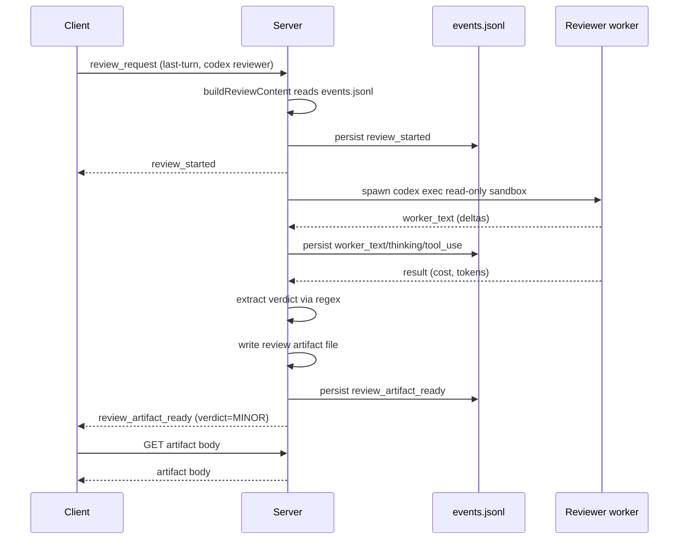
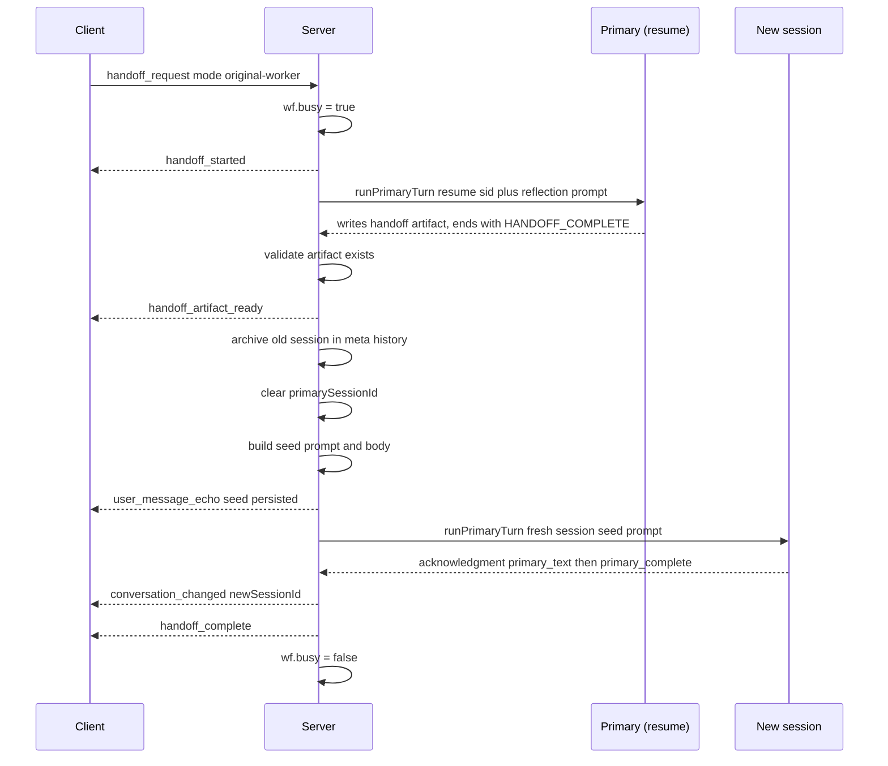
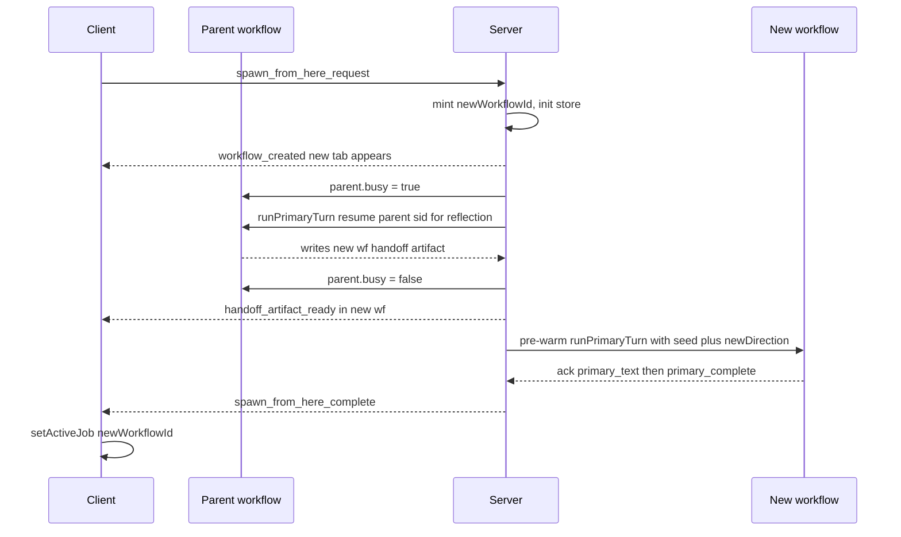

# Arco - primitives

The three core operator-triggered primitives - **Review**, **Handoff**, **Spawn** - plus the implicit **primary turn** that powers normal chat, and the later bounded job primitives (Deep Research, Compare, doc-edit, tune-up, ...,+). The worker-running pieces live under `server/src/primitives/` (`seedWorker.ts`, `runReviewer.ts` + `reviewContent.ts` + `reviewSchema.ts` + `parseReviewFindings.ts`, `exportContext.ts`, `runResearch.ts`, `runCompare.ts`, `runDocEdit.ts`, `runMdTuneup.ts`); the WS dispatchers live under `server/src/ws/` (`turnEngine.ts`, `workflowHandlers.ts`, `handoffHandlers.ts`, `compareHandlers.ts`, `compactHandlers.ts`, ...) - **not** `server/src/index.ts`, which is now just boot + routing.

> **Peer messaging is NOT a primitive** (no ephemeral worker, no artifact). The substrate lives in `server/src/clusterStore.ts` / `clusterMailbox.ts` / `clusterBudget.ts` / `clusterPeerOps.ts` and the Native peer tools (`peer_list` / `peer_send` / `peer_read` / `cluster_plan_tick` / `cluster_plan_write`) at `server/src/providers/claude-native/peerTools.ts`. The pre-turn helper `drainPeerMailbox` in `server/src/primitives/seedWorker.ts` survives for the legacy "auto-drain into a system block" path but is no longer called from `handleUserMessage` - the live path peeks `clusterMailbox.depthFor` and tells the worker to call `peer_read` itself (see cluster note).

This doc covers each one end-to-end: trigger, server flow, events emitted, client handling, persistence, cancel/error paths, and the non-obvious coupling. For protocol-level message shapes see [`PROTOCOL.md`](PROTOCOL.md). For the bigger lifecycle context see [`ARCHITECTURE.md`](ARCHITECTURE.md).

---

## The four flows at a glance

| Flow | File | Trigger (WS message) | Worker count | Output |
|---|---|---|---|---|
| Primary turn (implicit) | `seedWorker.ts` (`runPrimaryTurn`) | `user_message` | 1 (the primary) | streamed text -> events.jsonl + native CLI session |
| Review (transcript or plan-scoped) | `runReviewer.ts` + `reviewContent.ts` (`buildReviewContent` / `buildPlanReviewContent` / `buildClusterPlanReviewContent` / `buildPreviewCaptureReviewContent`) | `review_request` (with `contextRef.kind = last-turn / last-n / current-session / full / git-diff / since-event / plan-whole / plan-phase / plan-items / cluster-plan-whole / cluster-plan-phase / preview-capture`) | 1 (ephemeral reviewer; or - for cluster-routed reviews - dispatched as a real turn on a peer member, no artifact) | `review-<ts>.md` artifact (cluster-routed: findings stay in reviewer's chat, no artifact) |
| Handoff | `exportContext.ts` (`runExportContext`) | `handoff_request` | 1 (reflection or summarizer) | `handoff-<ts>.md` artifact + new CLI session |
| Spawn | `exportContext.ts` (same primitive) | `spawn_from_here_request` | 1 (reflects on parent) | new workflow + handoff seeded into it |

All four primitives accept a `broadcast` callback - the seedWorker broadcasts to the workflow it's running in, but Spawn's reflection runs against the parent workflow while writing artifacts to the new workflow. The callback abstraction makes that work cleanly.

Two additional surfaces, DOCS and GIT, reuse the primary-turn machinery to dispatch structured one-off prompts in-tab or to a freshly spawned new tab via the shared RUN AS picker. They're not full primitives - no ephemeral workers, no artifacts, no verdicts - but they're operator surfaces with their own dialogs.

---

## 1. Primary turn (the seed worker)

`server/src/primitives/seedWorker.ts` defines `runPrimaryTurn(ctx, args)`. This is the **only** path for normal chat work; everything else (Review/Handoff/Spawn) is layered on top.

### Trigger

`server/src/ws/turnEngine.ts` `handleUserMessage` is the dispatcher. Behavior depends on `wf.busy`:

- **Idle** - set `wf.busy = true`, broadcast `user_message_echo`, broadcast `primary_turn_started`, call `runPrimaryTurn`.
- **Busy** - push the message into `wf.queue.steering[]` or `wf.queue.followUp[]` (split - `kind: 'steer' | 'follow-up'` on the `user_message`, default `follow-up`), echo the message with the `kind` tag, broadcast a queue-update, return immediately. Both buckets drain post-turn today; steer is wired for real mid-turn delivery per provider where the provider supports it.

### Server-side flow

1. Mint `workerId` as `primary-<timestamp>-<random>`.
2. Decide session strategy:
   - **Claude (first turn)** - pre-mint a UUID; pass `--session-id <uuid>`; persist in `meta.cliSessions[]` immediately.
   - **Claude (resume)** - pass `--resume <wf.primarySessionId>`.
   - **Codex (first turn)** - pass nothing; capture `thread_id` from the `thread.started` init event, then reconcile the placeholder UUID in `meta.json`.
   - **Codex (resume)** - pass `codex exec resume <wf.primarySessionId> <prompt>`.
   - **Gemini / Ollama** - no session concept; each turn is fresh.
   - **Antigravity** - reuse the same desktop conversation, prepend `[Project directory: <cwd>]\n\n`.
3. Inject the attached plan (if any) as a header prefix to the prompt - `wf.planId` set ⇒ `buildPlanPrefix` reads from `<cwd>/.arco/plans/<planId>.md`. The plan body re-injects on every turn so operator edits propagate.
4. Spawn via `WorkerManager.spawn(spec)`. Returns a `TurnHandle`: `{ workerId, initialSessionId, onSessionDiscovered, settled: Promise }`.
5. Stream events. The seedWorker's job is to translate each `WorkerEvent` (`text`/`thinking`/`tool_use`/`result`/`system_notice`) into the corresponding `primary_*` protocol message and broadcast it.
6. Settle. `await turn.settled` collects the final outcome. For Claude, also call `estimateContextFill` and broadcast `context_usage`.
7. Drain `wf.queue.steering` then `wf.queue.followUp`. If non-empty, join messages with `\n\n`, concat attachments, loop back to step 1. Each queued message was already echoed at enqueue time, so the drain doesn't re-echo individually.
8. `finally`: `wf.busy = false`, queue cleared. Run `maybeCalibrate` (Claude, idle, zone-gated) and `maybeAutoHandoff`.

### Events emitted (in order)

```
primary_turn_started
primary_model               (on first init event)
primary_text                (delta, repeated)
primary_thinking            (optional, repeated)
primary_tool_use            (optional, repeated)
worker_system_notice        (optional, on transient provider error -> translated to system_notice)
primary_complete            (cost, tokens, durationMs)
primary_turn_token_usage    (Claude Native - ground-truth input/output/cache tokens for context_usage recompute)
primary_turn_ended          (always)
context_usage               (Claude only, post-settle)
[CONTEXT] system_notice     (Claude only, on threshold cross)
```

### Cancel / error

- `cancel` WS -> `handleCancel` calls `wf.manager.killAll`. Server unconditionally broadcasts `turn_cancelled` + `primary_turn_ended` even if the worker had gone "ghost" (silently exited mid-turn - would otherwise leave the UI stuck on busy).
- Worker crash mid-turn -> `worker_error` event -> seedWorker marks the turn failed -> `primary_turn_ended` still fires.
- API overload (Claude) -> caught by the retry loop in `runReviewer`/`seedWorker`, surfaced as a `worker_system_notice` -> 15s/30s/60s backoff, up to 3 attempts. Same session id so retries are idempotent.

### Persistence

- `events.jsonl` carries every persisted message above. Replay on reconnect rebuilds the chat exactly.
- For Claude, the native session JSONL at `~/.claude/projects/<cwd-hash>/<sessionId>.jsonl` is the canonical chat history. The `sessionJsonl.ts` watcher emits `session_entry` for each new line; the client uses these for the rendered chat (richer than `primary_text` deltas because tool_use blocks split text).

### Coupling worth knowing

- The pre-mint of the Claude session UUID happens **before** the spawn, so `wf.primarySessionId` is set immediately. If something fails between pre-mint and first stream, the session UUID still ends up in `meta.cliSessions[]` (orphaned but harmless).
- Codex's `thread.started` event must be captured before the first user message is sent; otherwise resume wouldn't work. `seedWorker.ts` blocks on this via `onSessionDiscovered`.
- The seedWorker translates `worker_*` to `primary_*` so chat + TokenBadge + composer behave the same regardless of which provider is underneath. Workers (Review/Summarizer) keep their `worker_*` messages unmodified.
- **Before the busy/queue split** `handleUserMessage` expands `/prompt` templates and composer context refs (`expandContextRefs`, `server/src/contextRefs.ts`), so queued and immediate sends carry identical expansions (queued items stash theirs on `QueueItem.expandedContext`). APPLY-ONCE `pickedSkills` are inlined later, at dispatch.
- **Chat tabs** (`config.kind === 'chat'`) run through the same engine but thread `WorkerConfig.interactionMode: 'chat'`: no project context, no plan prefix, no checkpoints, no project tools. The only tools a chat turn can see are web search + fetch, and only when `chatWebArmed` (`server/src/chatMode.ts`) says so; incognito additionally forbids any persistence. See `docs/GOTCHAS.md / worker plumbing`.
- **Goal run**  hooks the settle path: `maybeGoalRun` may dispatch one continuation turn after a turn ends.
- Interjection merging joins with `\n\n`. A `cancel` during the merge drops the entire batch (intentional - operator wanted out).
- **Cluster pre-turn mailbox handling** (2026-05-11): `handleUserMessage` no longer auto-drains the peer mailbox via `drainPeerMailbox`. Instead it peeks `clusterMailbox.depthFor(workflowId)`, and if the depth is > 0 prepends a short `--- PEER MAILBOX ---` notice to the prompt instructing the worker to call `peer_read` itself. `peer_message_received` events now fire at `peer_read` time (where they belong) rather than pre-turn. Removes the "no new peer messages" false-negative where `peer_read` returned empty because the pre-turn drain had already moved content into the system prompt.

---

## 2. Review

`server/src/primitives/runReviewer.ts`. Spawns an ephemeral reviewer over a slice of the conversation, writes a markdown artifact, surfaces the verdict in the right pane.

### Trigger

```
client -> server: review_request {
  workflowId,
  contextRef: { kind: 'last-turn' | 'last-n' | 'current-session' | 'full' | 'git-diff' | 'since-event' | 'plan-whole' | 'plan-phase' | 'plan-items' | 'cluster-plan-whole' | 'cluster-plan-phase' | 'preview-capture', n?, anchorEventSeq?, planId?, heading?, itemIds?, clusterId?, reportName?, mode? },
  reviewer: { provider, model, effort,... },
  includeGitDiff?,
}
```

`server/src/ws/workflowHandlers.ts` `handleReviewRequest` is the dispatcher (it also resolves fallback legs from `settings.fallbackChains.reviewer`).

### Server-side flow

1. Mint `reviewId` as `rev-<base36 ts>-<rand>` (artifact name is `review-<iso-ts>.md`).
2. `buildReviewContent` walks `events.jsonl` and assembles the slice:
   - `last-turn` - most recent `user_message_echo` and the `primary_text`s up to the next `primary_complete`.
   - `last-n` - same but for the last N turns.
   - `current-session` - everything from the most recent `[HANDOFF U+2014` seed forward (matches the seed prefix in `reviewContent.ts`).
   - `full` - the entire `events.jsonl`.
   - `git-diff` - runs `git diff HEAD` in the workflow cwd; reviewer sees the diff alone (no transcript). Operator surface: the SCOPE picker in `ReviewDialog`.
   - `since-event` - slices the transcript from `anchorEventSeq` onward. Wired from the HISTORY tab's "REVIEW FROM HERE" pin; `ReviewDialog` collapses the SCOPE row to a locked label and hides the VERIFY/CRITIQUE picker (since-event has no plan-mode distinction).
   - `preview-capture` (Preview-verification integration) - no transcript: `buildPreviewCaptureReviewContent(cwd, workflowId, reportName)` reads a Preview-verification report artifact (path-confined to the workflow's `artifacts/` via `path.basename` + `.md` check) and frames it as "judge a running UI from captured evidence". Reachable **only** from the Preview tab's `ATTACH TO REVIEW` button (not the SCOPE picker); the reviewer defaults to the tab's primary provider/model/effort. See `docs/PREVIEW_VERIFY.md to Review`.
3. Optionally append `git diff HEAD` if `includeGitDiff` is true and the slice doesn't already include diffs.
4. Build the reviewer prompt with `REVIEW_FRAMING`: instructs the reviewer to produce a Summary / Concerns / Verdict structure ending in `Verdict: PASS | MINOR | BLOCKING`.
5. Spawn the reviewer worker:
   - **Claude** - tools restricted to `READ_ONLY_CLAUDE_TOOLS` (`['Read', 'Grep', 'Glob', 'LSP']`).
   - **Codex** - `sandbox: 'read-only'` via `WorkerConfig.sandbox`. `-s read-only` argv.
   - **Ollama / llama.cpp / LM Studio** - each gets a read-only allowlist (`READ_ONLY_OLLAMA_TOOLS` / `READ_ONLY_LLAMACPP_TOOLS` / `READ_ONLY_LMSTUDIO_TOOLS`, all `['Read', 'Grep', 'Glob', 'WebSearch', 'WebFetch']`); they share Ollama's server-side tool registry. Ollama additionally runs with `skipPermissions: true` so its SAFE mode doesn't refuse the read/search tools (the allowlist, not SAFE mode, is what enforces safety).
   - **Gemini** - no tool restriction (no tool use).
   - **Antigravity** - reviewer mode (fresh RPC cascade seeded with the review prompt; no CDP artifact watcher).
6. Collect `worker_text` deltas into a `collected` buffer. Don't broadcast them as primary text - review output is **not** mirrored to chat.
   - **Fallback chain.** The reviewer is a bounded job, so `runReviewer` walks `[reviewer,...reviewerFallbacks]` on a classified provider failure; `collected` resets per leg so a failed leg's partial output never bleeds into the artifact. Unset ⇒ single leg.
   - **Ollama structured output.** Ollama reviewers get `ollamaFormat: REVIEW_FORMAT_SCHEMA` (`reviewSchema.ts`) - Ollama's sampler-level JSON-schema constraint; `parseStructuredReview` + `reconstructStructuredReview` rebuild the canonical markdown body so the artifact, badge and findings are unchanged downstream. Ollama-only because no other provider exposes a sampler-constrained `format`; small models were the main source of verdict-regex misses.
7. On settlement, parse the verdict via regex (`detectVerdict` - primary pattern is `verdict[^\n]*?\n+\s*\*?\*?(PASS|MINOR|BLOCKING)` case-insensitive, with a bare `\b(PASS|MINOR|BLOCKING)\b` fallback so the badge still resolves when reviewers bold or italicize the line).
8. Write the artifact to `<cwd>/.arco/workflows/<wfid>/artifacts/review-<ts>.md` with YAML frontmatter:

   ```yaml
   ---
   reviewId: <id>
   createdAt: <iso>
   completedAt: <iso>
   durationMs: <number>
   contextRef: <flattened string, e.g. "last-turn" or "plan-phase/verify/3. Categories">
   reviewer: <provider/model@effort>
   primary: <provider/model@effort>
   verdict: PASS | MINOR | BLOCKING
   ---
   <body>
   ```

9. Broadcast `review_artifact_ready` with the verdict and artifact name.

### Events emitted

```
review_started              (persisted)
worker_spawned              (persisted, scoped to reviewer worker)
worker_model
worker_text                 (deltas, collected internally - NOT mirrored to chat)
worker_thinking             (optional)
worker_tool_use             (optional, read-only tools)
worker_system_notice        (optional, on transient API error)
worker_complete
review_artifact_ready       (persisted; carries verdict + artifact name)
```

### Client handling

- `ws/handleServerMessage.ts` `case 'review_started'` -> `store.upsertReview` records reviewer + startedAt; also emits a `[REVIEW] Running review (provider:model@effort)...` system row into chat. `case 'review_artifact_ready'` -> `store.upsertReview` updates artifact name + verdict + error, and emits a `[REVIEW <verdict>] <artifactName>` (or `[REVIEW] Failed - ...`) system row. The chat-row injection mirrors the Handoff pattern; without it the dialog closes silently and the verdict only surfaces in the REVIEW + HISTORY tabs.
- The Review tab reads the artifact body lazily via `GET /api/workflows/artifact?path=<cwd>&workflowId=<wfid>&name=<artifactName>`.
- HISTORY tab: clicking a `REVIEW <verdict>` row opens the artifact in `FileViewerModal` directly (path = `<cwd>/.arco/workflows/<wfid>/artifacts/<artifactName>`, with `fallback={cwd, workflowId}` for the artifact-dir retry). `HistoryEventEntry.reviewArtifactName` carries the filename; rows produced from a failed review (no artifact written) are non-clickable.

The Review tab renders one row per review with the reviewer config, verdict badge, and a `↳ SEND TO AGENT` button that pre-fills the composer with the review body.

### Inline review findings

The reviewer framing (`runReviewer.ts_FRAMING`) asks the model to append an optional fenced **findings block** after the Summary/Concerns/Verdict prose - a ` ```findings ` (or ` ```json `) fence wrapping a JSON array of `{ file, line, severity, note }`, where `severity ∈ {info, warning, error}`. The artifact storage shape is unchanged; findings are parsed from the existing body on read.

- **Parser:** `server/src/primitives/parseReviewFindings.ts` exports the pure, total `parseReviewFindings(body): Finding[]`. It extracts the **last** matching fence (so an in-prose JSON example can't shadow the real block), `JSON.parse`s it defensively, and validates each entry individually (non-empty `file`, positive-int `line` - stringified ints coerced, severity in the enum with a few synonyms tolerated, non-empty `note`). **Tolerant by contract: it never throws and never hides the prose** - an absent/malformed/non-array block yields `[]` and the body still renders verbatim, so pre-D5 reviews and non-compliant models are unaffected. The client mirrors this parser byte-for-byte at `client/src/components/RightPanel/reviewFindings.ts` (kept in lockstep by hand; the client file is outside the server tsconfig rootDir - same duplication discipline as D1's `contextRefs.ts`). The smoke (`scripts/smoke/review-findings.ts`, `npm run smoke:review-findings`) unit-tests the server copy directly.
- **Render + click:** `ReviewTab` parses the lazily-fetched body and renders a `FINDINGS (n)` list under the prose. Clicking a finding opens the A3 `FileViewerModal` scrolled to `finding.line` (a new optional `startLine` prop; the modal estimates the scroll offset by line-height across its markdown/code/plain render paths). Repo-relative finding paths are anchored to the workflow `cwd` before the fetch.
- **Fix:** each finding's `FIX` button composes a scoped prompt (`file:line` + the note) and dispatches it through the composer's existing `onSend(..., 'follow-up')` path - **operator-click-only, no auto-send/auto-fix** (passes the four-question fence: operator-initiated, bounded, lands in `events.jsonl` as a normal turn, reversible). `onSend` is threaded App -> WorkflowView -> RightPanel -> ReviewTab.

### Cancel / error

- `cancel_review` WS -> reviewer worker is killed; `review_artifact_ready` fires with `error` set.
- Provider failures during review surface as `worker_system_notice` -> in-chat `system_notice`.

### Persistence

- Artifact: `<cwd>/.arco/workflows/<wfid>/artifacts/review-<ts>.md`
- Events: `review_started`, `worker_*`, `review_artifact_ready` all persisted to `events.jsonl`. The Review tab list is rebuilt from these events on replay.
- The artifact body is **not** persisted to events.jsonl (only on disk). If the artifact file is deleted, the Review tab still shows the entry but the body fetch 404s.

### Coupling worth knowing

- Verdict regex is fragile. If the reviewer's markdown deviates from `Verdict: PASS|MINOR|BLOCKING`, the `verdict` field stays undefined and the badge shows `?`. The body is still readable.
- `current-session` scope depends on the `[HANDOFF U+2014` prefix. If that string changes server-side, this scope silently degrades to `full`.
- Antigravity reviewer is single-consumer: a Review locks the desktop conversation, blocking primary work in other tabs. The `system_notice` "Waiting for Antigravity" fires before blocking.
- Reviewers always honor RSS guard even if the primary has it disabled. Review crashes can't take down the operator's primary.
- **North-star inherited (not forced normal).** The reviewer worker config carries `goal: wf.config.goal` so the reviewer judges against the operator's standing objective. This is the deliberate divergence from `outputStyle`, which reviewers force to `'normal'`; the goal is inherited instead of suppressed; see [TASK_LEDGER.md](TASK_LEDGER.md) for task context.

### Local-reviewer addendum

When the reviewer's provider is `ollama` or `llamacpp`, `runReviewer.ts` builds the framing as `BASE_FRAMING + LOCAL_REVIEWER_ADDENDUM` instead of `BASE_FRAMING` alone. The addendum exists because frontier reviewers (Claude / Codex / Gemini / Antigravity) routinely pull files via tools to verify diff claims; smaller local models tend to opine on the diff text alone and miss orphan files / seed-data drift / broken wiring / typos in identifiers.

The addendum:

- Bold header: "You have read-only tools (Read, Grep, Glob, WebSearch, WebFetch). USE THEM."
- Verification checklist: orphans / dead code, seed / fixture sanity, wiring (was the new code actually called?), typos in identifiers.
- Verdict rule: "A PASS verdict means you used the tools and nothing came back wrong. If you only read the diff, the right verdict is MINOR with 'did not verify against the tree' as the justification."

The local reviewer also receives a tools allowlist (`READ_ONLY_OLLAMA_TOOLS` or `READ_ONLY_LLAMACPP_TOOLS`) and `skipPermissions: true` to make those tools execute server-side rather than return SAFE-mode denial strings.

### Plan-scoped review

A separate dispatch path inside the Review primitive: instead of slicing workflow transcript via `buildReviewContent`, the server calls `buildPlanReviewContent(cwd, ref, includeGitDiff)` from `reviewContent.ts` to assemble the plan body itself as the review subject.

**Trigger surfaces** (all in the right-pane Plan tab, `client/src/components/RightPanel/PlanTab.tsx` + `PlanBodyRenderer.tsx`):

| Surface | UI | ContextRef kind | Default mode | Auto git diff |
|---|---|---|---|---|
| Whole plan, structure | `REVIEW PLAN` button at top of Plan tab | `plan-whole` | `critique` | - |
| Whole plan, claims | `VERIFY WORK` button next to REVIEW PLAN | `plan-whole` | `verify` | yes |
| Per-section, structure | `▷ REVIEW PHASE PLAN` pill under each `### Phase` heading | `plan-section` (carries `heading`) | `critique` | - |
| Per-section, claims | `▷ VERIFY PHASE WORK` pill under each `### Phase` heading | `plan-section` (carries `heading`) | `verify` | yes |
| Custom items | `CUSTOM REVIEW` button -> `PlanReviewPicker` modal (tree with tri-state per-section checkboxes) | `plan-items` (carries `itemIds: string[]`) | `verify` | - |

The REVIEW / VERIFY split is presentational - both buttons in each pair dispatch the same `plan-*` ref kind, only `mode` (and the dialog's INCLUDE GIT DIFF default via `initialIncludeGitDiff`) differ. Operators can flip mode and toggle git diff inside the dialog; the buttons just preset the common intent. The MODE row is always visible for `plan-*` refs.

**ContextRef shape** (`shared/src/protocol/reviews.ts`):

```ts
type ReviewContextRef =
  |...                                                                           // existing: last-turn, last-n, current-session, full, git-diff, since-event
  | { kind: 'plan-whole'; planId: string; mode: PlanReviewMode }
  | { kind: 'plan-phase'; planId: string; heading: string; mode: PlanReviewMode }
  | { kind: 'plan-items'; planId: string; itemIds: string[]; mode: PlanReviewMode };

type PlanReviewMode = 'verify' | 'critique';
```

**VERIFY vs CRITIQUE modes:**

- **VERIFY** - reviewer cross-checks claimed-completed work against actual code. Items shown are filtered to `[x]` only; the framing addendum tells the reviewer "these are the worker's claimed-completed work - verify each claim against the actual code in the tree using your tools - do not take the checkboxes at face value." Partial-completion signals (a `[x]` parent with `[ ]` subtasks) are flagged as worth attention. If a plan section has no `[x]` items AND no preamble prose, the path returns a reject ("No completed work found ... switch to CRITIQUE mode to review pending work, or check off some items first").
- **CRITIQUE** - reviewer evaluates the plan itself (gaps, ordering, missing considerations), not just whether checked items shipped correctly. All items shown with check state preserved. Always proceeds even when no plan sections are present.

**For `plan-items` the operator's selection is authoritative.** Mode affects framing only; items render regardless of check state. The picker emits stable item IDs in the form `${phaseIdx}/${taskIdx}` (zero-based, slash-delimited). These are stable across check-state toggles but break on reorder/delete. If the operator edits the plan between selection and submission, unresolvable IDs trigger a reject naming the missing items so the operator can re-pick.

**ReviewDialog UI changes.** When invoked with `prefilledPlanRef + prefilledScopeLabel`, the SCOPE row collapses to a locked label (e.g. `PLAN PHASE: 3. Categories + auto-assignment`), and a MODE row (VERIFY / CRITIQUE) appears in its place. The provider/model/effort row works the same as for transcript reviews.

**Plan parser invariants** (`reviewContent.ts` `parsePlan`). Three load-bearing rules - see also `docs/GOTCHAS.md-review parsing invariants`:

1. **H2 closes the current plan sections.** An `##` header inside a plan section ends that section; intervening prose is discarded. Without this, headers like `## Open Questions` between plan sections leak into the preceding section's preamble and corrupt review bodies.
2. **Numbered-bullet fallback.** Parser recognizes `- **N.M** Task` (naked numbered bullet, no checkbox) as an unchecked task. Foot-gun mitigation - agents (especially Qwen) sometimes strip checkboxes when "updating" a plan. Indented variant `  - **1**` is a subtask; non-numbered indented bullets like `  - Some text` are continuation prose, not separate tasks.
3. **Preamble shown in VERIFY when no [x] tasks.** A plan section with zero checked items but containing prose (e.g., " Completed: we did X, Y, Z") renders the prose. Completion-claims-as-prose is a valid claim and the reviewer needs to see it. Decision rule: render the section if `taskCount > 0 OR preambleLength > 0`.

**Server dispatch.** `handleReviewRequest` in `server/src/ws/workflowHandlers.ts` branches on `contextRef.kind`: `plan-*` kinds call `buildPlanReviewContent(cwd, ref, includeGitDiff)` and skip the transcript-walk path entirely. Everything downstream (worker spawn, artifact write, verdict regex, event emit) is shared with transcript reviews.

### Cluster-plan-scoped review (2026-05-11)

First-class cluster surface: instead of "review the worker's per-cwd plan," operators can review the **shared cluster plan body** directly. The cluster plan lives in `~/.arco/clusters/<id>/plan.md` (loaded into `clusterStore` + carried on `cluster_state.plan.body`), not in the per-cwd plans index. Two new ContextRef kinds:

```ts
type ReviewContextRef =
  |...
  | { kind: 'cluster-plan-whole'; clusterId: string; mode: PlanReviewMode }
  | { kind: 'cluster-plan-phase'; clusterId: string; heading: string; mode: PlanReviewMode };
```

Wired through `buildClusterPlanReviewContent` in `server/src/primitives/reviewContent.ts`. It reads the body via `clusterPlanStore.readPlan(clusterId)` (not `readPlan(cwd, planId)`), then runs the same `parsePlan` / mode-filter / git-diff machinery as `buildPlanReviewContent`. Same parser invariants (H2 closes the current plan section, numbered-bullet fallback, preamble-in-VERIFY).

**Worker selection.** The cluster plan tab's `REVIEW PLAN` / `VERIFY WORK` / `CUSTOM REVIEW` buttons pop a `ClusterMemberPicker` first - the reviewer has to run on some workflow, and that worker also lends its transcript + git-diff context when VERIFY mode includes diff. The picked member's `workflowId` rides on the outbound `review_request`; `contextRef.clusterId` names the plan body to review. The two are independent - operator can review the cluster plan as critiqued by Member A while Member B is the one that did the implementation, etc.

**Trigger surfaces.** Header pill bar in `ClusterPlanTab.tsx` (VIEW mode): `REVIEW PLAN` -> `cluster-plan-whole` + `critique`; `VERIFY WORK` -> `cluster-plan-whole` + `verify` + auto git-diff; per-section `▷ REVIEW PLAN` / `▷ VERIFY WORK` -> `cluster-plan-phase` with `heading`; `CUSTOM REVIEW` reuses the existing `PlanReviewPicker` against the picked member's promoted plan (no per-item slicer for the cluster body itself today - operator picks a member first, then their plan slice).

**No `cluster-plan-items` variant.** The cluster body doesn't carry stable per-item IDs the way per-cwd plans do (no `.md` round-trip; the parse-and-reflect cycle happens on every read). CUSTOM REVIEW is the workaround: pick a member, review their plan slice - which on a cluster-member tab is typically the cluster plan (PROMOTE TO CLUSTER detaches the worker plan; see "Worker plan vs cluster plan" below).

**Worker plan vs cluster plan.** A cluster member can still attach a per-cwd plan to its own tab (`plan_attach` -> `worker.config.plan`), but the `PROMOTE TO CLUSTER` button on the per-workflow PLAN tab now **detaches the worker's local plan** after `setClusterPlan` writes through. Rationale: the cluster plan is the single source of truth post-promote - without the detach the worker would inject BOTH plans (cluster plan as a system block + worker plan in `appendSystemPrompt`), doubling cost and surfacing two conflicting "the plan" framings. See `GOTCHAS.md mode` for the load-bearing invariant.

### Operator transcript-send - `-> TRANSCRIPT` (2026-05-11)

A new operator-driven peer-substrate surface, NOT a primitive in the formal sense (no artifact, no spawn) but worth understanding alongside Review because it's how reviewer findings reach a director after the fact.

**Trigger.** `-> TRANSCRIPT` button in the composer status row of any cluster member tab (gated on `clusterContext` + ≥1 peer). Opens `client/src/components/TranscriptSendDialog.tsx`.

**What it does.** Lets the operator paste an arbitrary chunk of the current tab's chat into a single peer's mailbox FROM the current member. Scope options: `Last turn` (default) / `Last N turns` / `Full transcript`. Filters strip rendering noise - `ctx-divider` rows, tool-pill rows, and single-line metadata system pills (`[TURN · 1m 49s]`, `[REVIEW] Running review...`) - but keep substantive multi-line system rows like inlined review bodies and AUTH notices, so the recipient actually sees work product (not a narration of it).

**Wire shape.** Client sends `operator_peer_send` (see `PROTOCOL_CLUSTER.md_peer_send`); server dispatches via `clusterPeerOps.peerSend` with `{ bypassBudget: true, bypassDedupe: true, maxContentBytes: 32_768 }`. Server emits the usual `peer_message_sent` event on the chosen sender's workflow channel - recipient sees no difference between operator-driven and model-driven sends.

**Why it bypasses budget + dedupe.** The operator is in direct control; both gates exist to constrain model-issued sends (per-turn budget) or catch retry-loop pathologies (dedupe). An operator clicking SEND TRANSCRIPT twice is presumed intentional. The 32 KB cap matches the cluster-plan body cap.

**Relationship to peer_send.** `peer_send` is a model tool; `operator_peer_send` is an operator surface that reuses the same enqueue path. Substrate code lives once in `clusterPeerOps.peerSend` - the bypass opts make it parametric. Do NOT route model-driven sends through the operator path.

### Cluster-routed reviews (member-as-reviewer, 2026-05-11)

Review dialog gained a second reviewer family. The default `SUB-WORKER` path still spawns a one-shot disposable subprocess (the existing primitive shape). The new alternative dispatches the review as a **regular operator turn on an existing cluster peer**, which does the review as a normal visible turn - output streams into the peer's chat + activity feed; no `.md` artifact, no `review_artifact_ready` event.

**Trigger.** When the dialog opens from a cluster member's pane, `ReviewDialog` receives `clusterContext` + `onConfirmViaMember` props. The top of the dialog renders a `STEP 2 - WHO DOES THE REVIEW?` pill row: `SUB-WORKER` (default) + one pill per cluster peer. Selecting a peer hides the provider / model / effort pickers (the peer's existing primary config is the reviewer) and changes the submit button to `SEND REVIEW TASK`.

**Reviewer eligibility.**

- For **cluster-plan refs** (`cluster-plan-whole` / `cluster-plan-phase`), the picker **includes self**. The cluster plan body is shared across the cluster, not bound to a specific member's transcript, so any member is a valid routing anchor - including the one the dialog opened from.
- For **transcript-scoped refs** (`last-turn` / `last-n` / `current-session` / `full`) self is **excluded** - self IS the target being reviewed.
- `git-diff` scope auto-falls-back to `SUB-WORKER` (server holds the diff; peer-routed dispatch would send an empty payload).

**Dispatch path.** `App.tsx -> onReviewViaMember` calls `buildClusterReviewTask(targetWfid, contextRef, includeGitDiff)` to assemble a directive-styled review task - a `# Review request from operator` header, mode-specific instructions, and the content slice - then dispatches as a real `sendMessage` to the reviewer. **Important: this uses `sendMessage`, NOT `operator_peer_send`.** `peer_send` would silently queue the task in the reviewer's mailbox; with AUTO-PICKUP off (the default) the reviewer would never start a turn on it. `sendMessage` starts a turn immediately and the response streams into the reviewer's chat + the cluster ACTIVITY feed. See `GOTCHAS.md primitive`.

**Mode-specific prompts.**

- `VERIFY WORK` (plan-scope, `mode: 'verify'`) - reviewer reads only the `[x]` items and verifies each claim against the actual code in the cluster cwd. Asked to use Read / Grep / Glob / Bash and produce a verdict (PASS / MINOR / BLOCKING) + per-item confirmed/partial/missing + file refs.
- `CRITIQUE PLAN` (plan-scope, `mode: 'critique'`) - reviewer evaluates the plan itself (structure, ordering, gaps, missing considerations). Not about whether work is done.
- Transcript-scoped - generic verdict + findings + recommendation.

The task explicitly tells the reviewer **NOT to forward findings**: _"Produce your full review inline in your reply. Do NOT send it to any peer - the operator will decide who needs the findings."_ The operator then forwards the relevant slice via `-> TRANSCRIPT`. This keeps the autonomy fence clean: no LLM-decided routing.

**MODE row is locked.** Plan reviews no longer expose a toggle pill in the dialog - `VERIFY WORK` / `CRITIQUE PLAN` is fixed by which button the operator clicked in the cluster PLAN tab (or in the per-workflow plan picker). No accidental flips mid-dialog.

**REVIEWS tab visibility.** Cluster-routed reviews do NOT land in the cluster REVIEWS sub-tab - there's no `review_id`, no artifact, no `review_started` event. The findings live in the reviewer's chat (and in their `events.jsonl` as a normal turn). Sub-worker reviews continue to surface in the REVIEWS tab the same way.

### Cluster PLAN tab - target picker bypass

Pre-2026-05-11, every PLAN-tab review button (REVIEW PLAN, VERIFY WORK, per-section REVIEW / VERIFY) opened a `ClusterMemberPicker` first ("STEP 1 - Whose work to review?"). For cluster-plan-scoped refs that picker was confusing - the plan body is shared, the picker was a routing-anchor decision and operators kept hesitating. `ClusterPlanTab.dispatchPlanReview` now goes straight to `RUN REVIEW` for plan-scoped buttons, using the cluster's first member as the routing anchor; the operator can re-route via the dialog's STEP 2 pill row. `CUSTOM REVIEW` still opens the target picker (it's transcript-scoped, so whose transcript matters). The picker copy is clearer too: "STEP 1 of 2 - Whose work to review?" / "Whose plan critique?" / "Whose phase work to verify?".

### Review body inlines in chat (2026-05-11)

The `review_artifact_ready` WS handler in `client/src/ws/handleServerMessage.ts` seeds the chat with a header row (`[REVIEW <verdict>] <artifactName>`) AND fetches the artifact body via `/api/workflows/artifact`, then patches the same row to inline the body. Header + body live in one chat message. The REVIEWS tab still surfaces the artifact independently for navigation. Two reasons:

1. Operator scrolling chat sees the verdict + findings without flipping to the REVIEWS tab.
2. Transcript-send filters keep substantive system rows (multi-line, no metadata-pill shape), so an operator clicking `-> TRANSCRIPT` after a review naturally carries the full review body to the recipient. Before this change, the inline row was just `[REVIEW] artifact.md` and transcript-send only carried the filename - which was invisible to the peer.

The cluster REVIEWS tab's `ClusterReviewRow` (`ClusterRightPanel/ClusterReviewsList.tsx`) also fetches the artifact body on row expand for the same reason.

### History-anchored review

The `since-event` ContextRef variant slices `events.jsonl` by seq instead of by turn count, then runs the same reviewer machinery. Wired from the HISTORY tab's "REVIEW FROM HERE" button.

```ts
{ kind: 'since-event'; anchorEventSeq: number }
```

Server dispatch: `buildReviewContent` short-circuits before the regular slicer when `ref.kind === 'since-event'`. It runs `extractTurns` over the **full** event stream first, then filters turns by `completeSeq >= anchorEventSeq` - i.e. a turn is in scope if its closing `primary_complete` lands at or after the anchor. This was a deliberate change from the original "filter events first then extract" approach: that path dropped the `user_message_echo` whenever the operator anchored on a row mid-turn (e.g. a `worker_tool_use` block fired before the turn finished), making the in-flight turn invisible to the reviewer. Filtering by `completeSeq` keeps that turn surfaced and frames it correctly. The renderer emits USER:/AGENT: blocks with framing that names the operator's anchor:

> _You are reviewing the slice from operator label "{labelText}" (event seq N) onward - earlier turns are context but the verdict applies to this slice only._

When the anchor is itself an `operator_label` event, the label's `text` is lifted into the framing; otherwise the framing falls back to the bare seq. `includeGitDiff` is honored as for transcript scopes.

ReviewDialog reuses its locked-scope rendering: `prefilledSinceEventRef` collapses the SCOPE row to a label like `FROM 07:39:02 - research checkpoint` and hides the plan-mode picker entirely (since-event has no VERIFY/CRITIQUE distinction). The reviewer / model / effort / git-diff controls work the same way.

### Sequence



---

## 3. Handoff

`server/src/primitives/exportContext.ts` `runExportContext`, dispatched by `handleHandoffRequest` in `server/src/ws/handoffHandlers.ts`. Two modes share most of the machinery; the third (`fresh-agent`) is a stub.

### Modes

| Mode | Who writes the doc | Fidelity | Required |
|---|---|---|---|
| `original-worker` (default) | The primary itself: CLI via `--resume <sessionId>`; Claude Native via in-memory `messages[]` replay | High - sees real git state, project docs, full session context | Claude / Codex / Z.ai (the "resumable" providers). Native: any tab on `claudeTransport='native'` (no rollout needed) |
| `fresh-summarizer` | Ephemeral summarizer worker reading a rendered transcript | Lower - no git/project intro | Any provider |
| `fresh-agent` | Stub | - | `runExportContext` returns "not implemented yet" |

**Summarizer resolution.** When the request carries no `summarizer`, both Handoff and Spawn fall back to the operator's pinned `settings.handoffSummarizer` (model and effort come from the tab's primary, or, for Spawn, from the new tab's primary) before defaulting to the primary itself. Why: a handoff fires exactly when the current worker is low on context, so letting that degraded worker summarize itself is the failure mode to dodge. Auto-handoff never sends `summarizer`, so it always takes this chain.

**Original-worker on a non-resumable provider.** Only Claude / Codex / Z.ai have a live session to resume. For Ollama / llama.cpp / LM Studio / Gemini / Antigravity, `original-worker` is *translated* rather than refused: the **same model** re-reads its own transcript via the fresh-summarizer mechanism (notice: "Original-worker on a local model = the same model re-reads its transcript"). If `lastContextPercent ≥ autoHandoff.autoAt` (default 90) the transcript likely won't fit back into that window, so it switches to the configured summarizer - or, when none is configured, attempts anyway with a warning. A resumable provider with no session yet (no turn taken) also degrades to `fresh-summarizer`. The dialog doesn't gate any of this.

**Per-cwd serialization.** Handoffs in the same cwd are chained (`cwdHandoffChain`): a second request waits (`[HANDOFF QUEUED]` notice) so two reflections don't read repo state mid-write; a duplicate on the same workflow is ignored. The chain is mirrored to clients as `handoff_lock_snapshot` (-> `appStore.handoffLocksByCwd`) and a wedged slot can be cleared by the operator via `handoff_lock_clear` (`handleHandoffLockClear`).

**Cancel (`handoff_cancel`).** An in-flight handoff is cancellable from the HANDOFFS tab's `RUN...` row. The client `✕` sends `handoff_cancel { workflowId, handoffId }`; `handleHandoffCancel` broadcasts a sticky `handoff_artifact_ready { cancelled: true }` then calls `handle.abort` (kills the reflection/summarizer worker via `manager.kill`). The kill resolves `handle.settled`, so the existing `finally` cleanup runs (`busy=false`, slot release, `wf.activeHandoff` clear). The `✕` is hidden for **Antigravity** tabs (`job.config.primaryProvider === 'antigravity'`) because its RPC has no stop method - verified by probing the live language server - so a cancel could only detach Arco's poll loop while the desktop agent keeps running. The handle's `abort` captures the worker id for both modes: fresh-summarizer spawns with `id === handoffId`; original-worker records `runPrimaryTurn`'s id once it spawns, with a pre-spawn `killed`-intent guard.

**Native parents:** `runOriginalWorkerNative` in `server/src/primitives/exportContext.ts` runs the reflection on a Native worker instead of `--resume`. For Handoff (target == parent) the existing in-memory worker carries history; for Spawn the child worker is pre-seeded by replaying the parent workflow's `events.jsonl` into `messages[]` via `seedClaudeNativeWorkerFromForeignEvents`. After the reflection settles, `disposeClaudeNativeWorker` runs before the pre-warm so the post-handoff session boots on a fresh worker.

**Replay is pair-flush + reset on `handoff_artifact_ready`.** `replayMessagesFromEvents` walks the events list, buffers USER -> ASSISTANT pairs, and flushes only when both sides land. Orphan assistant blocks (e.g. reflection output that landed in the child tab without a preceding `user_message_echo`) and dangling solo user entries are dropped. **Replay restarts at the most recent successful `handoff_artifact_ready`** - any pre-handoff history is discarded so the post-handoff worker boots clean. Without this, post-spawn `events.jsonl` produced an `[assistant, ...]` history Anthropic rejects on the first `messages.create` after a server restart. Pre-warm itself stays on CLI per the rule; the operator's first real turn picks up Native and replays only post-`handoff_artifact_ready` events.

### Trigger

```
client -> server: handoff_request {
  workflowId,
  mode,
  summarizer?: { provider, model, effort },   // for fresh-summarizer
  newPrimary?: { provider, model, effort },   // optional swap on rotation
}
```

`handleHandoffRequest` in `server/src/ws/handoffHandlers.ts`.

### Server-side flow

1. Set `wf.busy = true` (handoff blocks operator turns).
2. Mint `handoffId` as `hof-<base36 ts>-<rand>` (inside `runExportContext`).
3. Broadcast `handoff_started`.
4. Generate the handoff document:

   - **`original-worker`**: build the reflection prompt with `buildOriginalWorkerPrompt` - instructs the primary to:
     - Run `git status` / `git log` / `git diff` to capture the WIP state
     - Read `AGENTS.md`, the attached project plan, `DEVLOG.md`, and any linked planning notes
     - Use `Write` to put the handoff at `<cwd>/.arco/workflows/<wfid>/handoffs/handoff-<ts>.md`
     - Optionally prepend a DEVLOG.md entry, mark PLAN.md sections shipped
     - End with `[HANDOFF_COMPLETE]` so the server knows it's done

     Then call `runPrimaryTurn` with the reflection prompt **resuming the primary's session** (so the primary has full context). After settle, validate the file exists.

   - **`fresh-summarizer`**: render the transcript via `renderTranscript` (extracts USER:/AGENT: blocks from `user_message_echo` + `primary_text` events). Spawn an ephemeral worker with the summarizer config and the transcript as its input. Worker writes the artifact directly. The summarizer spawns `sandbox: 'read-only'` (it only reads the transcript; the handoff machinery writes the file): inert for Codex/Claude but load-bearing for Cursor - it routes the spawn to the stateless `cursor-agent -p` one-shot rather than the long-lived ACP worker cache, which carries the primary tab's `workflowId` and would otherwise summarize inside the operator's live Cursor session.

5. If the file exists, broadcast `handoff_artifact_ready` with the artifact name.
6. Archive the old session into `meta.history[]` with the artifact link, turn count, and reason.
7. Clear `wf.primarySessionId` so the next turn mints a fresh session.
8. If `newPrimary` was set, swap `wf.config.primaryProvider/Model/Effort` and persist to `meta.json`.
9. Build the seed prompt: `[HANDOFF U+2014 new session initialized...]\n\n<handoffBody>` and broadcast it as `user_message_echo` (persisted).
10. Pre-warm the new session with the seed via `runPrimaryTurn` - primary reads the handoff and replies with a 2-3 sentence acknowledgment.
11. Broadcast `conversation_changed` (announces the new session ID) and `handoff_complete`.

### Events emitted

```
handoff_started            (persisted)
[HANDOFF] system_notice    "Generating handoff..."
worker_text/...            (during reflection or summarizer)
handoff_artifact_ready     (persisted)
user_message_echo          (the seed; persisted)
primary_turn_started       (the pre-warm)
primary_text               (primary's acknowledgment)
primary_complete
primary_turn_ended
conversation_changed       (new session ID)
handoff_complete           (persisted)
[HANDOFF] system_notice    "Session rotated - previous session archived (N turns). New session ready."
```

### Client handling

- `case 'handoff_started'` -> `store.upsertHandoff` + `[HANDOFF] Generating...` system message
- `case 'handoff_artifact_ready'` -> `store.upsertHandoff` updates artifact name
- `case 'conversation_changed'` -> `store.changeWorkflowSession` updates `currentSessionId`; client adds the rotation note as a system message
- `case 'handoff_complete'` -> `store.upsertHandoff` finalizes the entry; `[HANDOFF] Session rotated` system line appears

The Handoff tab renders one row per handoff with mode, archived/new sessionIds, turn count, and a link to the artifact.

### Cancel / error

- Cancel is `handoff_cancel` from the HANDOFFS tab (see **Cancel** above); the `finally` cleanup clears `busy`, releases the cwd slot and `wf.activeHandoff`.
- If the artifact write fails, `handoff_artifact_ready` fires with `error`. Pre-warm is skipped. `meta.history[]` is **not** updated (the old session stays primary).
- If the original-worker reflection fails partway, the file may be missing or truncated. The server validates file existence before accepting.

### Persistence

- Artifact: `<cwd>/.arco/workflows/<wfid>/handoffs/handoff-<ts>.md`
- `meta.json`: `lastActiveAt` updated, `primarySessionId` cleared, `meta.history[]` appended
- Events: `handoff_started`, `handoff_artifact_ready`, the seed echo, the pre-warm turn events, `conversation_changed`, `handoff_complete` - all persisted

The handoff endpoint is separate from the artifact endpoint (`/api/workflows/handoff` vs `/api/workflows/artifact`) so the path-traversal guard stays tight on each.

### Coupling worth knowing

- `wf.busy = true` covers the entire handoff (reflection + pre-warm). If the reflection crashes between busy-set and pre-warm, busy can stick - the cancel path's defensive busy clear is the recovery.
- Original-worker mode requires Write tool access. Codex's read-only sandbox would fail; the prompt's Write instruction wouldn't run. The mode picker should refuse `original-worker` for read-only sandboxes (currently the operator picks).
- If `newPrimary` swaps provider (Claude -> Codex), `meta.primaryProvider` updates but the new session is provider-native. Subsequent code paths must not assume the old provider.
- The seed prompt's `[HANDOFF U+2014` prefix is load-bearing: the Review primitive's `current-session` scope detects session boundaries via this prefix.
- `--resume <sessionId>` reflects on the session **as it stands** - the primary sees its own work. That's the whole point: the reflection has full context, not a rendered summary.
- **North-star inherited.** The handoff folds `wf.config.goal` into both the `summarizer` (fresh) and `original` (original-worker) contexts, so the reflection preserves the standing objective for the continuation. Unlike `outputStyle` (forced `'normal'` on primitives), the north-star is inherited.

### Customizable prompts (operator-features)

Both the `original-worker` reflection prompt and the `fresh-summarizer` framing are operator-editable via the SettingsPanel HANDOFF PROMPTS section. Override files (project beats global):

| Mode | Project | Global |
|---|---|---|
| `original-worker` | `<cwd>/.arco/handoff.prompt.md` | `~/.arco/handoff.prompt.md` |
| `fresh-summarizer` | `<cwd>/.arco/handoff.summarizer.prompt.md` | `~/.arco/handoff.summarizer.prompt.md` |

`server/src/handoffPrompts.ts` owns the cascade: `loadEffectivePrompt(mode, cwd)` returns project -> global -> default in that order. `runExportContext` calls it before each handoff and renders the resulting template via `renderPrompt(template, vars)` where `vars` substitutes:

- `{{cwd}}` - workflow's working directory
- `{{wfid}}` - workflow id
- `{{handoffPath}}` - absolute path the artifact must land at (`<cwd>/.arco/workflows/<wfid>/handoffs/handoff-<ts>.md`)
- `{{seedPrefix}}` - the literal `[HANDOFF U+2014` (a load-bearing string Review's `current-session` scope detects; exposed as a variable so operator-edited prompts reference it instead of forking the constant)

Validation is advisory - the editor surfaces warnings before save but never blocks. Two checks fire for `original-worker`: missing `{{handoffPath}}` (the agent won't know where to write) and missing `[HANDOFF_COMPLETE]` (no clean end-of-output marker for the reflection turn). `fresh-summarizer` skips both - its worker writes the file from collected text, no Write tool involved.

`[RESET TO DEFAULT]` deletes the override file at the chosen scope, dropping the editor back to the default template. The default templates live as `DEFAULT_TEMPLATES` in `server/src/handoffPrompts.ts` and are also returned by `GET /api/handoff-prompts` so the editor seeds the textarea with concrete starter text instead of a blank box.

### Sequence (original-worker mode)



---

## 4. Spawn from here

`handleSpawnFromHere` in `server/src/ws/handoffHandlers.ts`. Reuses `runExportContext` but writes artifacts into a **new** workflow. The parent stays alive in parallel.

### Trigger

```
client -> server: spawn_from_here_request {
  parentWorkflowId,
  newConfig,                // model/effort/name; primaryProvider can differ
  mode: 'original-worker' | 'fresh-summarizer',
  newDirection?,
  summarizer?: { provider, model, effort },
  includePlan?,             // copy parent's attached plan onto the spawn
  cutoffEventSeq?, // truncate parent transcript at this seq
}
```

### Server-side flow

1. Validate parent exists and has a conversation.
2. Mint `newWorkflowId`. Create `WorkflowState` + `WorkerManager`. Initialize `events.jsonl` + `meta.json` for the new workflow.
3. Broadcast `workflow_created` for the new workflow - the new tab manifests immediately so the operator can watch the spawn stream into it.
4. Run `runExportContext`:
   - For `original-worker`, the reflection runs against the **parent's** primary session; parent.busy is set during reflection. The artifact writes to the **new** workflow's `handoffs/`.
   - For `fresh-summarizer`, the parent's transcript is rendered and a summarizer worker writes the artifact into the new workflow.
5. On reflection settle:
   - Unstick parent.busy.
   - If error, broadcast `spawn_from_here_complete` with `error`.
   - Otherwise, build the seed: handoff body + optional `\n\n---\n\nNew direction: <newDirection>\n\nAcknowledge with "READY"`.
6. Broadcast the seed echo and pre-warm the new session.
7. Broadcast `spawn_from_here_complete` with the new workflow ID.

### Events emitted

```
workflow_created            (new tab; persisted in NEW wf's events.jsonl)
handoff_started             (in NEW wf's events.jsonl)
handoff_artifact_ready
user_message_echo           (the seed)
primary_turn_started        (pre-warm)
primary_*                   (pre-warm streaming)
primary_complete
primary_turn_ended
spawn_from_here_complete    (NOT persisted - it's a one-shot signal)
```

### Client handling

- `case 'workflow_created'` -> `store.createJob(...)` (the new tab appears).
- `case 'spawn_from_here_complete'` -> `store.addMessage` to parent with completion status, then `store.setActiveJob(newWorkflowId)` to auto-switch focus.

### Persistence

- New workflow: full lifecycle in **its own** `events.jsonl` and `meta.json`.
- Parent: nothing recorded. The fork is one-directional (parent -> child); the parent's `events.jsonl` doesn't note that a child was spawned. (This is intentional - Spawn isn't part of the parent's conversation.)

### Plan-tab spawn surfaces

Three operator-facing surfaces dispatch `spawn_from_here_request` with a prefilled direction (`SpawnDialog`'s `initialDirection` prop -> the wire's `newDirection`, the new worker's seed prompt). All three include the parent's attached plan by default.

| Surface | UI | Direction prefilled with |
|---|---|---|
| Per-task | `▷ SPAWN` next to each unchecked checkbox row | `planTaskSpawnDirection(taskBlock)` - task line + sub-items, framed "complete this ONE task; do not start unrelated tasks" |
| Per-section | `▷ SPAWN PHASE` pill under each `### Phase` heading | `planPhaseSpawnDirection(phaseBlock)` - full phase block (heading + every line up to the next H1/H2/H3), framed "walk every `[ ]` task in this section" |
| HISTORY-anchored | `SPAWN FROM HERE` button after selecting a row in the HISTORY tab | (no plan-specific direction; carries `cutoffEventSeq` instead - see 8 cutoff below) |

The plan-section extractor (`extractPhaseBlock` in `PlanBodyRenderer.tsx`, shared by the per-workflow and cluster PLAN tabs) walks from the H3 line forward, stopping at the next H1/H2/H3 - so each plan section stays self-contained and the spawned worker doesn't pull in adjacent sections or footer prose.

### Coupling worth knowing

- For `original-worker` mode, the parent must have a resumable handle: a live `primarySessionId` (CLI Claude / Codex / Z.ai) or `claudeTransport='native'` (the child's worker is seeded from parent's `events.jsonl`). Non-resumable parents get the same translation as Handoff (parent's own model re-reads the transcript; overflow -> configured summarizer); a resumable parent with no session yet falls back to `fresh-summarizer`.
- ** cutoff (HISTORY tab "SPAWN FROM HERE"):** when `cutoffEventSeq` is set, `runExportContext` filters the transcript to events with `seq <= cutoffEventSeq` before rendering, and `seedClaudeNativeWorkerFromForeignEvents` stops walking parent's `events.jsonl` past the same seq. The fresh-summarizer mode and Native original-worker both honor the cutoff cleanly. CLI original-worker silently ignores it - `claude --resume` carries the parent's full session and there's no clean way to retroactively trim its view; operators who want a hard cutoff on a CLI parent should choose fresh-summarizer.
- The new tab auto-activates on `spawn_from_here_complete`. If the operator clicks back to the parent mid-spawn, the auto-activate still fires and pulls focus to the new tab once it completes.
- The summarizer config resolves request -> `settings.handoffSummarizer` -> the new workflow's `primaryProvider/Model/Effort` (not the parent's). So absent a pinned summarizer, a Spawn into a Codex tab uses Codex. (The `SpawnFromHereRequestMessage` comment says "defaults to parent's primary config" - stale; the handler uses `newPrimary`.)
- **North-star durably inherited.** When the operator doesn't set one at spawn time, `parent.config.goal` is copied into `msg.newConfig.goal`, so every post-seed turn of the new tab - not just the seed - carries the standing objective, persisted with the new tab's meta. Reversible: clear it on the new tab.
- Parent.busy is briefly set during reflection (for `original-worker` mode). The operator can't send messages to the parent during this window.

### Sequence



---

## 5. DOCS and GIT one-off prompts

Two composer-button surfaces (`✎ DOCS` and `⎇ GIT`, siblings of `PLAN` in the composer toolbar) that dispatch a structured prompt as a single operator turn. Unlike Review/Handoff/Spawn, they don't spawn ephemeral workers, write artifacts, or surface verdicts - they're just rich prompt builders that send the result either as an in-tab turn or to a freshly spawned new tab.

### Shared dispatch decision (RUN AS picker)

Both dialogs embed the shared `RunAsPicker` component (`client/src/components/RunAsPicker.tsx`) and accept two callbacks from the parent:

- `onConfirm(prompt)` - dispatch in-tab as a regular operator turn (current primary).
- `onSpawn(newConfig, prompt, includePlan)` - open a new tab with `newConfig` and seed it with `prompt`.

The picker compares its current selection against the tab's primary config (`provider`, `model`, `effort`); if they match, the dialog calls `onConfirm`; if they differ, the dialog calls `onSpawn` with the result of `spawnConfigFromRunAs(parentConfig, runAs, suffix)`. That helper:

- Copies parent config entirely (cwd, name, theme, etc.)
- Overrides `primaryProvider`, `primaryModel`, `primaryEffort`
- Suffixes the workflow `name` with `(git)` or `(docs)`
- Forces `outputStyle: 'normal'` when the suffix is `'git'` or `'docs'` (primitive one-offs hard-code normal regardless of source tab)
- Clears `resumeSessionId` and `resumeWorkflowId` so the new tab is fresh, not resuming the parent's session

The pattern matters because git and doc work is exactly the kind of operation an operator wants to escalate to a frontier model when their tab's primary is a local model doing the actual coding. Without RUN AS, the operator would have to manually open a new tab + reconstruct the prompt + dispatch.

### DOCS button - `client/src/components/DocsUpdateDialog.tsx`

Sends the agent a structured prompt to update repo markdown docs (README / DEVLOG / AGENTS.md / `docs/**/*.md`) based on recent git activity.

The base prompt:

1. **Process** - check `git log --oneline -20`, `git status`, `git diff main...HEAD` if on a branch; identify which markdown docs reference changed code; update only those docs in place.
2. **Constraints** - *do not modify any file under `.arco/plans/`* (load-bearing reason: plan files have checkbox / H3 section structure that the Plan tab parses for per-section review and spawn-from-task; agents have stripped that structure when "updating" docs). Don't add new doc files unless something genuinely requires one. Don't restate what the code already says clearly. If you spot stale sections, flag them or fix them.
3. **Wrap-up** - summarize which files were updated and what changed in each so the operator can review.

Optional operator note appended verbatim to the base prompt (e.g. "focus on the auth changes - leave README alone").

### GIT button - `client/src/components/GitDialog.tsx` + `server/src/git.ts`

Combines a live git status view, branch picker, action picker, and structured prompt builder.

**On dialog open:** fetches `GET /api/git/status?path=<cwd>` (see HTTP_API.md operations). Returns `currentBranch`, `upstream`, ahead/behind counts, dirty/staged counts, branch list (current first then alphabetical), remotes, `hasGitHubRemote` flag, `defaultBranch` (from `origin/HEAD` or first of main/master).

**Branch dropdown:** all local branches. Inline `+ NEW BRANCH` form to create from a chosen base. Server-side `POST /api/git/checkout` is dispatched **before** the agent prompt if the operator picked a different branch - this means the agent finds itself already on the target branch and never needs to handle checkout. Server refuses checkout on dirty trees; the dialog surfaces this refusal as a UI warning before the operator confirms.

**Action picker:** `commit` / `commit + push` / `commit + push + PR (gh pr create)`. The PR option is auto-disabled when no GitHub remote is detected. Smart default (`inferDefaultAction(status)`):

- PR if on a non-protected branch with a GitHub remote.
- Otherwise commit-push.

**Protected-branch pattern:** `/^(main|master|release\/.*|prod|production)$/i`. UI shows a warning when the target matches; the prompt itself includes an explicit "pause and confirm intent before pushing to protected" instruction.

**Per-repo prefs:** `localStorage[\`arco.gitDialog.prefs.\${cwd}\`]` stores the chosen action when the operator checks `SAVE AS DEFAULT FOR THIS REPO`. Loaded on next dialog open for the same cwd.

**Optional inputs:** commit subject hint (gets baked into the prompt as a hint, not a directive - agent still reads the diff and writes the actual message), scope notes (free-form, appended).

**Prompt construction** (`buildPrompt(args)`): bakes in branch context (current -> target, ahead/behind, upstream tracking branch), action steps (status -> stage relevant -> logical commits -> push if chosen -> PR if chosen), pause-and-ask rules, and expected deliverables (commit hash(es), push result, PR URL). Stable structure so agents reliably produce the requested artifacts.

### Why these aren't full primitives

DOCS and GIT don't write artifacts, don't have verdicts, don't run ephemeral workers, don't surface in any right-pane tab. They are operator-triggered prompt builders that route through the existing primary-turn machinery. They live in this doc next to Review/Handoff/Spawn because they're operator surfaces with their own buttons and dialogs, but the implementation is much thinner.

### Output-style carveout

The in-tab dispatch path tags the `user_message` with `primitive: 'docs' | 'git'` (`shared/src/protocol/clientMessages.ts` `UserMessage.primitive?`); `handleUserMessage` honors the tag and overrides `outputStyle: 'normal'` for that turn only (as required by the primitive output rules). The new-tab dispatch path takes the equivalent carveout client-side via `spawnConfigFromRunAs`'s suffix override above. Both ends keep DOCS / GIT output legible regardless of the source tab's `lite` / `terse` setting.

**North-star is the opposite carveout.** Where `outputStyle` is forced to `'normal'`, the north-star is *inherited*: the in-tab path reads `wf.config.goal` on every turn (including DOCS/GIT), and the new-tab path preserves it because `spawnConfigFromRunAs` copies the parent config wholesale - it overrides `outputStyle` but not `goal`. Review / Handoff / Spawn / Task-children inherit it too (see each primitive's coupling note).

### Composer prompt commands - `+SKILL` and `/prompt`

Two operator-only composer surfaces that inject deterministic prompt context (no ephemeral worker, no artifact, no verdict). Like DOCS / GIT they're prompt builders, not full primitives.

- **`+SKILL` apply-once / pin.** A skill whose frontmatter carries `operator-only: true` is withheld from the model's skill manifest entirely - `buildSkillsManifest` (`server/src/skills.ts`) filters `!operatorOnly`, so the model is never told it exists. **APPLY ONCE** rides `pickedSkills: Array<{ scope, slug }>` on the outbound `user_message`; `buildPickedSkillsBlock` inlines each full body into that turn prompt (wrapped in `<arco-skill>`, no Read round-trip). **PIN TO TAB** replaces `WorkflowConfig.pinnedSkills` through `update_primary_config`; the refs persist in meta while `resolvePinnedSkills` re-reads the bodies and `buildPinnedSkillsBlock` inserts them as standing system instructions every primary turn. Pin/unpin is acknowledged by the persisted `pinned_skills_set` audit event. Both blocks report byte size; pinning is count/aggregate-byte bounded.
- **`/prompt <name> [args]`.** Parameterized prompt templates resolved from `<cwd>/.arco/prompts/<name>.md` (project - gated behind the DD7 project-trust check via `includeProject`) and `~/.arco/prompts/<name>.md` (global - ungated); project wins on a name clash. Substitution (`substituteArgs` in `server/src/prompts.ts`) is bash-positional: `$1`..`$N` / `${1}`..`${N}` map to shell-tokenized args (unbound positional ⇒ empty), `$@` / `$*` expand to all args space-joined, `$$` is a literal `$`. A name that resolves to no template falls through and sends the original text as a normal turn. Entry points: `parsePromptInvocation` / `expandPromptCommand` / `substituteArgs`.

The skill editor (`client/src/components/SkillEditorDialog.tsx`) also exposes an **AUDIT** button labelled "AUDIT - DIAGNOSTIC ONLY (does not block save)": `POST /api/skills/audit` (`server/src/http/router.ts`) -> `auditSkillContent` (`server/src/skillAudit.ts`), an invisible-unicode + known-threat scan that surfaces findings but never blocks the save.

---

## 6. HISTORY-tab actions

The right-pane HISTORY tab is read-only timeline view, but it dispatches four operator actions that fan out into the existing primitives. The first three mint no new server-side surface - they reuse Review / Spawn / the events.jsonl persistence layer; the fourth (REWIND CONVERSATION) appends a `leaf_move` event.

### LABEL THIS (`create_label_request` -> `operator_label`)

Operator pins a free-text label (≤ 200 chars) to a prior event by its `seq`. The client sends `create_label_request { workflowId, text, targetEventSeq }`; the server validates (text length, target seq exists) and broadcasts `operator_label { workflowId, text, targetEventSeq, createdAt }` which persists to `events.jsonl`. The HistoryTab renders pinned labels anchored to their target event; v1 is append-only (no edit/delete - re-label freely).

### REVIEW FROM HERE (since-event Review)

Wired through `ReviewDialog` with `prefilledSinceEventRef: { kind: 'since-event', anchorEventSeq }`. See above for the dispatch - the Review primitive is unchanged; the HISTORY tab is just one more entry point.

### SPAWN FROM HERE (cutoff-aware Spawn)

Wired through `SpawnDialog` with the row's `seq` set as `cutoffEventSeq` on the `spawn_from_here_request`. The Spawn primitive  honors the cutoff in `runExportContext` by filtering the parent's transcript to events with `seq <= cutoffEventSeq` before rendering, and by passing the same seq into `seedClaudeNativeWorkerFromForeignEvents` so the Native pre-warm replay stops at the cutoff. CLI original-worker silently ignores the cutoff - `claude --resume` carries the parent's full session and there's no clean way to retroactively trim its view; the dialog tells the operator to choose fresh-summarizer if a hard cutoff matters.

### REWIND CONVERSATION (Native-only fork)

The HISTORY tab's `REWIND CONVERSATION` button (two-click confirm -> `CONFIRM REWIND ↩`, no modal) moves the live conversation head back to a prior event. The client sends `revert_to_point_request { workflowId, targetSeq }` (the selected row's seq). `handleRevertToPointRequest` (`server/src/ws/workflowHandlers.ts`): refuses while the turn is busy ("Cannot rewind while a turn is in progress - cancel it first"); enforces a **Native-first gate** - rejects CLI / Codex with "REWIND CONVERSATION is Claude Native only in v1 (CLI / Codex resume is summarizer-backed)" because only the Native transport rebuilds its in-process `messages[]` from `meta.leafSeq` (on session-id / rollout resume, setting `leafSeq` would silently no-op); validates `targetSeq ≤ head`; then appends a durable `leaf_move { targetSeq, source }` event and writes `meta.leafSeq` (atomic `writeMeta`, so the rewind survives a restart). It drops any live Native worker so the next turn rebuilds from the rewound branch.

Branch-aware replay (`server/src/providers/claude-native/resumeSummary.ts`) walks ancestry from the physical tail honoring the `leaf_move` redirect chain; **`leafSeq` absent ⇒ identity ⇒ unchanged flat replay when the branch head is absent** (`branchReplay.test.ts` pins this). The kept branch can be returned to - "undo the undo" is just another rewind (a second `leaf_move`), so it is reversible; a self-referential `leaf_move` terminates via the cycle guard. When older ancestry has rotated off `events.jsonl`, the rebuild is RECONSTRUCTED (lossy) and warns. The HISTORY tab renders fork markers and a `REWINDS` filter preset (category `fork`); this is distinct from the git working-tree RESTORE FILES action on checkpoint rows. `branch_summary` is RESERVED/unemitted - forks ship via `leaf_move`, not `branch_summary`. See [CHECKPOINTS.md](CHECKPOINTS.md) for checkpoint and rewind behavior.

---

## 7. Cluster-aware behavior

Cluster mode (shipped end-to-end as of 2026-05-10) lets N primary agents share a working directory and exchange peer messages. Peer tools (`peer_list` / `peer_send` / `peer_read` / `cluster_plan_tick` / `cluster_plan_write`) register on Native Claude in-process, on CLI Claude via per-spawn `--mcp-config arco-cluster` children, on Codex via `-c mcp_servers.arco-cluster.*` TOML overrides, on Ollama / llama.cpp via the local server-side tool registry when `WorkerConfig.clusterId` + `workflowId` are present, and on Cursor via an in-process loopback StreamableHTTP MCP server (`server/src/mcp/clusterMcpLoopback.ts`; ACP honors http/sse MCP only). The per-tab primitives surface inside `MemberPane` with these semantics:

### HANDOFF inside a cluster

Cluster membership is keyed on `workflowId` in `clusterStore.ts`; HANDOFF rotates the session inside the same `workflowId`. Membership is **preserved for free** - the post-handoff session is still in the cluster, `peer_send` / `peer_read` tools are still registered on its first turn (the lookup happens at turn start), and inbound peer messages still drain. No new event fires (membership is unchanged). Acceptance recipe step 1 covers this.

### SPAWN inside a cluster

`SpawnDialog` accepts an optional `clusterContext: { clusterId, name }` prop. When mounted inside `MemberPane` the prop is set; the dialog renders a default-checked "Spawn into cluster - <name>" checkbox. Confirm propagates `joinClusterId` through `TerminalInput` -> `MemberPane` -> `ClusterTab` -> App -> `requestSpawnFromHere`, which adds it to the `spawn_from_here_request`. Server-side:

1. `handleSpawnFromHere` validates the join up front when `joinClusterId` is set: unknown cluster -> `unknown_cluster:<id>`; a new primary other than Claude (either transport) or Codex (either transport) -> `member_not_supported`. The whole spawn is rejected so the operator doesn't end up with an orphan tab. (Narrower than the general membership fence below - spawn-into-cluster hasn't been widened to Z.ai / Ollama / llama.cpp / Cursor.)
2. After the new workflow's `workflow_created` emit, server calls `clusterStore.addMember(joinClusterId, newWorkflowId)` and broadcasts `cluster_member_added` + a fresh `cluster_state`.
3. The seed turn runs as normal; peer tools register on the first turn because `clusterStore.getClusterIdForWorkflow` already returns the join.

Spawn from a standalone tab leaves the checkbox absent (no `clusterContext`), so the spawn is standalone - the existing escape-hatch path.

### REVIEW inside a cluster

The Review primitive's transcript serializer (`server/src/primitives/reviewContent.ts`) folds peer events into the turn they belong to:

- `peer_message_received` events that landed BETWEEN turns (i.e. between the previous `primary_complete` and the next `user_message_echo`) are attached to the next turn's `peerReceivedBefore` array. The outer `extractTurns` loop only matches `peer_message_received` outside the j-loop, so mid-turn drains (post 2026-05-11 `peer_read` calls fire `peer_message_received` while the model is responding) currently DON'T surface in the reviewer body - a known gap from the pre-turn-drain era worth fixing if reviewers start missing peer-read content.
- `peer_message_sent` events fire DURING the model's response (when the agent calls `peer_send`), so they're collected inside the `j` loop alongside `primary_text` as `peerSentDuring`.

`formatTurns` renders them as labeled blocks bracketing the operator/agent exchange:

```
### Turn N
**[PEER <- <fromName>]**
```
<received body>
```

**Operator:**
...
**Primary agent:**
...

**[PEER -> <toName>]**
```
<sent contentPreview>
```
```

The reviewer sees what context arrived between turns and what the agent emitted during the turn. Cluster-wide review (one reviewer call threaded across every member's transcript) is not currently available.

### PLAN / DOCS / GIT inside a cluster (pass-through)

PLAN is per-workflow (`planStore.ts` keys on workflowId); each cluster member has its own plan store. DOCS and GIT both write to `wf.config.workingDirectory`, which for cluster members is the cluster's shared cwd - concurrent writes from two members hit the same files, same as two operators editing the same repo on disk. No Arco code changes are needed; this is a verified pass-through.

### Cluster management UX from the TabBar

Right-clicking a cluster-capable tab opens `TabContextMenu` with three modes:

- **CREATE WITH EXISTING** - multi-pick other cluster-capable tabs in the same cwd; dispatches `cluster_create` with `[anchor,...selected]`.
- **ADD TO EXISTING** - only enabled when same-cwd clusters exist AND the anchor isn't already a member. Radio-pick which cluster; dispatches `cluster_member_add { clusterId, workflowId }`.
- **CREATE WITH FRESH** - pick N (1-4) and an optional name; dispatches `cluster_create_with_fresh_workers { sourceWorkflowId, additionalCount, name? }`. Server creates N new workflows (cwd + primary inherited from source) via `createBlankNativeWorkflow`, then calls `clusterStore.createCluster`.

The membership fence (`assertAllMembersClaudeOrCodex` in `server/src/index.ts`, name kept from) is enforced server-side in every mode; despite the name it now admits every `CLUSTER_MEMBER_PROVIDERS` entry - `claude` (cli + native), `codex` (exec + appserver), `zai`, `ollama`, `llamacpp`, `cursor` (fresh-only membership) - and rejects others with `member_not_supported`. The `isolated` access mode additionally requires Claude Native (`isolated_requires_claude_native`). ClusterRightPanel's new `REVIEWS` sub-tab aggregates `job.reviews[]` across all members for the operator working from inside the cluster tab.

### Cluster-attached plan + role hints

Two operator-armed surfaces overlay onto every member's per-turn system context (forced system blocks on Native; string-form folds elsewhere - see **Cross-provider** below).

**Shared cluster plan.** One markdown body per cluster, persisted at `~/.arco/clusters/<id>/plan.md`. Three operator entry points:

- The `PLAN` sub-tab in `ClusterRightPanel` (textarea + char-count; soft warn at 28672 chars, hard reject at 32768).
- The `PROMOTE TO CLUSTER` button on a per-workflow PLAN tab (gated on cluster membership, confirms via `window.confirm`).
- The `ATTACH TO CLUSTER` button on a worker's `PlanCandidateBanner` (mounts only on cluster-member tabs). Saves the plan record per-cwd like the existing `ATTACH TO WORKER` button does, but routes the body to the cluster's shared PLAN via `cluster_plan_set` instead of attaching to the worker's per-tab slot. The banner shows three buttons in a member tab - `ATTACH TO WORKER` / `ATTACH TO CLUSTER` / `DISCARD`; standalone tabs see only the first and third.

The body is injected as a forced system block immediately after the worker's `FORCED_FIRST_BLOCK` and before the operator's `appendSystemPrompt` / `systemPrompt` - every member's next turn reads it. `CLEAR PLAN` deletes `plan.md` from disk; subsequent turns no longer see the block. Hard cap `PLAN_MAX_BYTES = 32768` enforced server-side; oversize requests are rejected with a `NotificationToasts` error.

**Role hint per member.** Free-form text (≤120 chars, `MEMBER_ROLE_MAX`). Stored sparsely on `ClusterMeta.memberRoles`. When set, the Native worker injects a second forced system block (`Your role in this cluster: <role>`) immediately after the plan block. Empty / whitespace clears. The operator surface is a popover on each `MemberRow` in the Members sub-tab anchored to the `SET` button: six canonical presets from [`shared/src/clusterRolePresets.ts`](../shared/src/clusterRolePresets.ts) - DIRECTOR / BUILDER / REVIEWER / RESEARCHER / TESTER / DOCUMENTER - plus `CLEAR` and `Custom...` (falls back to a free-form inline editor). The wire shape is unchanged: a preset is just a known string the UI drops into the editor; `presetForText` round-trips a stored body back to its preset id so EDIT reopens with the matching preset highlighted and `MemberCard` chips can label known presets vs free-form `CUSTOM`. Director-vs-worker is **emergent through operator conversation** - the role string is a framing nudge, not a permission flag. Cross-member coordination still happens through the existing peer_* substrate.

**Plan-changed propagation.** Editing the plan mid-turn for member A does NOT tear down A's running turn - the new body lands on the NEXT turn only (the worker reads `this.config.clusterPlan` once at `buildSystemBlocks` per `messages.create`). Member B (idle at edit time) picks up the new body on its next turn naturally.

**Model-driven plan mutation.** Workers can tick checkboxes via `cluster_plan_tick` (matchers: case-insensitive unique `taskText` substring, or `lineIndex`; structured errors `task_not_found / ambiguous_task / not_a_checkbox_line / out_of_range / invalid_matcher`) and write the body via `cluster_plan_write` (32 KB cap, body cannot be empty). Once a plan exists, `cluster_plan_write` is additive: `clusterPlanStore.validatePlanWritePreservesCheckboxes` rejects writes that remove existing checkbox task text or change its `[ ]` / `[x]` state (`destructive_write_requires_operator`). Convention is still "only the director calls `cluster_plan_write`"; the constraint lives in the DIRECTOR role preset, while preservation is server-enforced. Destructive replace/clear stays operator-only from the PLAN tab. `clusterPlanStore.togglePlanItem` / `writePlan` broadcast `cluster_plan_changed` so every member's next-turn system block + the cluster tab re-render.

**Wire shape.** Three client->server WS messages (`cluster_plan_set` / `cluster_plan_clear` / `cluster_member_role_set`) + one server->client audit event (`cluster_plan_changed`). Plan body rides inline on `cluster_state.plan`; per-member role rides inline on `cluster_state.members[i].role`. See `docs/PROTOCOL_CLUSTER.md`.

**Cross-provider.** Native uses `buildSystemBlocks` for the system-block injection; CLI Claude and Codex fold the same plan body + role text into `appendSystemPrompt` / `-c experimental_instructions_file` at spawn time for cluster members. The string-form fold is capped (16 KB CLI; 48 KB for the Codex app-server JSON-RPC fold): over budget, only the plan shrinks, to a deterministic outline (`clusterPlanOutline.ts`, preserving labelled standing/rules/gates/contract/authority/cadence sections) with the full body reachable via the `cluster_plan_read` peer tool (`clusterStringFold.ts`). Codex app-server also receives cluster identity, code-mode tool names and the Director contract through `developerInstructions` on thread start/resume.

---

## 8. Pre-tool-use guards (NOT a primitive - transport-level)

Cross-reference. Pre-tool-use guards (`server/src/providers/claude-native/pretoolGuards.ts`) sit inside the Claude Native worker's `dispatchTool` and intercept individual tool calls before they execute. They're transport-level (Native-only at first ship; CLI parity remains deferred) - no ephemeral worker is spawned, no chat artifact is produced, no operator click drives one call. The model emits a tool_use block, the guard returns a synthetic tool_result, the model adapts and re-issues, the turn continues. Today's rules: `checkConfigProtection` (blocks edits to lint/format/type-check config files) and `checkFactForceFirstEdit` (first edit of a turn per path emits a synthetic prompt asking the model to state importers + API surface + operator instruction before re-issuing). Both emit `tool_gate_triggered` events with distinct `gate` values so transcript review can distinguish them. Per-tab toggles in CONFIG: `efficiencyFactForce: 'on' | 'off'` (default off; explicit opt-in). Related guard behavior is described in [GOTCHAS.md](GOTCHAS.md)

---

## 9. Deep Research (Workbench Expansion)

A general, agent-agnostic research primitive: one operator-initiated, bounded turn of plan -> web-search -> read -> synthesize, producing a cited markdown report artifact. Works on Claude + Codex (and Ollama / llama.cpp / LM Studio via their server-side web tools). It mirrors the Review primitive's dispatch shape exactly - `server/src/primitives/runResearch.ts` is modeled on `runReviewer.ts`.

### Trigger

The `⌕ RESEARCH` button near the composer (`client/src/components/TerminalInput.tsx`, handler factored into `client/src/components/terminalInput/research.ts` to respect the 2000-line cap) opens `ResearchDialog`: a topic brief, a hard round cap (clamped `[1, RESEARCH_MAX_ROUNDS_CEILING=10]`, default `RESEARCH_DEFAULT_ROUNDS=4`), and the shared RUN AS picker. RUN AS == current primary ⇒ in-tab dispatch (`research_request` against this workflow). RUN AS != primary ⇒ the client mints a one-shot `researchSpawnToken`, stamps it on the new tab's `WorkflowConfig`, registers a pending research, creates the workflow, and the `workflow_created` handler fires the deferred `research_request` against the new id.

### Server-side flow

`handleResearchRequest` (`server/src/ws/workflowHandlers.ts`) clamps `maxRounds`, resolves the researcher account (Codex CODEX_HOME like the reviewer path), reads the seed artifact body for a dig-deeper follow-up, and calls `runResearch`. `runResearch` spawns one short-lived worker via `WorkerManager.spawn` with: read-only local tools (Claude: `Read/Grep/Glob/LSP`; Ollama/llama.cpp/LM Studio: `Read/Grep/Glob` + `WebSearch/WebFetch`; Codex: none, gated by `sandbox: 'read-only'`), `outputStyle: 'normal'` (hard exclusion - reports are read carefully; matches the reviewer rule), `skipPermissions` for Ollama only, and a research-structured framing prompt that states the round cap as the non-negotiable stop and the "sufficient" signal as advisory. `worker_text` is collected; `worker_tool_use` for a web tool emits a coarse `research_progress`; `worker_system_notice` surfaces as a `system_notice`. On settle the report is written to `artifactsDir(cwd, wfid)/research-<ts>.md` with YAML frontmatter (researchId, createdAt, completedAt, durationMs, researcher, topic, maxRounds, roundsUsed, sourceCount, isFollowUp); `sourceCount` is a best-effort unique-URL count over the report body.

### Web-search enablement + provider asymmetry (load-bearing)

Both providers enable native web search; the round cap is enforced differently per provider, and the asymmetry is documented honestly (the AGENTS.md fence forbids *silent* caps):

- **Claude Native** - `maxRounds` is threaded through as `WorkerConfig.webSearchMaxUses` -> `buildClaudeServerTools(maxUses)` (`contentBlocks.ts`), which overrides the `web_search_20260209` / `web_fetch_20260309` server-tool `max_uses` budget (default 10 when unset). This is a **mechanical** hard ceiling, not just a prompt cap.
- **Codex** - `buildThreadConfigOverrides` returns `{ web_search: 'live' }` and exposes **no** per-turn `max_uses` knob. Codex's hard stop is therefore the single bounded turn + the prompt-stated cap. This is an accepted, documented asymmetry (also noted at the top of `runResearch.ts`).

### Dig-deeper follow-up

`ResearchTab`'s artifact viewer (`client/src/components/RightPanel/ResearchTab.tsx`) carries a "dig deeper" composer. A follow-up sends `research_request` with `seedArtifactName` + `followUp` set. The server reads the existing artifact body (basename-validated against the artifacts dir - no traversal), seeds the worker, instructs it to emit ONLY a dated addendum section, and **appends** that section to the same artifact (never rewrites). `isFollowUp: true`; the `complete` event carries the existing artifact's name.

### Events emitted

`research_started` (dispatch) -> `research_progress` (per web-tool invocation, advisory) -> `research_complete` (on settle, with `roundsUsed`/`sourceCount`, or `error` on failure / cancel). Cancel: `cancel_research` -> `handleCancelResearch` kills the worker (mirrors `cancel_review`), resolving the settle with an error and a `research_complete` carrying it.

### Client handling

`handleServerMessage` upserts a `ResearchEntry` into `JobState.research` from all three events and drops a system chat row at start/complete. The RESEARCH right-panel tab lists runs, fetches each report via `GET /api/workflows/artifact`, shows the live progress note + a CANCEL button for in-flight runs, and renders the dig-deeper composer on finished reports.

### Fence note

Operator-initiated (a button click) + bounded (deterministic round ceiling - mechanical on Claude, prompt-stated on Codex) + artifact-reviewed. **No hidden routing authority** (no routing / synthesis / model selection outside the operator's dispatch), **no second-LLM summarization step** (one provider, one bounded turn, content quoted verbatim - the follow-up appends, it does not re-summarize), **no LLM "is it done?" judge** (the model's "sufficient" signal is advisory; the round cap is the hard stop). Every round lands in `events.jsonl` via the worker's tool stream + the `research_*` events; the artifact is operator-reviewed; a wrong run is reversible (delete the artifact / ignore the addendum). Clears the four-question test.

### Reused by: Cookbook recommendation (Workbench Expansion)

The Cookbook's **agent-driven recommendation** reuses this exact bounded turn - it does **not** fork `runResearch`. `handleCookbookRecommendRequest` (in `workflowHandlers.ts`) fetches the G2 fit-scored catalog against the G1 hardware profile, fit-filters the candidates for the operator's task profile, builds a grounding **topic** (`server/src/cookbook/recommend.ts`, `buildRecommendationTopic` - PURE), and hands it to `runResearch`. The lifecycle, the `research-<ts>.md` artifact, the `research_started/_progress/_complete` events, and the `cancel_research` path are all shared verbatim - only the prompt differs (a local-model-selection brief grounded on the hardware + candidates instead of a free-text topic). Same fence posture: operator-armed, one bounded turn, recommend-only (no routing/judge/auto-apply/auto-download); the operator applies the recommended config in G4. Full detail: [`COOKBOOK.md`](COOKBOOK.md).

---

## 10. Recall summaries (Workbench Expansion)

A durable, searchable recap per conversation - "a point in time I can go back to." Operator-triggered (the Recall view's **Summarize** button) or operator-armed on tab close; **never** in the agent turn loop. Reuses `summarizePriorTurns` (the deterministic fallback) + the Handoff `fresh-summarizer` spawn shape (the bounded-LLM path). Full subsystem doc: [`RECALL.md`](RECALL.md)

### Trigger

The **Summarize** action on a `RecallResultRow` (in the top-level Recall view). When the hit has no `summaryRef`, the button generates a summary (`recall_summary_request` over WS); when one exists it reads `GET /api/recall/summary?wfid=` and renders it inline. There is also a footer **"summarize on tab close"** toggle (default OFF, localStorage-backed) - the on-close *offer* hook itself is a documented graceful TODO at the `TabBar` close handler; the toggle's existence + default-OFF and the per-row button are shipped.

### Server-side flow

`handleRecallSummaryRequest` (`server/src/ws/workflowHandlers.ts`) resolves the summarizer Codex account like the reviewer/research path, picks the open tab's `WorkerManager` (or a transient one for archived conversations), and calls `summarizeWorkflow` (`server/src/recall/summarize.ts`). `summarizeWorkflow` loads the transcript (`replayEvents`), runs ONE short-lived read-only worker over a `renderTranscript` of the events (recall-summary framing; `tools: ['Read','Grep','Glob']` for claude/ollama; `outputStyle: 'normal'`; codex account passthrough), and writes `~/.arco/recall/<wfid>/summary.md` (machine-global recall home - **not** the per-cwd handoff dir). On **any** failure (spawn error, empty body, no provider authed) it writes the deterministic `summarizePriorTurns` digest to the same file instead. Then `RecallIndex.setSummary` records `summaryRef` (and indexes the body into FTS for). `summarizeWorkflow` never throws and never blocks.

### Events emitted

`recall_summary_request` -> `recall_summary_ready { wfid, summaryRef, ok }`. `ok=true` = bounded-LLM summary; `ok=false` = deterministic-fallback digest (NOT an error - a degraded summary still exists). The event is **not** workflow-scoped (no `workflowId`) so it isn't persisted to `events.jsonl`; the client routes it to `recallStore.onSummaryReady`, which flips the row Summarize -> Open summary and pre-fetches the body.

### Storage + serving

`~/.arco/recall/<wfid>/summary.md`; `summaryRef` = the relative ref `<wfid>/summary.md`. Served by a dedicated `GET /api/recall/summary?wfid=` route (the recall home is outside any cwd the `/api/workflows/artifact` endpoint serves). The route validates `wfid` against `/^[a-zA-Z0-9-]{1,64}$/` (no `..`, no separators) **before** path-joining and only serves `summary.md` under the recall home. Reversible - delete the file to regenerate.

### Fence note (fence-sensitive - this phase makes an LLM call)

The rejected hard fence is *second-LLM summarization **in the agent loop*** (`distill` - doubles spend, fails closed). F2 is fence-CLEAR because: **(a) operator-triggered / operator-armed only** - `summarizeWorkflow` has no caller in any per-turn path; **(b) deterministic fallback** (`summarizePriorTurns` digest) means it never fails closed and never blocks; **(c)** the full transcript stays the source of truth (summaries only read `events.jsonl` and are additive); **(d)** it's reversible (delete `summary.md`). The call is a **single bounded turn** - no loops, no multi-pass refinement, no second LLM judging the summary. Clears the four-question test.

---

## 11. AI-collaborative document editing (Workbench Expansion)

A scoped, reviewable edit assist - a one-off composer-prompt surface layered on the A6 editor. The everyday "tighten this paragraph / fix the formatting of this block / rewrite this in my voice" loop, without spending a full conversational turn or hand-editing. A thin composition of A6 (editor + selection + guarded write), A3 (`DiffView` preview), and the existing RUN AS picker - no new dispatch machinery.

### Trigger

Inside the A6 editor (after **EDIT**), select a region (or **SELECT ALL** for a whole-doc edit) and click **✦ ASK AI** (`client/src/components/editor/AiEditAffordance.tsx`). Type an instruction, pick the agent via the **existing RUN AS picker**, and **PROPOSE EDIT** fires `doc_edit_request`.

### Server-side flow

`handleDocEditRequest` (validates non-empty selection + instruction, resolves the codex account like the research path) -> `runDocEdit` (`server/src/primitives/runDocEdit.ts`) spawns a **short-lived, read-only worker** for ONE bounded turn. The worker gets `Read`/`Grep`/`Glob` only (no web tools), `sandbox: 'read-only'`, `outputStyle: 'normal'`, and - **critically - NO Write/Edit tool**. Its entire output is the replacement for the selection, broadcast in `doc_edit_proposed` (a leading/trailing code fence is defensively unwrapped). No artifact file is written; the agent produces no on-disk side effects.

### The propose -> approve -> approve fence (load-bearing)

The agent **PROPOSES text only.** The operator approves **twice**:

1. **Accept** splices `replacement` into `[selectionFrom, selectionTo)` of the editor **buffer** - nothing on disk yet (`CodeEditor.spliceSelection`). Reject discards; the buffer is untouched.
2. **Save** (the existing A6 button) is the one and only disk write, through `POST /api/files/write` -> `writeFileWithinCwd` with the `resolveWithinCwd` path-escape guard. The A2 checkpoint covers the on-disk save.

Iterate: accept one region, select the next, repeat. Whole-doc edits run via SELECT ALL.

### Events emitted

`doc_edit_started` (optional progress) and `doc_edit_proposed` (carries the `replacement` + echoed `selectionFrom`/`selectionTo` + `filePath`; `error` on failure). All workflow-scoped -> persisted to `events.jsonl`. No cancel message - a single bounded turn settles on its own.

### Scope note: in-tab only

A7 is **in-tab only**, a deliberate scope call: the proposal must round-trip to the open editor buffer, so a fresh-tab RUN AS dispatch (which spawns a separate tab with no path back to this modal's buffer) is intentionally not wired. The RUN AS picker is still reused verbatim for provider/model/effort selection; the picker's "spawn a new tab" hint does not apply here.

### Fence note

The agent has no Write tool and never touches disk (text output only). NO hidden routing authority, NO second-LLM judge, ONE bounded turn per proposal. Operator-initiated + bounded by deterministic rules + every proposal in `events.jsonl` + reversible at both levels (Reject discards; Accept is buffer-only; the save is checkpoint-covered). Clears the four-question test - the cleanest fence in the program.

---

## 12. Compare (blind multi-provider answer race, Workbench Expansion)

Send ONE prompt to N providers concurrently, stream each answer into its own pane side-by-side, optionally blinded, then have the operator vote a winner (and optionally have one leg synthesize a combined answer). Answers the operator's frequent "Opus or GPT for this?" empirically. A bounded-job fan-out modeled on `runReviewer.ts` / `runResearch.ts` - `server/src/primitives/runCompare.ts` is the same shape, just N independent legs instead of one.

### Trigger

The `⚖ COMPARE` button near the composer (`client/src/components/TerminalInput.tsx`; the handler is factored into `client/src/components/terminalInput/compare.ts` to respect the 2000-line cap - the button only calls `openCompareDialog(job.id)`). The button is store-driven (no prop): it flips `compareStore.dialogOpen`. The globally-mounted `CompareDialogHost` renders `CompareDialog` - one prompt textarea, 2..`COMPARE_MAX_LEGS` legs each picked via the shared **RUN AS** picker (seeded with the current primary + one "other" default), and a **blind** checkbox (default on). Confirm dispatches `compare_request` and the results stream into the globally-mounted `CompareOverlay`.

### Server-side flow

`handleCompareRequest` (`server/src/ws/compareHandlers.ts`) clamps the leg count to `[COMPARE_MIN_LEGS=2, COMPARE_MAX_LEGS=6]`, resolves each Codex leg's account positionally (CODEX_HOME, like the reviewer path, but per leg), seeds an in-memory `CompareRecord` (kept alive past settle for the vote/synthesize join), and calls `runCompare`. `runCompare` fans **N independent `WorkerManager.spawn` calls**, each with a **unique worker id** (`<compareId>-leg<i>`) and **NO shared session**: there is no `resumeSessionId`/`sessionId`, no transcript prepend, and the prompt is each leg's *entire* input - the legs never see each other. Each leg is **read-only / no-tools by default** (empty `tools` allowlist for every leg; Codex / Ollama / llama.cpp / LM Studio are additionally gated by `sandbox: 'read-only'`, and Ollama runs with `skipPermissions: true`; `outputStyle: 'normal'` forced) - stricter than the reviewer's read-only set, because the race is meant to be a cheap, side-effect-free answer comparison, not a tool-using agent run. Each leg's `worker_text` is streamed out as a `compare_leg_delta` keyed by `legIndex`, accumulated into the record's `answers`, and finalized with `compare_leg_complete`. One failed leg never blocks the others (`Promise.all` over per-leg promises that each resolve to ok/fail). When all settle, `compare_complete` carries `succeededLegs`.

### Vote + synthesize (operator-only)

The winner is an **operator action** - `compare_vote` -> `handleCompareVote` looks up the record, validates the index, and broadcasts `compare_vote_recorded` (carrying the winner's identity so a blind client can reveal it). Nothing auto-selects; there is **no "LLM judges the winner"** step. The optional **synthesize** follow-up (`compare_synthesize` -> `handleCompareSynthesize`) is also operator-chosen: it spawns ONE more bounded read-only leg, run by the operator-named synthesizer agent, seeded with the prompt + every leg's answer and asked to merge the best of each. It streams into a fresh "synthesis" pane (`legIndex == legs.length`) via the same `compare_leg_*` events. `cancel_compare` -> `handleCancelCompare` kills every still-running leg worker (and the synth worker), and each leg's `.then` emits a terminal `compare_leg_complete` so no pane hangs.

### Events emitted

`compare_started` (resolved legs + blind flag echoed) -> `compare_leg_delta`* (per leg, streamed) -> `compare_leg_complete` (per leg, authoritative final text + durationMs, or `error`) -> `compare_complete` (succeededLegs). Operator vote: `compare_vote_recorded`. All are workflow-scoped ⇒ persisted to `events.jsonl` - the race, the per-leg outcomes, and the vote are all replayable.

### Client handling

The `compare_*` events route into the standalone `compareStore` (mirrors `docEditStore` / `cookbookStore` - a transient global overlay, not per-tab session state). `CompareOverlay` renders `CompareGrid` (clones `MemberPane`'s pane structure: status-dot + label header, scrollable body) while the race runs; once `raceDone`, each original pane shows a **PICK THIS WINNER** button; once a winner is voted, identities are revealed and `CompareVote` shows the winner + the synthesize picker.

### Sequence

1. Operator clicks `⚖ COMPARE`, types a prompt, picks legs (RUN AS each), toggles blind, clicks RACE -> `compare_request`.
2. `runCompare` fans N independent no-session spawns -> `compare_started`, then `compare_leg_delta`* per pane, then `compare_leg_complete` per leg -> `compare_complete`.
3. Operator votes a winner -> `compare_vote_recorded` (persisted; reveals labels in blind mode). Optionally clicks SYNTHESIZE -> one more bounded leg streams into the synthesis pane.

### Fence note

This is **bounded-job territory** and respects it: operator-initiated (a button + dialog), read-only / no-tools by default (never wired into the primary turn loop, never given tools by default), bounded by a deterministic leg count, every leg + the vote in `events.jsonl`, and reversible (cancel kills legs; close dismisses; nothing was written to disk). The winner is an **operator vote** - no hidden routing authority, no "LLM judges the winner", no second-LLM verdict; the optional synthesize is one more operator-chosen bounded leg, not an automatic synthesis step. There is deliberately **no cost / USD framing** anywhere (the operator is on a subscription; "cheap" means tool-free). Clears the four-question test.

---

## 13. Knowledge base + wizard (Workbench Expansion)

A per-cwd, **operator-owned** knowledge store at `<cwd>/.arco/knowledge/` - a curated companion to `AGENTS.md` that turns can read. **Not a primitive** in the ephemeral-worker sense (CRUD is plain REST); the one bounded-worker piece is the wizard's optional "distill from session" *draft*. Full detail in [`KNOWLEDGE.md`](KNOWLEDGE.md); the fence-critical wizard flow is summarized here.

### The wizard flow

`KnowledgeWizard.tsx` "Add from..." offers three sources, all converging on the **same editable draft fields** The operator then Saves:

1. **Blank** - empty draft, written by hand.
2. **Quick link** - paste a URL + write a short summary. The URL is **not** auto-fetched (manual quick-link, same deferred-SSRF posture as D1 `@url:` - Arco has no SSRF-guarded fetch helper yet).
3. **Distill from this session** - fires `knowledge_distill_request` (WS). `server/src/ws/knowledgeHandlers.ts` replays the transcript and spawns a bounded, **read-only, NO-Write** worker (`runDistill` in `server/src/knowledge/distill.ts`, mirroring `runDocEdit.ts`). It proposes a draft (H1 title + markdown body + a trailing `tags:` line, parsed by `parseDraft`); the draft returns as `knowledge_distill_proposed`, lands in the wizard's editable fields (`knowledgeDistillStore`), and **the operator must explicitly Save** (POST `/api/knowledge`) to persist anything.

### Fence note

This is the sanctioned, operator-in-the-loop **replacement** for the rejected self-writing memory / curator pattern (Appendix B). **Nothing is ever auto-saved to the KB by an LLM** - the distill worker has no write tool and no store access; the only persist path is the operator's explicit Save. Always-include articles fold into the next turn's system prompt as a **bounded** block (hard-capped at `KNOWLEDGE_INJECT_BUDGET`, truncation-noticed, byte counts emitted to `events.jsonl`), so the KB can never silently bloat context. Operator-initiated + deterministic + visible + reversible (unflag/edit/delete) ⇒ clears the four-question test.

---

## 14. Genesis (ideation -> scaffold, the Creative-mode integration)

Not a primitive in the ephemeral-worker sense (no reviewer, no artifact, no verdict) - it's an
operator surface that rides the **primary turn**. A from-nothing Genesis workflow starts with no
project folder: the operator picks `GENESIS` in the new-workflow MODE toggle, gives a working name
+ a Spark, and launches a **cwd-less** workflow. Because the turn engine requires a cwd, the server
runs it in a hidden scratch dir (`~/.arco/genesis/<wfid>`) and injects a staged-ideation system
block each turn (`buildGenesisSystemBlock`, gated on the scratch cwd). The operator shapes the seed
in the `GENESIS` right-panel tab through four stages (Spark -> Concept -> Case -> Build-direction);
**CREATE & SCAFFOLD** (operator-confirmed) creates the real project folder, writes seed docs via the
Appendix-D hardened writer, optionally a GitHub repo, then **rebinds the cwd in place** - moving the
on-disk store so the transcript + monotonic seq carry over - and seeds a plan.

**In-workflow Creative mode ** runs the same staged process inside an **existing** project to
explore an alternative direction. The operator arms it from the `GENESIS` tab (`genesis_creative_arm`);
the server snapshots the project as grounding context + assesses codebase size (an established
codebase raises an advisory warning), and the seed carries `creative: true` so the engine injects the
block on that flag instead of the scratch cwd. **CREATE ALTERNATIVE** scaffolds into a sibling
`ALTERNATIVE/<slug>/` dir + a **separate** plan - it never edits the existing project, never rebinds
the cwd, and offers Spawn-from-here to fork a sharply diverging direction into a fresh tab.

The implementation defines the engine stages, anchoring rules, scratch and rebind mechanics,
Creative-mode controls, WebSocket messages, and scaffold safety.

---

## 15. Orchestration assist (Stage K - operator-armed proposal surface)

An operator-armed surface that asks a model/member to draft coordination
proposals for the cluster task board. The proposals are **preview data only**;
the task ledger is not touched until the operator explicitly accepts individual
items. Everything is logged, reversible, and gated on explicit operator action.

> Not a primitive in the ephemeral-worker sense - no ephemeral worker is
> spawned, no `.md` artifact is written, no verdict is produced. The proposals
> are durable JSON stored alongside the task ledger. Stage K ships the
> server/store/UI slice; the live model-call hook is deferred to a follow-on
> stage and the current server accepts the optional `draft` field from the
> requester as a stand-in so smoke and operator-driven flows can exercise the
> full lifecycle without a provider round-trip.

### Proposal kinds

Five `OrchestrationAssistKind` values - `task_graph` / `assignments` /
`swarm` / `recovery` / `synthesis`. The operator picks one per request. All
five go through the same proposal store and apply path; the kind is advisory
framing for the model and the UI label, not a routing branch.

### Item types

A proposal holds up to 64 `OrchestrationProposalItem` entries. Four item
types:

| Type | Effect when accepted |
|---|---|
| `task_create` | Creates a new ledger task via `taskLedger.newTask` then `applyUpdate` for status/assignee/parents |
| `task_update` | Patches an existing task via `taskLedger.applyUpdate` (mode `task_kernel`) or appends a comment (mode `comment`) |
| `task_comment` | Appends a durable comment (source metadata `orchestration_proposal`) |
| `note` | Human-readable note only; no ledger mutation path |

The `applyMode` field on `cluster_orchestration_proposal_apply` /
`cluster_orchestration_proposal_accept` switches `task_update` items between
direct kernel mutation (`task_kernel`, the default) and comment-as-update
(`comment`). `task_create` items are silently skipped in `comment` mode.

### Server flow

1. **Request** (`cluster_orchestration_assist_request`): operator must be a
   current cluster member. Server validates kind, resolves model ref (falls
   back to `provider: 'claude'` if absent), emits
   `cluster_orchestration_assist_started` + `cluster_orchestration_proposal_started`,
   creates a durable `OrchestrationProposal` via `orchestrationProposals.create`,
   writes it to `<cwd>/.arco/project/orchestration-proposals.json` (atomic
   tmp+rename), emits `cluster_orchestration_proposal_proposed` + a fresh
   `cluster_orchestration_proposals_snapshot` broadcast to the cluster.
   Suggested `provider` / `model` / `effort` in `OrchestrationAssistModelRef`
   are **stored for reference** but do not affect routing - they are inert
   unless the operator explicitly accepts items that encode them.
2. **Reject** (`cluster_orchestration_proposal_reject`): stamps `status:
   'rejected'` + `rejectedAt` on the proposal via `orchestrationProposals.
   withRejected`. Writes `orchestration-proposals.json`. Emits
   `cluster_orchestration_proposal_rejected` + snapshot. **No task state
   changes.** Already-accepted proposals cannot be rejected.
3. **Apply / accept** (`cluster_orchestration_proposal_apply` or the
   alias `cluster_orchestration_proposal_accept`): operator supplies a
   non-empty `itemIds` selection. For each selected item the server calls the
   **normal task-kernel mutation path** (`persistLedgerMutation` under the
   per-cwd lock) - `task_create` creates, `task_update` patches or comments,
   `task_comment` appends. Each mutation emits an ordinary `task_ledger_event`
   and a `task_ledger_snapshot` broadcast (cluster-wide). Item edits
   (`itemEdits`) let the operator adjust title/body before applying. Items
   already accepted are rejected to prevent double-apply. Items with terminal
   target status (`done` / `archived`) are gated. After all items process,
   the proposal's `acceptedItemIds` is updated (status transitions to
   `partially_accepted` or `accepted`) and
   `cluster_orchestration_proposal_applied` is broadcast with the resolved
   `taskIds`.

### Persistence

- `<cwd>/.arco/project/orchestration-proposals.json` - versioned
  (`version: 1`), atomic write, cleaned through `cleanProposal` on every
  load/save. Sorted by `updatedAt` descending. The file is cwd-scoped (same
  `.arco/project/` root as `tasks.json`), so all cluster members sharing the
  cwd see the same proposals.
- Hard limits enforced at the module layer: prompt ≤ 16 KB, rationale ≤ 16 KB,
  raw JSON ≤ 64 KB (truncated), items ≤ 64, input refs ≤ 64, ref string ≤ 2 KB.
- The `actions[]` array on each proposal is an immutable audit log:
  `requested` + `proposed` on create; `accepted` (with `itemIds` + `taskIds`)
  on each partial accept; `rejected` on reject. Never mutated in place.
- Proposals survive server restart and appear in the activity feed on
  re-subscribe (the server sends a `cluster_orchestration_proposals_snapshot`
  inside `handleClusterSubscribe` after the `cluster_state` push).

### Client

- **Store** (`client/src/stores/orchestrationAssistStore.ts`): Zustand store
  keyed by `clusterId`. `dispatch` mints a `requestId` and fires
  `cluster_orchestration_assist_request` through the registered WS sender.
  `replaceClusterProposals` / `upsertProposal` / `markRejected` / `markApplied`
  maintain the local cache; `selectedProposalId` tracks the active proposal in
  the proposal drawer.
- **UI** (`client/src/components/ClusterTaskBoardTab.tsx`): an `ASSIST` toggle
  button (`data-help="cluster.orchestration-assist"`) in the BOARD tab header.
  Opening the panel exposes mode picker (five kinds), member/model selector,
  and a free-text prompt. `REQUEST PROPOSAL` fires the dispatch. A
  `ProposalSummaryCard` list (latest four) lets the operator switch the active
  proposal. `ProposalDetailDrawer` renders the full item list with ACCEPT
  SELECTED / REJECT / item-level checkboxes and edit affordances.
  Reject sends `cluster_orchestration_proposal_reject` and optimistically
  calls `markRejected`. Accept sends `cluster_orchestration_proposal_apply`
  and optimistically calls `markApplied`.

### Fence note

Operator-initiated (a button click + explicit item selection) + bounded by
deterministic size caps (16-64 KB limits, 64-item cap) + every action logged
in `actions[]` + in `task_ledger_event` for accepted items + reversible
(rejected proposals are audit-only; accepted items can be undone via normal
task mutations). No hidden routing: model suggestions for provider/model/effort
are stored in `OrchestrationAssistModelRef` but are never applied by the server - they are inert reference data. Clears the four-question test.

---

## 16. Review safe-mode gate (durable HITL approval - DEBAG)

A per-tab, operator-armed pre-tool-use approval gate for Claude Native (NOT a primitive - no ephemeral worker, no artifact; like it is transport-level). The operator arms it with the **REVIEW SAFE-MODE** toggle in CONFIG (`WorkflowConfig.reviewSafeMode: 'off' | 'on'`, default `off`, Native-only - CLI / Codex / Gemini ignore it). When armed, the Native worker consults a deterministic classifier before running each tool and **parks** sensitive calls for operator approval instead of running them.

**Classifier** (`server/src/providers/claude-native/gateReview.ts` - a static allowlist, no model judgment, modeled on `pretoolGuards.ts`). `classifyGate(toolName, input, cwd)` flags: `Bash` -> category `bash` (any shell command), or `git-destructive` when the command matches `git push` / `git reset --hard` / `git clean -fd`; `KillShell` -> `kill-shell`; `Write` / `Edit` / `MultiEdit` whose resolved `file_path` escapes the workflow cwd -> `write-outside-cwd` (in-cwd writes are inert). Firing is two-condition: a call gates only if it is sensitive AND safe-mode is armed (`evaluateGate(armed, ...)`); with safe-mode off the module is never consulted, so the hot path is untouched.

**Flow.** The worker emits `gate_required { gateId, toolUseId, toolName, category, reason, proposedArgs, signature }` and parks the turn. The client anchors a synthetic `gate::<gateId>` chat message rendered by `GateApprovalNotice.tsx` (an editable card). The operator approves (call runs; edited textarea -> `finalArgs`), edits-then-approves, rejects (model gets a refusal tool_result and continues), or checks **approve all like this**. Resolution is `gate_reply { gateId, decision, finalArgs?, remember? }`; the server broadcasts `gate_resolved { decision, wasEdited, finalArgs, liveArgsAtFire, standing? }`.

**Standing approvals** are keyed by `gateSignature` - a NON-lossy sha256 of the canonicalized tool name + args (never reuse the digit-lossy `outputHash`, which would silently broaden approval to commands the operator never saw). Honored only on an UNEDITED approve (`remember: true`). The current set rides on `gate_standing { approvals[] }` (broadcast on rehydrate and on add/revoke); the CONFIG REVIEW SAFE-MODE list renders them with revoke controls. Revoke via `gate_revoke { signature }` -> `handleGateRevoke`.

**Durability / restart.** Gates persist to a sidecar (`gateStore.ts`) and to `events.jsonl`. `gateHandlers.ts rehydrateGatesOnce` re-emits `gate_required` for every unresolved gate on the first rehydrate per workflow after a restart. A gate that survived a restart cannot resume the dead in-process tool-loop: `resolveOrphanedGate` falls back to the sidecar and, on approve, re-issues the approved call as the operator's NEXT-turn input - an honest re-issue, not a seamless continuation.

**Fence note.** Operator-armed + deterministic allowlist (the server never *decides* to run a sensitive action - it pauses on a fixed rule and waits) + every gate / decision in `events.jsonl` + reversible (reject, or revoke a standing approval). This guide describes the approval flow; protocol shapes in `docs/PROTOCOL_PRIMITIVES.md`. Smoke: `scripts/smoke/debag-gate.ts`.

---

## 17. Agent-instruction-file tune-up (`md_tuneup_*`)

A propose-only primitive that compacts a long-lived agent-instruction file (`AGENTS.md` / `CLAUDE.local.md` / `AGENTS.md` / `GEMINI.md`) - sibling to doc-editing, same propose->approve fence. Because the instruction file is re-read on every turn of every worker, accreted cruft (dated session logs, resolved TODOs, restated rules) is a fixed per-turn token tax; the tune-up runs ONE bounded, **read-only** worker turn that PROPOSES a compacted version. Protocol + fence rationale: `shared/src/protocol/mdTuneup.ts`.

### Trigger

The operator opens the **TUNE MD** dialog (`client/src/components/MdTuneupDialog.tsx`), which fires `md_tuneup_candidates_request`. The server answers with `md_tuneup_candidates { candidates[], defaultPath? }` - `discoverInstructionFiles` (`server/src/primitives/runMdTuneup.ts`) walks the cwd (bounded depth 6, skipping `node_modules` / `.git` / `.arco` / build dirs) and collects every `INSTRUCTION_FILE_NAMES` match, shallowest-first; `defaultPath` pre-selects the file matching the tab's primary provider (claude->`AGENTS.md`, codex->`AGENTS.md`, gemini->`GEMINI.md`). The operator picks the target + an agent via the **RUN AS picker** and dispatches `md_tuneup_request { editor, target }` (`target` is `'auto'` or a repo-relative path).

### Server-side flow

`handleMdTuneupRequest` (`server/src/ws/workflowHandlers.ts`) resolves the target through `resolveWithinCwd` (refuses any path escaping the cwd), emits `md_tuneup_started { tuneupId, filePath, baseName, originalBytes, editor }`, then `runMdTuneup` spawns a **short-lived, read-only worker** for ONE bounded turn - `Read`/`Grep`/`Glob` only, `sandbox: 'read-only'`, **NO Write/Edit/Bash mutation**. Its output (split by `splitTuneupOutput` into the compacted body + the agent's operator-facing notes) comes back as `md_tuneup_proposed { original, proposed, notes, originalBytes, proposedBytes, error? }`. The client previews it as an A3 diff (original vs proposed) plus notes; the agent never touches disk.

### Propose -> approve fence

On **Accept** the client fires `md_tuneup_accept { tuneupId, filePath, proposed }`; `handleMdTuneupAccept` -> `backupAndWriteInstructionFile` re-reads the current file, backs the original up to `.arco/md-backups/<baseName>.<ts>.bak` (fsync-flushed BEFORE the overwrite), then writes `proposed` through the `resolveWithinCwd`-guarded path, answering `md_tuneup_applied { ok, backupPath?, bytesWritten?, error? }`. Reject discards; nothing is written.

### Fence note

This is the operator-reviewed narrowing of the "LLM-mutated instructions across sessions" fence, not the rejected `headroom learn` pattern: operator-initiated (button), the source is the file itself (not silent session traces), the agent only PROPOSES (no Write tool), the operator reviews the diff and approves, and the write is backed up + reversible. Same posture as doc-editing.

---

## 18. COMPACT and FOLD (in-place context reduction)

Not ephemeral-worker primitives - both act on the **live** session - but operator-triggered and cheaper than Handoff (no fresh worker, no portable doc, no resume re-feed). Handlers: `server/src/ws/compactHandlers.ts`.

- **COMPACT** (`compact_workflow` -> `handleCompactWorkflow`, composer `⊟ COMPACT`), provider-routed: Codex / Z.ai app-server fire `thread/compact/start` on the live thread and stay locked until the **matching** compact turn's `turn/completed` (a 120 s timer once unlocked early and let sends bounce off `ActiveTurnNotSteerable` - the ceiling is now 10 min and a timeout reports failure + recycles the child, never success); Cursor sends the advertised `/compress` as an unprefixed prompt; Claude Native / Z.ai Native run ONE summarization round that **replaces** retained history and persist a `native_compacted` marker so replay re-seeds it after restart; Ollama arms a forced compaction for the next turn. Idle-gated. Visible as `ctx_action` / `native_compacted`; the client mirrors the lock via `compacting` + the `⊟ COMPACTED` banner. Opt-in `nativeCompactAutoContinue` may send one deterministic continue turn afterward (`maybeAutoContinueAfterCompact`).
- **FOLD** (`fold_workflow` -> `handleFoldWorkflow`, composer `⊞ FOLD`; Claude Native only, idle) - deterministic, instant, no LLM round: `foldClaudeNativeWorker` trims the transcript in place to a digest + tail; the worker emits the durable `context_folded` marker itself. Opt-in `autoFold` (`maybeAutoFold`, default OFF) fires it at `foldAt` below the handoff `warnAt`.
- **S-FOLD / Server Fold** (`fold_workflow {engine:'server'}` -> same handler, composer `⊞ S-FOLD`; Claude Native Agent tabs, idle, operator-only - no auto trigger) - `serverFoldClaudeNativeWorker` -> `worker.serverFoldInPlace`: one on-demand compaction call (`compact-2026-09-04`), last 2 turns kept verbatim with thinking, persisted as `context_folded {engine:'server'}`. Any failure runs the deterministic Fold instead. Reversible via HISTORY rewind to a seq before the marker.

Fence: operator-initiated or operator-armed, deterministic gating, persisted markers, and Handoff remains the heavier escape hatch (Codex also keeps the pre-compact rollout).

---

## 19. Goal run (north-star auto-continue)

`/goal run <n>` (default OFF) arms a per-tab loop: after each settled turn `maybeGoalRun` (`server/src/ws/turnEngine.ts`) asks the pure `evaluateGoalRun` (`server/src/goalRun.ts`: default 10 iterations, `GOAL_RUN_MAX_ITERATIONS = 500`, `GOAL_RUN_CONTEXT_STOP_PCT = 92`; skips while busy or with queued messages) and dispatches one deterministic continuation turn until the budget (iterations and optional `tokenBudget`) is spent or a stop condition trips - error, throttle, context ≥ 92 %, or the north-star cleared. State rides `WorkflowConfig.goalRun` (`setGoalRun` on the client; the RUN n/N · tokens chip above the composer is one-click stop). Every tick is a real visible turn plus a persisted notice. **The loop continues because budget remains, never because a model judged the work unfinished** - a model signal may shorten a run, never extend one, and no model tool can arm it. See [TASK_LEDGER.md](TASK_LEDGER.md).

---

## 20. Worktree bake-offs (operator-armed attempt batch)

The BAKE-OFF right-panel tab sends one `bakeoff_start` with 2-5 `RunAsPicker` legs (`MAX_ATTEMPTS = 5`, prompt ≤ 64 KB). `server/src/ws/bakeoffHandlers.ts` -> `gitBakeoff.ts createBakeoffAttempts` creates each attempt in its own managed git worktree from an **exact, clean base** and starts it as an ordinary visible workflow (`workflow_created.backgroundCreated` keeps a batch from stealing the active tab). State is an out-of-repo manifest (`bakeoffStore.ts`) projected to clients as `bakeoff_state` / `bakeoff_list_result`. Only an explicit operator `bakeoff_promote` merges a winner - there is no model judge - and `bakeoff_cleanup` removes selected worktrees inside the managed-root fence while preserving branches. Invariants: `docs/GOTCHAS.md bake-offs`; detail: `docs/GIT_WORKBENCH.md`.

---

## Cross-references

- Protocol message shapes: [`PROTOCOL.md`](PROTOCOL.md)
- HTTP endpoints used by GIT (`/api/git/status`, `/api/git/checkout`): [`HTTP_API.md`](HTTP_API.md) operations
- Provider-specific resume mechanics: [`PROVIDERS.md`](PROVIDERS.md)
- What goes in the artifact files: [`PERSISTENCE.md`](PERSISTENCE.md)
- Components mentioned (`PlanReviewPicker`, `GitDialog`, `DocsUpdateDialog`, `RunAsPicker`): [`CLIENT.md`](CLIENT.md)
- Goal run continuation: [the goal-run section in ARCHITECTURE.md](ARCHITECTURE.md#goal-run-operator-armed-north-star-auto-continue)
- "Don't regress X" invariants: [`GOTCHAS.md`](GOTCHAS.md)
