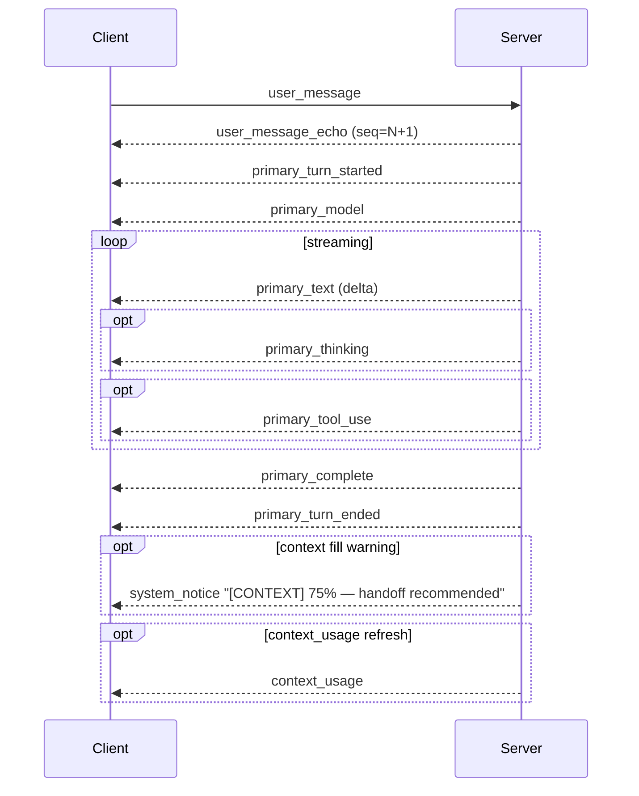

# Arco — WebSocket protocol reference

Complete catalog of every message that crosses the WebSocket between client and server. Source of truth: the [`shared/src/protocol/`](../shared/src/protocol/) directory — ~44 per-domain files (`clientMessages.ts` + `serverMessages.ts` carry the two top-level unions; the rest define the families). The legacy [`shared/src/protocol.ts`](../shared/src/protocol.ts) is now a thin barrel that re-exports `protocol/index.ts`, so old import paths still resolve to the full flat surface. This doc tracks the same content with deeper commentary, direction tags, persistence notes, and happy-path sequence diagrams.

For the higher-level lifecycle (when these messages fire), see [`ARCHITECTURE.md`](ARCHITECTURE.md). For terminology, see [`GLOSSARY.md`](GLOSSARY.md).

---

## Conventions

- **Direction**: `→` = client to server. `←` = server to client.
- **Persistence**: most workflow-scoped server-to-client messages are persisted to `events.jsonl` so they replay on reconnect. "Transient" means broadcast without persistence. Client-to-server messages are not persisted as such, but their server-side echoes (e.g. `user_message_echo`) usually are.
- Every workflow-scoped server message is stamped with `{seq, ts, parentEventSeq?, ...message}` before persistence. The `seq` and `parentEventSeq` fields appear on the wire too. `parentEventSeq` (Phase 0) is the seq of the preceding event in the same workflow's `events.jsonl`; absent on the first event and on pre-Phase-0 (`schemaVersion: 1`) workflows. Readers should treat absent as "previous event in seq order".
- All messages are JSON. Tagged unions discriminated by `type`.

---

## Connection lifecycle

**Upgrade auth.** `/ws` (and `/terminal`) upgrades need an allowed `Origin` header **and** a valid `archon_session_<port>` cookie, minted by `POST /api/session` (`docs/HTTP_API.md § Session cookie`). Otherwise the server answers `HTTP/1.1 401` and logs `refused upgrade … (peer=… ua=…)`. The client calls `ensureWsSession()` (`client/src/utils/wsSession.ts`) before every connect. Scripted clients (smoke harness) must target a server booted with `ARCHON_WS_AUTH=off`.

### `connected` ←

Sent immediately after WS handshake. Carries the server's `sessionId` (per-connection identifier; **not** related to CLI session UUIDs).

```ts
{ type: 'connected', sessionId: string }
```

### `workspace_sync` →

First message on every WS open. The server owns the open-tab set (`server/src/workspace.ts`, persisted to `~/.archon/workspace.json`); this reports the browser's local non-incognito tabs so the server can **adopt** them — only when the server's workspace is unseeded (`adopt` is a legacy hint, no longer honoured). Task children are never adopted.

```ts
{ type: 'workspace_sync', adopt: boolean,
  workflows: Array<{ workflowId: string, config: WorkflowConfig, parentWorkflowId?: string }>,
  clusterIds: string[] }
```

### `workspace_snapshot` ← / `workspace_changed` ←

`{ type, workspace: { workflows: Array<{ workflowId, config, parentWorkflowId? }>, clusters: Array<{ clusterId, memberIds }> } }`. `workspace_snapshot` answers `workspace_sync` (this socket only); `workspace_changed` fans to **every** socket whenever a tab opens (any `workflow_created` through `send()`, `cluster_created`, a successful `cluster_subscribe`) or closes (`remove_workflow`, `cluster_deleted`, `cluster_not_found`). The client (`client/src/ws/workspaceSync.ts`) reconciles: on a snapshot it drops every local non-incognito tab the server doesn't list, creates missing ones in the background (no focus steal), replaces existing jobs' config with the server's, then sends `rehydrate_workflows` + `cluster_subscribe`; on a change it removes only ids present in the *previous* snapshot and rehydrates only new ones (from seq 0). Cluster members are carried by `memberIds`, never listed as workflows. Incognito tabs are never reported.

### `workflow_config_synced` ←

`{ type, workflowId, config }` — the server's resolved `WorkflowConfig` after an `update_primary_config` lands, fanned to observers via `broadcastTransient` (NOT persisted: a stale config replayed after later edits would regress the job). Mirrored browsers replace their local config wholesale. Skipped while the state is boot-materialized.

### `rehydrate_workflows` →

Sent after the client reconciles a `workspace_snapshot` (see above). Entries may carry `tail: true` (first sight of a mirrored tab); the server then — and for any `lastSeq: 0` entry or a >5000-event gap — replays only the recent tail (`replayTailEvents`, last 3 MB from a turn boundary, as one `replay_batch`, preceded by a non-persisted `[MIRRORED]` `system_notice` when truncated). Entries replay sequentially in message order. Lists every retained workflow (incl. local incognito + cluster-member jobs) and the latest `seq` the client has for each; for a workspace-created job `lastSeq` is 0 and the server replays the whole transcript.

```ts
{
  type: 'rehydrate_workflows',
  workflows: Array<{
    workflowId: string,
    config: WorkflowConfig,
    currentSessionId: string,
    lastSeq?: number,
  }>,
}
```

Server replays events with `seq > lastSeq` then sends `workflow_state_snapshot`. If too much rotated off disk, the snapshot lands with `snapshotOnly: true`.

### `workflow_state_snapshot` ←

The server's authoritative state at this moment. Sent after replay completes (or as a fallback when replay isn't possible).

```ts
{
  type: 'workflow_state_snapshot',
  workflowId: string,
  workers: Record<string, WorkerState>,
  busy: boolean,
  transcriptTail: ChatMessage[],
  lastSeq?: number,           // server's head seq
  snapshotOnly?: boolean,     // true → events rotated, force-set lastSeq
  snapshotReason?: string,
  claudeSessionId?: string,
  lastTurnTokens?: TokenUsage,    // most recent primary_complete tokens — seeds CTX bar without waiting for the next turn
  modelContextWindow?: number,    // provider-reported window for the active model (Codex / Native), when known
}
```

Persistence: not persisted (it's derived state). The snapshot also carries an optional `sessionMetadata?: WorkflowSessionMetadata` (same field rides `workflow_created`).

### `workflow_session_metadata` ←

Standalone push of a workflow's resolved session metadata (`WorkflowSessionMetadata`) when it changes outside a snapshot. Lets the client refresh provider/session-derived header fields without a full state sync.

```ts
{ type: 'workflow_session_metadata', workflowId: string, sessionMetadata?: WorkflowSessionMetadata }
```

### `replay_batch` ←

Atomic bulk delivery of a member's compacted `events.jsonl` lines (server-message
shaped, seq-ascending) — used for cluster-snapshot restore (2026-06-12). The
client dispatches each through its normal `handleServerMessage` reducer in ONE
synchronous task, so the ingest is all-or-nothing. Load-bearing vs. streaming N
live messages: run-to-completion stops the client's persisted `lastSeq` outrunning
its persisted chat (the blank-workers bug — a mid-stream interrupt persisted
`lastSeq≈head` with no messages, and reconnect replay-since-seq then had nothing
left to resend).

```ts
{ type: 'replay_batch', workflowId: string, events: unknown[] }
```

### `shutdown` ←

Server is exiting. `reason` distinguishes graceful stop from restart.

```ts
{ type: 'shutdown', reason?: string }   // server sends 'server_stopping' | 'server_restarting'
```

The wire type is an optional free-form string; the server only ever emits the two values above.

On `server_restarting`, the client keeps the tab open — the existing reconnect loop will land on the new process. On `server_stopping`, the client tries to close the tab (browsers usually block this; the `ShutdownOverlay` stays visible).

### `error` ←

Generic system error. `workflowId` is present when the failure belongs to one
workflow (including provider/worker failures) and omitted for connection-wide
or command errors.

```ts
{ type: 'error', workflowId?: string, message: string }
```

Notable senders: invalid JSON on WS, "unknown workflow", "primary busy" (handoff during turn), session ID validation, review content rejection. Most are non-fatal.
Workflow-scoped errors are persisted and routed to that workflow's chat even
when another tab is focused; unscoped errors retain the active-tab fallback.

---

## Workflow lifecycle

### `create_workflow` →

`primaryProvider: strata` selects the standalone OpenAI-compatible service.
It supports Agent and saved Chat (including the Chat web toggle), not Incognito
or cluster membership. `/api/auth-status` supplies its discovered model IDs,
context and image capability, plus optional `installedModelLabels` for prepared
local profiles. `update_primary_config.model` keeps the exact model ID; a
registered local profile loads on the next message and retains the conversation.
See `PROVIDERS.md § Strata`.

`primaryProvider: deepseek` selects prepared DeepSeek Exact/Light on Xolotl.
Agent/saved Chat and web-only Chat tools are supported; Incognito, clusters and
Computer selection are not enabled. Auth discovery lists both prepared profiles
while stopped. Model selection takes effect on the next message, through the
guarded launcher; loading/switch/ready/recovery notices use `system_notice`.
Context and rates use existing completion/usage events. Capabilities add optional
`xolotlRevision` and `latestVersions.xolotl`; Strata's existing version field now
has an offline build-metadata fallback. Lifecycle controls are HTTP; see
[HTTP_API.md](HTTP_API.md#get-apideepseek--post-apideepseek).

`WorkflowConfig.kind` is absent/`workflow` for the coding workbench and `chat`
for a projectless conversation (`cluster` exists too, but cluster tabs are
minted by `cluster_create`, never here). A Chat create intentionally sends an empty
`workingDirectory`; the server assigns `~/.archon/chats/<workflowId>`, persists
`kind` in `meta.json`, and echoes the resolved config in `workflow_created`.
Chat provider admission is server-enforced (Claude/Codex/Z.ai/Cursor/Ollama/
llama.cpp/LM Studio only), not merely a client picker filter.
`WorkflowConfig.chatWebAccess` (Chat only; Claude/Codex/Ollama) arms web
search + fetch and nothing else — default on for saved chats, off for
incognito; `chatWebArmed()` in `server/src/chatMode.ts` is the single decider.

`WorkflowConfig.incognito:true` is valid only with `kind:'chat'`. The server
uses a private per-process 0700 temp dir (`incognitoChatCwd()`, re-assigned on
rehydrate) as the process cwd without creating a workflow directory,
does not register the workflow in `workflowCwds`, and therefore never seq-stamps
or appends its broadcasts. Its compact transcript lives in `WorkflowState`
memory. Claude CLI runs with `--no-session-persistence`; Codex is forced to
`exec --ephemeral` (Computer uses a verified pathless ephemeral app-server
thread); Z.ai is forced to Native. Cursor is rejected because its
CLI has no non-persistence flag; llama.cpp is rejected because its shared
Archon-managed daemon writes `~/.archon/llamacpp.log`. Incognito configs are
excluded from client localStorage and cannot use `resumeWorkflowId` or
`resumeSessionId`. The server rejects attachments, skills, primitives, remote
reporting, and every other project/workbench operation on an incognito workflow.

Operator opens a new tab.

```ts
{
  type: 'create_workflow',
  config: WorkflowConfig,           // primaryProvider, primaryModel, primaryEffort, workingDirectory, resumeSessionId, etc.
}
```

`resumeSessionId` and the rest of the resume / native-session hints all ride on the nested `WorkflowConfig` — there are no top-level fields on the request itself.

### `workflow_created` ←

Server confirms the new workflow. Carries the canonical `workflowId` (server-minted UUID) and the (possibly mutated) config.

```ts
{
  type: 'workflow_created',
  workflowId: string,
  config: WorkflowConfig,
  resumedVia?: 'native' | 'bootstrapped',
  backgroundCreated?: boolean,      // worktree bake-off attempts — batch-created tabs; the source tab keeps focus
  parentWorkflowId?: string,        // Phase 7b — set when minted by a Task tool call. Client creates the JobState but suppresses tab creation + active-tab switch while parented + unpromoted.
  priorClaudeSessionId?: string,    // legacy hint kept parallel to priorSessionId so older client builds hydrate Claude sessions unchanged
  priorSessionId?: string,          // native CLI session UUID (Claude or Codex) to fetch transcript for
  priorProvider?: 'claude' | 'codex',
  claudeSessionId?: string,
  hydrationSource?: 'events' | 'transcript',  // 'events' = server is replaying events.jsonl; 'transcript' = client falls back to GET /api/transcript
  sessionMetadata?: WorkflowSessionMetadata,
}
```

### `remove_workflow` →

Operator closed the tab. Server kills any in-flight workers, deletes the in-memory state, and removes the persisted directory.

```ts
{ type: 'remove_workflow', workflowId: string }
```

### `update_primary_config` →

Live model/effort swap. Same-provider only — provider swaps require Handoff.

```ts
{
  type: 'update_primary_config',
  workflowId: string,
  model?: ModelName,
  effort?: EffortLevel,
  providerAccountRef?: string,                        // provider-account profile id (wired for Codex; reserved on Claude)
  autoHandoff?: { enabled, warnAt, autoAt, mode?, summarizer? },  // Phase 3 / WP5 — per-tab auto-handoff thresholds + mode + fresh-summarizer
  codexTransport?: 'exec' | 'appserver',             // Phase 6e — per-tab Codex transport override
  codexContextPolicy?: 'max' | 'standard',           // per-tab window policy; absent means MAX
  claudeTransport?: 'cli' | 'native',                // Phase 7a — per-tab Claude transport override
  ultracode?: boolean,                               // ULTRACODE_PLAN — sticky ultracode; forces CLI + Workflow tool + xhigh (Claude only). Does NOT mutate stored claudeTransport
  webSearchMaxUses?: number,                         // per-tab Native web_search/web_fetch per-turn budget (clamped 1..50); default 15
  chatWebAccess?: boolean,                           // Chat-only web toggle (Claude/Codex/Ollama); chatWebArmed() in server/src/chatMode.ts decides
  zaiTransport?: 'native' | 'appserver',             // Z.ai Native — per-tab Z.ai transport override
  claudeNativeCompact?: boolean,                     // Phase 7c-followup — Anthropic server-managed compaction
  claudeNativeForceInterleavedThinkingBeta?: boolean, // Native A/B debug — force interleaved-thinking beta next turn
  claudeNativeThinkingDisplay?: 'omitted' | 'summarized' | 'updates', // Native adaptive-thinking display — 'summarized' streams thinking into Activity (default 'omitted', Claude Code parity); 'updates' (beta progress notes) only where supportsThinkingDisplayUpdates, else resolves to 'omitted'
  nativeCompactAutoContinue?: boolean,               // NATIVE_COMPACTION_PLAN Phase 3 — auto-continue after a Native compaction (default false)
  autoFold?: { enabled, foldAt, tailBudget? },       // §2.1 per-tab auto-fold (Native) — off by default; foldAt is the budget-meter pct
  goalRun?: { enabled, total?, tokenBudget? },        // GOAL_RUN_PLAN — arm/re-arm (resets counters) / disarm the north-star auto-continue; refused without a north star. Acked by goal_run_state
  efficiencyToolFilter?: 'off' | 'conservative' | 'aggressive',  // EFFICIENCY_PLAN Phase C
  efficiencyFactForce?: 'on' | 'off',                // EFFICIENCY_PLAN Phase D
  efficiencyConfigProtection?: 'on' | 'off',         // config-protection write-gate (Native, default 'on')
  efficiencySandbox?: 'off' | 'on',                  // EFFICIENCY_PLAN Phase E — opt-in ctx_* tools
  reviewSafeMode?: 'off' | 'on',                     // DEBAG durable review gate (Native, default 'off')
  outputStyle?: 'normal' | 'lite' | 'terse',         // OUTPUT_STYLE_PLAN — Claude Native, Codex app-server, Z.ai
  goal?: string,                                     // GOAL_NORTHSTAR_PLAN — persistent per-tab north-star; empty/whitespace CLEARS. Cap 2048 bytes. Injected as a system block every turn on transports that fold the cluster plan; inherited by primitives (unlike outputStyle's forced 'normal')
  pinnedSkills?: Array<{ scope: 'project' | 'global'; slug: string }>, // replace the durable tab pin set; empty CLEARS. Full bodies are re-resolved + injected every turn
  remoteEnabled?: boolean,                            // REMOTE_MANAGEMENT §1.4 — per-workflow hub opt-in
  remoteGatesEnabled?: boolean,                      // REMOTE_CLUSTER_CONTROL §9.2 — second arming: resolve DEBAG gates from the hub console (default false)
  ollamaParams?: Record<string, unknown>,            // LOCAL_AI_MASTER_PLAN M3 — per-tab Ollama generation-param blob (whole-blob replace)
}
```

Takes effect on the next primary turn. Persisted to `meta.json` (except `goalRun`, whose counters are memory-only — a restart ends any run). On an incognito chat only `model` / `effort` / `chatWebAccess` (`INCOGNITO_SAFE_CONFIG_FIELDS`) are accepted, held in memory; every other field is refused. Transport / efficiency fields are provider-specific knobs. `outputStyle` is honored by Claude Native, Codex app-server, and Z.ai; other transports silently ignore it on turn dispatch. `outputStyle: 'caveman'` is accepted on the wire for back-compat with pre-2026-05-10 clients and aliased to `'terse'` server-side.

### `goal_set` ←

GOAL_NORTHSTAR_PLAN.md — ack/visibility broadcast for a north-star set / edit / clear (the durable side of `update_primary_config { goal }`). **Persist-then-announce**: the server writes `meta.json` before emitting, so "`goal_set` observed ⇒ value already durable" holds. Persisted to `events.jsonl` (reviewable in the transcript per the four-question test). `goal` is `null` on clear; `byteLen` is the UTF-8 byte length of the stored text (0 on clear).

```ts
{ type: 'goal_set', workflowId: string, goal: string | null, byteLen: number }
```

### `goal_run_state` ←

GOAL_RUN_PLAN.md — state of the north-star auto-continue loop. Persisted; emitted on arm, after every tick, and on stop, so the transcript carries the whole run and the RUN chip rehydrates from replay. Counters are NOT in `meta.json`: a server restart ends an armed run (deliberately — no unattended resume after a deploy).

```ts
{ type: 'goal_run_state', workflowId: string, enabled: boolean, total: number, remaining: number, tokensUsed: number, tokenBudget?: number }
```

### `pinned_skills_set` ←

Durable acknowledgement for `update_primary_config { pinnedSkills }`. The
server validates and resolves the complete replacement set, writes the stable
references to `meta.json`, then broadcasts this persisted audit event. `bytes`
is the current UTF-8 size of the standing system block; `missing` names invalid,
missing, or over-budget references that were not pinned.

```ts
{
  type: 'pinned_skills_set',
  workflowId: string,
  skills: Array<{ scope: 'project' | 'global'; slug: string; name: string }>,
  bytes: number,
  missing: string[],
}
```

### `rename_workflow` →

Operator-set friendly name for a workflow. Server trims + caps at 64 chars; empty / whitespace clears back to default (the wfid 8-char prefix). Persists `wf.config.name` to `meta.json` and emits `workflow_renamed` to every observer. If the workflow is a cluster member, re-emits `cluster_state` to every cluster subscriber so the bottom-row tab + member grid pick up the new label without a reload (`ClusterMember.displayName = wf.config.name?.trim() || wfid.slice(0, 8)`). Rejected on validation failure via a generic `error` message (`rename_workflow rejected: name_too_long (<n> > 64)` or `rename_workflow requires a string name`). Shape defined in [`shared/src/protocol/clusters.ts`](../shared/src/protocol/clusters.ts) (`RenameWorkflowMessage`).

```ts
{ type: 'rename_workflow', workflowId: string, name: string }
```

### `workflow_renamed` ←

Broadcast on every successful `rename_workflow`. `name === null` means the operator cleared the name (`ClusterMember.displayName` reverts to the wfid prefix). Persisted (so reconnect rehydration picks up the new label without a `cluster_state` round-trip).

```ts
{ type: 'workflow_renamed', workflowId: string, name: string | null }
```

### `fresh_antigravity_cascade` →

Antigravity-only. Forget the currently stored cascade id so the next primary turn starts a fresh Antigravity cascade. Does not compact or inspect Antigravity's internal context/cache; other providers no-op.

```ts
{ type: 'fresh_antigravity_cascade', workflowId: string }
```

---

## Primary turn

### `user_message` →

The operator's prompt. May arrive while another turn is in flight; server queues it on `wf.queue.steering` or `wf.queue.followUp` keyed by `kind`.

```ts
{
  type: 'user_message',
  workflowId: string,
  content: string,
  attachments?: string[],           // file paths from /api/upload
  clientMessageId?: string,         // optimistic adds correlate by this
  interjection?: boolean,           // set when sending while busy
  kind?: 'steer' | 'follow-up',     // Phase 4: only meaningful when interjection: true
  pickedSkills?: Array<{ scope: 'project' | 'global', slug: string }>,  // one-turn skill picks (composer `/skill`); resolved + injected for this turn only (contrast pinnedSkills)
  primitive?: 'docs' | 'git',       // OUTPUT_STYLE_PLAN §6 — set by the in-tab DOCS / GIT composer dialogs so the server forces `outputStyle: 'normal'` on this single turn even when the tab's WorkflowConfig pins lite/terse. Hard-coded; not a free-form knob.
}
```

`kind` is the operator's intent for a mid-turn message: `steer` is "do this now / change direction"; `follow-up` is "after the current task lands." Pre-Phase-4 clients (sending only `interjection: true`) default to `follow-up` — matches the silent post-turn flush they used to get. Phase 4 ships visible + rebindable; Phases 5–7 wire real mid-turn delivery for `steer` per provider (Codex `app-server`, Ollama / llama.cpp loop hook, Native Claude).

### `user_message_echo` ←

Server echoes the message back, stamped with `seq` and `timestamp`. Optimistic-add path correlates by `clientMessageId`. **Persisted** — survives restart.

```ts
{
  type: 'user_message_echo',
  workflowId: string,
  content: string,
  attachments?: string[],
  timestamp: number,                // ms since epoch
  clientMessageId?: string,
  kind?: 'steer' | 'follow-up',     // present on echoes for queued messages
}
```

The client hides queued user messages from chat until the corresponding `session_entry` arrives (Claude's JSONL writes the merged drained prompt — see `docs/GOTCHAS.md § Chat / UI`). The `[steer]` / `[follow-up]` pill in the queue strip reads from `kind` so a reconnect's replay can colour the strip correctly even though the optimistic in-memory state was lost.

### `primary_turn_started` ←

Marks the beginning of a primary turn. Sets server `wf.busy = true` and client `JobState.busy = true`.

```ts
{ type: 'primary_turn_started', workflowId: string, startedAt: number }
```

### `primary_text` ←

Streaming text from the primary. Multiple deltas per turn until `primary_complete`. `phase` is currently always `'passthrough'`.

```ts
{
  type: 'primary_text',
  workflowId: string,
  text: string,                     // delta, not cumulative
  phase: 'passthrough',
}
```

### `primary_thinking` ←

Reasoning blocks (Claude/Codex extended thinking). Surfaces in the ACTIVITY tab.

```ts
{ type: 'primary_thinking', workflowId: string, text: string }
```

### `primary_tool_use` ←

The primary invoked a tool. Renders as inline `ToolCallPill` in chat (Claude only — derived from session JSONL). Also feeds the ACTIVITY tab.

```ts
{
  type: 'primary_tool_use',
  workflowId: string,
  tool: string,                     // 'Bash', 'Read', 'Grep', ...
  input: string,                    // JSON-stringified tool args
  status?: 'started' | 'in_progress' | 'completed' | 'failed',
  provider?: ProviderName,
  itemType?: string,                // provider-specific (e.g. Codex item kind)
  itemId?: string,                  // provider-specific stable id
  output?: string,                  // populated on settle if available
  exitCode?: number,                // populated on settle for shell-tool calls
  outputHash?: string,              // stable normalized hash of `output` (providers/outputSignature.ts) — watchdog error-persistence signal; Native + Codex only
  toolUseId?: string,               // server-minted; correlates background-job descendants to the spawning Bash call. Native overrides with the Anthropic `block.id` so client-side lookups (e.g. Task inline cards) stay stable across replay.
}
```

### `primary_complete` ←

End of one streaming turn. Carries cost and token usage.

```ts
{
  type: 'primary_complete',
  workflowId: string,
  phase: 'passthrough',
  costUsd: number,
  durationMs: number,
  tokens?: TokenUsage,              // input, output, cacheCreate, cacheRead, reasoningOutput?, total?
  modelContextWindow?: number,      // provider-reported window for this turn's model (Codex token_count.info / Native catalog lookup). Sticky on the workflow once observed; beats the client's hardcoded fallback for the CTX-bar denominator.
  lastPromptTokens?: number,        // Native/API providers — ground-truth prompt size of the last API round-trip in this turn. Persisted to events.jsonl for resume-time CTX restore.
  genSpeed?: GenerationSpeed,       // Ollama / Strata — runtime-measured { decodeTokens, decodeMs, prefillTokens, prefillMs } summed across the turn's tool loop. Drives the composer tok/s readout + [TURN · …] stamp. Also on worker_complete and primary_turn_token_usage.
}
```

### `primary_turn_token_usage` ←

EFFICIENCY_PLAN.md Phase A — per-turn telemetry, broadcast right after `primary_complete`. Drives the Activity tab "Token usage" section. Token fields are Anthropic API ground truth; byte fields are raw byte sums of the relevant content blocks (see `docs/EFFICIENCY_PLAN.md` §14 2026-05-09 tokenizer-choice decision for why we don't claim token-precision on thinking/tool sizes).

```ts
{
  type: 'primary_turn_token_usage',
  workflowId: string,
  turnStartedAt: number,           // pairs with the matching primary_turn_started.startedAt
  durationMs: number,
  provider: ProviderName,
  transport?: 'native' | 'cli' | 'exec' | 'appserver',
  input: number,
  output: number,
  cacheRead: number,
  cacheCreate: number,
  lastPromptTokens?: number,       // last API round-trip's prompt size (Native/API providers)
  reasoningOutput?: number,        // Codex only
  thinkingBytes: number,           // Native: real value; CLI/Codex: 0 (we don't see inner messages[])
  toolResultBytes: number,         // Native: real value (post-filter once Phase C lands); CLI/Codex: -1 (unknown)
  toolResultBytesRaw: number,      // pre-filter equivalent; equals toolResultBytes until Phase C
  serverToolResultBytes?: number,  // Native — bytes of server-tool (web_search/web_fetch) results in this turn
  genSpeed?: GenerationSpeed,      // Ollama / Strata (see primary_complete)
}
```

Skipped for turns where the provider didn't surface usage (defensive — every transport should produce one but a transient API hiccup could leave usage absent). Persisted to `events.jsonl` like every other workflow-scoped broadcast.

### `hook_rewrote_input` ←

EFFICIENCY_PLAN.md Phase B0 — Native worker emits this when a `PreToolUse` hook returned `hookSpecificOutput.updatedInput` and the dispatched input was actually rewritten. The chat UI may surface a "rewritten by hook" chip on the affected tool block; transcript review uses these entries to attribute rtk-style rewrites back to their origin hook. Persisted to `events.jsonl`.

```ts
{
  type: 'hook_rewrote_input',
  workflowId: string,
  toolUseId: string,
  toolName: string,
  hookCommand: string,             // e.g. "rtk hook"
  originalInput: string,           // JSON-stringified
  rewrittenInput: string,          // JSON-stringified
}
```

### `tool_gate_triggered` ←

EFFICIENCY_PLAN.md Phase B/D — pre-tool-use guard inspected a tool call. `gate` identifies the rule (today: `"config-protection"`; Phase D adds `"fact-force-first-edit"`). `decision`: `"allowed"` = inspected and permitted, `"blocked"` = synthetic tool_result returned without dispatch, `"mutated"` = input modified before dispatch.

```ts
{
  type: 'tool_gate_triggered',
  workflowId: string,
  toolUseId: string,
  toolName: string,
  gate: string,
  decision: 'allowed' | 'blocked' | 'mutated',
  reason: string,
}
```

### `ctx_action` ←

EFFICIENCY_PLAN.md Phase B/D — context-management action ledger. Emitted from every code path that mutates `messages[]` in a way the operator should be able to see. `trigger: "operator"` for direct clicks; `"auto-threshold"` for Phase 6b.2's tool-call-count threshold; `"model"` is reserved (model-called context tools); `"recovery"` is a deterministic defensive repair of in-memory state before an API call (e.g. dropping a trailing orphan tool_use left by a cancel-mid-tool turn).

```ts
{
  type: 'ctx_action',
  workflowId: string,
  action: 'clear_thinking' | 'clear_tool_uses' | 'compact'
        | 'sandbox_redirect' | 'first_edit_gate'
        | 'prune_orphan_tool_use' | 'scrub_empty_text_blocks'
        | 'strip_trailing_thinking',
  trigger: 'operator' | 'auto-threshold' | 'model' | 'recovery',
  detail?: string,
}
```

### `model_resolved` ←

Opus-5 plan Phase 2 — alias-capability resolution. Emitted by the Claude Native worker when the model id Anthropic echoes on `message_start` differs from the id Arco requested — i.e. the tab runs a family alias (`opus`, `opus[1m]`) that the server resolved to a concrete model. Fires once per worker per distinct resolution, so `opus → claude-opus-5` is an explicit, durable release signal in `events.jsonl` instead of being inferred from behavior drift. Alongside the event, the worker persists `served` to `meta.json` (`resolvedModelId`) so a restarted alias tab resolves catalog capabilities (ctx-management / compact gating, thinking params, max_tokens, ctx window) from the concrete id on turn 1. The request `model:` field always stays the alias — auto-tracking is preserved. Client renders a `MODEL` line in Native activity; the chat header upgrade still rides the existing `primary_model` path.

```ts
{
  type: 'model_resolved',
  workflowId: string,
  requested: string,   // what Archon sent, e.g. 'opus'
  served: string,      // what Anthropic ran, e.g. 'claude-opus-5'
}
```

### `primary_refusal` ←

Opus-5 plan Phase 3 — a Native turn ended with `stop_reason: 'refusal'` (HTTP 200; Anthropic's safety classifiers declined the request). Not an API error, so `errorClassifier` never sees it — before this event the turn just ended blank. `category` / `explanation` come from the response's `stop_details` and are both nullable (`stop_details` can be `null` even on a refusal). `hadPartialOutput` distinguishes a mid-stream decline (billed partial output kept in history) from a pre-output decline (empty content; the per-request scrub pass patches it before the next `messages.create`). Paired with an operator-facing `system_notice` in chat; the event is the Activity/transcript-review trace. Deliberately **no** text-based refusal detection — `stop_reason` is structured ground truth (CLAUDE.md § Non-goals).

```ts
{
  type: 'primary_refusal',
  workflowId: string,
  category: string | null,      // e.g. 'cyber'; null when stop_details absent
  explanation: string | null,
  hadPartialOutput: boolean,
}
```

### `tool_filtered` ←

EFFICIENCY_PLAN.md Phase C — Native tool-result filter fired on a tool call. Emitted from `ClaudeNativeWorker.dispatchTool` after the raw output is captured and before it lands in `messages[]`. Cache invariant: filters operate only on the current turn's tool_result; prior turns are never rewritten.

When `originalBytes !== filteredBytes`, the worker gzips the pre-filter raw output to `<cwd>/.archon/workflows/<wfId>/artifacts/raw-tools/<turnId>-<toolUseId>.txt.gz` and stamps `rawArtifactPath` (workspace-relative) on the event. The chat-side `FilteredChip` (`ToolCallPill`) renders the byte-shrink summary and offers the path for `zcat` recovery — reversibility is non-negotiable. When a pack runs but doesn't change byte counts (passthrough) the event still fires so transcript review can confirm "filter ran, no change."

```ts
{
  type: 'tool_filtered',
  workflowId: string,
  toolUseId: string,
  toolName: string,
  filterName: string,             // e.g. "cargo-test-drop-passing"
  originalBytes: number,
  filteredBytes: number,
  rawArtifactPath?: string,       // workspace-relative; set iff bytes changed
}
```

### `tool_evicted` ←

§2.2 — tool-result eviction. Emitted when the per-turn aggregate spill replaces
a large tool result with a semantic 1-liner digest (operator-armed via
`efficiencyToolEvict`). Distinct from `tool_filtered` (which trims a single
result in place via a configured pack): eviction is the aggregate largest-first
spill that fires only when a batch's summed cost exceeds the turn budget.
`rawArtifactPath` is **always** set (eviction only fires when it shrinks the
result) — raw output is gzipped, same convention as `tool_filtered`, fully
reversible.

```ts
{
  type: 'tool_evicted',
  workflowId: string,
  toolUseId: string,
  toolName: string,
  originalBytes: number,
  filteredBytes: number,
  rawArtifactPath?: string,       // always set; workspace-relative gzipped raw output
}
```

### `primary_tool_counter` ←

EFFICIENCY_PLAN.md Phase D §8b — worker-authoritative tool-call counter since the last context-reshape (auto-threshold `compact` emission OR worker rebuild after handoff). Emitted from Claude Native's `dispatchTool` after every increment AND after every reset. Drives the composer chip's `toolCallsSinceCompact` field; when set, the chip prefers this over the client-side `toolCallsSinceHandoff` recount (which stays as audit fallback for non-Native tabs and first-paint). Native-only.

```ts
{
  type: 'primary_tool_counter',
  workflowId: string,
  toolCallsSinceCompact: number,
}
```

### `sandbox_chunk_added` ←

EFFICIENCY_PLAN.md Phase E §9 — best-effort UI freshness event fired when a `ctx_execute` call stored a new chunk in the per-tab SQLite index. Not load-bearing for correctness (the Files-tab sandbox sub-section can pull `/api/workflows/:wfId/sandbox/stats` on demand); this is the cheap push so the operator sees new chunks appear live.

```ts
{
  type: 'sandbox_chunk_added',
  workflowId: string,
  chunkId: number,
  byteLen: number,
  language: string,
}
```

### `sandbox_db_cleared` ←

EFFICIENCY_PLAN.md Phase E §9 — fired after the operator clicks "Clear DB" in the CONFIG tab (`POST /api/workflows/:wfId/sandbox/clear`) and the SQLite chunks table is truncated. Clients drop their local `sandboxChunkCount` mirror to zero on receipt.

```ts
{ type: 'sandbox_db_cleared', workflowId: string }
```

### `primary_turn_ended` ←

The full turn (including any tool roundtrips) is done. Clears `busy`. Fires from the seedWorker settle path **and** unconditionally from `handleCancel` as an escape hatch.

```ts
{ type: 'primary_turn_ended', workflowId: string, endedAt: number }
```

### `primary_model` ←

Resolved model name on init (e.g. `claude-opus-4-7`, `gpt-5-codex`). Used for the model badge.

```ts
{
  type: 'primary_model',
  workflowId: string,
  resolvedModel: string,
}
```

### `primary_activity` ←

Long-running background jobs (Claude's `run_in_background`). Carries the live process state.

```ts
{
  type: 'primary_activity',
  workflowId: string,
  jobs: Array<{
    toolUseId: string,
    description: string,
    pid?: number,
    alive: boolean,
    cpuActive?: boolean,
    descendantCount?: number,
    rssBytes?: number,
    startedAt: number,
  }>,
}
```

Broadcast at 1.5s cadence while there are live background jobs. Transient (not persisted).

### `ultracode_fleet_progress` ←

ULTRACODE_PLAN.md — live per-turn snapshot of the ultracode background subagent fleet. Under sticky ultracode the CLI `WorkflowTool` fans out subagents whose transcripts never reach the parent stream, so a turn-scoped watcher polls their journal/agent files and emits a fresh snapshot here. **Transient** (live telemetry like `context_usage` / `primary_activity` — NOT persisted; each snapshot replaces the prior one in place). Also bumps the client's stuck-turn clock.

```ts
{
  type: 'ultracode_fleet_progress',
  workflowId: string,
  total: number,                     // distinct subagents spawned this turn
  running: number,
  done: number,
  agents: Array<{
    agentId: string,
    label: string,                   // first user-turn prompt, truncated
    status: 'running' | 'done',
    lastTool?: string,
  }>,
}
```

### `primary_artifact` ←

Inline-expand artifact. Used for `archon-artifact` fenced blocks the primary emits during chat.

```ts
{
  type: 'primary_artifact',
  workflowId: string,
  artifactId: string,
  kind: 'image' | 'code' | 'text' | 'diff' | 'confirm' | 'choice',
  title?: string,
  content?: string,                 // body for code/text/diff
  language?: string,                // for `kind: 'code'`
  path?: string,                    // for `kind: 'image'` or any file-backed body
  message?: string,                 // for `kind: 'confirm'` / `'choice'`
  choices?: string[],               // for `kind: 'choice'`
  openInEditor?: boolean,           // §H4 — image written into cwd (e.g. Codex image_generation_call); client offers "Open in editor" (H2 media editor on `path`)
}
```

Ask-type responses (`confirm` / `choice`) come back to the agent as a follow-up user message `[artifact:<id>] <answer>`.

### `cancel` →

Operator hit the CANCEL button.

```ts
{ type: 'cancel', workflowId: string }
```

### `turn_cancelled` ←

Server's response to `cancel`. Reason explains who cut the turn.

```ts
{
  type: 'turn_cancelled',
  workflowId: string,
  reason: 'operator-stop' | 'quota-exhausted' | 'round-cap',
}
```

Always followed by `primary_turn_ended` (server emits both unconditionally).

### `compact_workflow` →

Operator hit the `⊟ COMPACT` button — provider-native context compression.
One message, **provider-routed** (`/compact` on most providers, Cursor `/compress`).

```ts
{ type: 'compact_workflow', workflowId: string }
```

Handler (`server/src/ws/compactHandlers.ts`) gates on provider + `!wf.busy`
(else an `error` ←), then:

- **Codex (app-server):** fires `thread/compact/start` against the live thread
  so Codex summarizes earlier history into its rollout server-side. On success
  the server pushes a fresh `codex_token_snapshot` so the CTX bar drops.
- **Claude (native transport only):** the worker runs ONE summarization round,
  REPLACES its in-memory history with the summary, and emits a persisted
  `native_compacted { summary }` ← marker. CLI-transport Claude is rejected
  (no in-process history to replace — use Handoff).
- **Z.ai Native:** the worker runs one no-tools Z.ai summarization request,
  replaces native `messages[]` with a summary seed plus recent clean tail,
  emits `native_compacted`, and persists a post-compact `zai_native_history`
  snapshot. **Z.ai appserver fallback** uses the Codex app-server compact path.
- **Cursor (ACP):** sends the advertised `/compress` command as the entire
  single-block `session/prompt`, deliberately bypassing the normal north-star +
  cluster prefix so Cursor's slash dispatcher recognizes it. Cursor persists
  the resulting summary in the same ACP session. The composer also routes a
  typed `/compress` through this handler.
- **Ollama:** arms a one-shot force-compact for the next real turn because the
  worker is stateless between turns; the next turn emits the durable result.

While it runs the tab is locked via a **transient** (not persisted)
`primary_turn_started` / `primary_turn_ended` pair — a textless compact turn is
deliberately kept out of `events.jsonl` so replay parsers (initHubLink,
reviewContent) only ever see real start→text→complete turns. The durable
audit is a persisted `ctx_action { action: 'compact', trigger: 'operator' }`
(plus the `native_compacted` marker on the Claude/Z.ai Native paths, which is **load-bearing
on replay** — see below). Far cheaper than a Handoff (no fresh worker, no
portable doc, no resume re-feed). See `docs/PROVIDERS.md § Codex` /
`§ Claude Native` and `docs/GOTCHAS.md`.

### `native_compacting` ←

NATIVE_COMPACTION_PLAN Phase 3 — pre-compaction marker. Emitted from
`compactInPlace()` BEFORE the (slow) summary round starts, once for BOTH the
manual COMPACT button and the Phase 2 between-turn auto path. Carries the
`workflowId` and advisory `foldedTurns` (turns about to be folded). The client
flips a per-workflow `compacting` takeover (a prominent "Compacting
conversation…" overlay in `ChatPanel`, distinct from the small `ctx_action`
divider; the composer greys + disables send). Persisted to `events.jsonl`;
**advisory on replay** — the takeover is live-only (cleared by the paired
`native_compacted` / a compaction-failure `system_notice` / the next
`primary_turn_started` / `turn_cancelled`), so replay never re-opens it.

```ts
{ type: 'native_compacting', workflowId: string, foldedTurns?: number }
```

### `native_compacted` ←

Persisted marker for a Claude-native in-place compaction. Carries the generated
`summary` (and advisory `foldedTurns`). **Load-bearing on replay:**
`buildMessagesFromReplayEvents` / `summarizeClaudeNativePriorTurns` reset at
this event (same semantics as `handoff_artifact_ready`) and re-seed `summary`
via `compactSummarySeed`, so the compaction survives a server restart / reload.
The client renders no chat bubble for it (the `ctx_action` divider +
`system_notice` carry the in-transcript feedback); it advances `lastSeq`, clears
the Phase 3 `compacting` takeover, and opens the post-compaction "Continue"
affordance (`compactedResume`).

```ts
{ type: 'native_compacted', workflowId: string, summary: string, foldedTurns?: number, keptTail?: ... }
```

### `fold_workflow` →

§2.1 — operator hit the composer `FOLD` button. A deterministic, instant
in-place context trim that continues the same session — **no LLM round, no fresh
worker** (the distinction from `compact_workflow`). Gated server-side on
provider=claude + transport=native + idle (else an `error` ←).

```ts
{ type: 'fold_workflow', workflowId: string, engine?: 'deterministic' | 'server' }
```

`engine: 'server'` (composer `⊞ S-FOLD`) is the **Server Fold**: one Anthropic
on-demand compaction call (`compact-2026-09-04`, top-level
`compaction: {type:'summarize'}`) that keeps the last 2 operator turns verbatim.
Any failure — beta/parameter rejected, no summary, 429/5xx — falls back to the
deterministic Fold in the same request; the `system_notice` says which ran and
the compaction call's token spend. Rejected on Chat tabs.

### `context_folded` ←

§2.1 — Fold marker. Carries the deterministic digest of the folded prefix
(task / files / cmds / searches / errors / recent-asks / open-todos) plus the
verbatim recent tail. **PERSISTED and load-bearing on replay:** like
`native_compacted`, replay resets at this marker and re-seeds `summary` +
`keptTail` via the same `compactSummarySeed` helper, so the Fold survives a
restart byte-identically. A distinct kind (not `native_compacted`) so the
transcript/UI can tell a deterministic in-place Fold from an LLM `/compact`, and
so the byte-delta fields can drive the anti-thrash termination. Auto-fold rides
`update_primary_config.autoFold` (off by default).

```ts
{
  type: 'context_folded',
  workflowId: string,
  summary: string,
  keptTail?: Array<{ role: 'user' | 'assistant'; content: string | Array<{ type: 'text'; text: string }> }>,
  foldedTurns?: number,
  trigger?: 'operator' | 'auto',
  originalBytes?: number,
  foldedBytes?: number,
  byteDelta?: number,                // originalBytes − foldedBytes
  // Server Fold only (engine: 'server'):
  engine?: 'server',
  compactionBlock?: { type: 'compaction'; content: string; signature?: string },  // verbatim, signed
  keptMessages?: unknown[],          // RAW kept turns (thinking + tool blocks), ≤256 KB
  keptTurns?: number,
  compactionUsage?: { input: number; output: number; cacheRead: number; cacheCreate: number },
}
```

With `engine: 'server'`, replay reseeds `[assistant{compactionBlock}, ...keptMessages]`
via the same `serverFoldSeed` the live worker used (not `compactSummarySeed`);
`summary` mirrors the block text for display and the summary_tail digest.
`compactionUsage` comes from `usage.iterations` (top-level usage is zero on a
compaction response); the client adds it to the tab's token total.

### `cancel_queued_message` →

Operator pulled a queued mid-turn prompt before it fired.

```ts
{
  type: 'cancel_queued_message',
  workflowId: string,
  clientMessageId: string,
}
```

### `queued_message_cancelled` ←

Server confirms removal. Persisted (so replay sees the same final state).

```ts
{
  type: 'queued_message_cancelled',
  workflowId: string,
  clientMessageId: string,
}
```

### Sequence: a normal turn



---

## Workers

Used by primitives (Review / Handoff fresh-summarizer / Spawn fresh-summarizer). Distinct from `primary_*` because workers are short-lived and their text isn't mirrored to chat.

### `worker_spawned` ←

```ts
{
  type: 'worker_spawned',
  workflowId: string,
  workerId: string,
  model: string,
  effort: string,
  task: string,                     // short description of the worker's job (review / handoff seed / spawn seed)
  provider?: ProviderName,
}
```

### `worker_model` ←

Resolved model on init.

```ts
{ type: 'worker_model', workflowId: string, workerId: string, resolvedModel: string }
```

### `worker_text` / `worker_thinking` / `worker_tool_use` ←

Same shape as their `primary_*` counterparts but scoped to a `workerId`. Used by the WorkerDetailModal and review/handoff progress UI. `worker_tool_use` carries the same status/provider/itemType/itemId/output/exitCode/outputHash/toolUseId optional fields as `primary_tool_use`; Native sets `toolUseId` to the Anthropic `block.id` so chat-side lookups (e.g. Task inline cards) match the assistant's tool_use row.

### `worker_complete` ←

```ts
{
  type: 'worker_complete',
  workflowId: string,
  workerId: string,
  result: string,                   // worker's final aggregated text
  costUsd: number,
  durationMs: number,
  tokens?: TokenUsage,
  permissionDenials?: PermissionDenial[],
  modelContextWindow?: number,      // Codex/Native ground-truth window when known
  lastPromptTokens?: number,        // Native/API primary turns — last round's prompt size (see primary_complete)
  genSpeed?: GenerationSpeed,       // Ollama / Strata (see primary_complete)
  thinkingBytes?: number,           // EFFICIENCY_PLAN Phase A — Native real; CLI/Codex 0
  toolResultBytes?: number,         // EFFICIENCY_PLAN Phase A/C — Native post-filter; CLI/Codex -1 (unknown)
  toolResultBytesRaw?: number,      // pre-filter byte count; equals toolResultBytes until Phase C
  serverToolResultBytes?: number,   // Native — server-tool result bytes (see primary_turn_token_usage)
}
```

If `permissionDenials` is non-empty, the client adds a `[SAFE]` system message naming the denied tools.

### `worker_activity` ←

Subprocess health probe. Fires at 1.5s cadence per worker.

```ts
{
  type: 'worker_activity',
  workflowId: string,
  workerId: string,
  alive: boolean,
  cpuActive: boolean,
  descendantCount: number,
  rssBytes: number,
}
```

Transient (not persisted).

### `worker_error` ←

```ts
{
  type: 'worker_error',
  workflowId: string,
  workerId: string,
  error: string,
}
```

### `worker_system_notice` ←

Provider-level out-of-band status (transient API errors, retry backoff). Surfaces cleanly in chat without getting routed as assistant text (no phase, no streaming, no cost / token accounting).

```ts
{
  type: 'worker_system_notice',
  workflowId: string,
  workerId: string,
  notice: string,
}
```

### `worker_stuck` ←

§3.1 — the stuck-worker breaker. Cross-turn, cross-provider: the same tool call
returning the same FAILING result over and over with no success interleaved
(error-persistence — the only loop signal that survived being tested on real
logs). `escalation`: `'detected'` (first trip → `recommendedAction: 'nudge'`),
`'persist'` (kept failing past the threshold → `'pause'`, reversible — a success
or the operator's next turn clears it, never a kill), `'recovered'` (a success
interleaved, latch cleared), `'limit'` (a hard ceiling — RSS cap / MAX_TOOL_TURNS
— routed THROUGH the breaker so it surfaces as a structured event instead of a
bare kill). `signature` is hash-only (`toolName|inputHash|outputHash`) — raw args
never leak. Persisted.

```ts
{
  type: 'worker_stuck',
  workflowId: string,
  escalation: 'detected' | 'persist' | 'recovered' | 'limit',
  recommendedAction: 'nudge' | 'pause' | 'none',
  toolName?: string,
  signature?: string,               // hash-only; never raw args
  streak?: number,
  reason: string,
}
```

`workerId?` exists on the internal WorkerManager→seedWorker hop (the RSS-cap
path) but is never set on the persisted/broadcast form.

### `tool_loop_warning` ←

H9 — in-turn tool-loop guardrail (Native). Emitted on the FIRST call where a
per-turn loop threshold is crossed: the model is re-running the same tool with
identical args (`identical-repeat`) or getting the byte-identical result back and
calling again (`no-progress`). `mode` echoes the operator arming
(`ARCHON_TOOL_LOOP_GUARD`) — `'warn'` (default, non-blocking) or `'stop'` (the
loop was aborted). Metadata is the tool name + an args **HASH** only — never the
raw args. Persisted.

```ts
{
  type: 'tool_loop_warning',
  workflowId: string,
  toolUseId: string,
  toolName: string,
  argsHash: string,                 // hash only
  signal: 'identical-repeat' | 'no-progress',
  repeatCount: number,
  sameOutputCount: number,
  mode: 'warn' | 'stop',
}
```

### `file_mutation_queued` ←

DD3 (cluster correctness) — a `Write` / `Edit` had to WAIT for an in-flight
mutation of the same real file path before it could run. Emitted **only** when a
write actually queues behind another (not on every write), so its presence in
events.jsonl is the signal that two members / Tasks contended for one file —
exactly the case that used to silently lose a write. `path` is cwd-relative;
`waitedForMs` is the queue wait the write ate. Persisted.

```ts
{
  type: 'file_mutation_queued',
  workflowId: string,
  toolUseId: string,
  toolName: 'Write' | 'Edit',
  path: string,
  waitedForMs: number,
}
```

---

## Operator-primitive messages → separate doc

Review, Deep Research, Compare, AI-collaborative document editing, Handoff, and Spawn messages now live in [`PROTOCOL_PRIMITIVES.md`](PROTOCOL_PRIMITIVES.md) (split out for doc-size).

---

## Chat hydration

### `session_entry` ←

One parsed line from Claude's native session JSONL (`~/.claude/projects/<cwd-hash>/<sessionId>.jsonl`). Drives the `sessionChat` array client-side. A single JSONL line can produce multiple entries (an assistant message with a text block plus tool_use blocks) — the server iterates content blocks and emits one `session_entry` each so the client renders them inline in chronological order. **Transient** (the JSONL is the source of truth on disk; replay reads from there).

```ts
{
  type: 'session_entry',
  workflowId: string,
  entry:
    | {
        kind: 'message',
        role: 'user' | 'assistant',
        content: string,             // already-extracted plain text
        timestamp: number,
        uuid?: string,
      }
    | {
        kind: 'tool_use',
        tool: string,                // 'Read' / 'Write' / 'Edit' / 'Bash' / ...
        input: unknown,              // parsed tool input JSON
        filePath?: string,           // extracted for Read/Write/Edit (absolute)
        toolUseId: string,           // Anthropic-issued, stable per invocation
        timestamp: number,
      },
}
```

### `session_history_status` ←

Pagination hint for the load-earlier pill.

```ts
{
  type: 'session_history_status',
  workflowId: string,
  hasEarlier: boolean,
  earlierRemaining: number,         // raw JSONL entries still in the server's pending-earlier queue; informational
}
```

Emitted after the watcher's initial tail emit AND after each `load_earlier_messages` response. Not persisted to events.jsonl — derived state.

### `load_earlier_messages` →

Operator clicked `↑ LOAD EARLIER MESSAGES`. Server pops the next N raw JSONL entries off the pending-earlier queue and re-emits them as `session_entry`. (Transcript REST pagination is a separate path — see `/api/transcript`'s `before` query param.)

```ts
{ type: 'load_earlier_messages', workflowId: string }
```

---

## Plans

### `plan_attach` →

```ts
{ type: 'plan_attach', workflowId: string, planId: string }
```

### `plan_detach` →

```ts
{ type: 'plan_detach', workflowId: string }
```

### `plan_attached` ←

```ts
{
  type: 'plan_attached',
  workflowId: string,
  planId: string,
  title: string,
  updatedAt: number,
}
```

Workflow-scoped (persists to `events.jsonl`). Fired in three cases that share this payload:

1. Initial attach (operator clicks a plan or sends `plan_attach`).
2. Plan body edited via REST `PATCH` — re-broadcast to every workflow currently attached so other tabs viewing the same plan refresh.
3. Watcher reconcile after the agent (or any external writer) edits `<cwd>/.archon/plans/<planId>.md` — same payload, debounced 200ms.

The client distinguishes "newly attached" from "existing plan changed" by checking whether the message's `planId` matches the workflow's existing `job.plan?.id`. Either way the body is fetched (or refetched) via `GET /api/plans/body` since `updatedAt` advanced.

### `plan_detached` ←

```ts
{ type: 'plan_detached', workflowId: string }
```

Fired on operator-driven `plan_detach`, `detachAllForPlan` (mark-complete or hard delete), watcher-reconcile-on-file-delete, and tab close.

### `plan_candidate_ready` ←

Cluster-member plan-creation choice point. When a worker that is a member of a cluster produces a plan via an auto-attach path (Native `EnterPlanMode`, or the `PlanComposerDialog` AUTOSAVE button), the server skips the silent worker-attach and emits this event instead. The client lands it in `JobState.planCandidate` so `PlanCandidateBanner` renders the three-button choice (SAVE & ATTACH TO WORKER / ATTACH TO CLUSTER / DISCARD). Non-cluster workflows never see this message — the existing `plan_set` auto-attach pipeline is unchanged for them. `plan_set` STILL fires alongside this message (for events.jsonl audit); only the `handlePlanAttach` side-effect is gated when the workflow is in a cluster.

```ts
{
  type: 'plan_candidate_ready',
  workflowId: string,
  body: string,
  source: 'native-plan-tool' | 'autosave-cluster-fallback',
  planTitle?: string,                  // pre-extracted title; client extracts its own if absent
}
```

Persisted.

---

## Calibration

### `recalibrate_request` →

Operator clicked the CTX cluster.

```ts
{ type: 'recalibrate_request', workflowId: string }
```

Response is **not** a single message — server runs `claude --print /context`, emits `system_notice` `[CALIBRATE] running` / `done` / `failed`, and broadcasts a fresh `context_usage` on success.

### `context_usage` ←

Current context-fill estimate.

```ts
{
  type: 'context_usage',
  workflowId: string,
  estimatedTokens: number,
  percentOfWindow: number,          // 0–100
  windowSize: number,
  method: 'byte-count' | 'calibrated' | 'ground-truth',
  calibratedAt?: number,            // epoch ms of last ground-truth calibration
  messagesTokens: number,
  overheadTokens: number,
  jsonlBytes: number,
  claudeSessionId?: string,
}
```

Transient (the byte count is derived from the JSONL).

### `context_budget` ←

§2.3 — token-budget meter (Claude Native). A deterministic per-turn reading of
usable-input pressure: the `count_tokens` prompt size against the **effective**
window (real window − reserved output budget), plus which warn/auto/fold
thresholds that `pct` has crossed. Distinct from `context_usage` (which is % of
the RAW window and drives the CTX bar): the budget meter is the signal the
Fold / auto-fold trigger reads, since the reserved output tokens aren't usable
for input. Transient — derived each turn from the persisted `lastPromptTokens`,
not persisted itself.

```ts
{
  type: 'context_budget',
  workflowId: string,
  usedTokens: number,
  windowSize: number,
  reservedOutput: number,
  effectiveWindow: number,          // windowSize − reservedOutput
  pct: number,
  thresholds: { warnAt: number, autoAt: number, foldAt?: number },
  crossed: { warn: boolean, auto: boolean, fold: boolean },
}
```

---

## Capabilities, settings, quotas

### `capabilities_updated` ←

CLI version bumped. Carries the full new `Capabilities` struct.

```ts
{
  type: 'capabilities_updated',
  capabilities: Capabilities,
  updated: boolean,
  previousVersion?: string,
}
```

If `updated` is true and `previousVersion` is set, the client adds an in-chat `[CLI] Updated X → Y` system line on the active tab.

### `capabilities_changed` ←

CLI help-surface changes (new flags, removed flags). Surfaces as a red-dot indicator on the CONFIG tab.

```ts
{
  type: 'capabilities_changed',
  changes: CliChangeEntry[],        // { provider, fromVersion, toVersion, newFlags, removedFlags, diffFileName }
}
```

### `settings_updated` ←

Phase 2 — fired on every settings cascade change (the global file or any project file the server is watching). Body-less by design: the cascade is cwd-scoped but the broadcast is global, so each client re-fetches via `GET /api/settings?cwd=<active-cwd>` and re-applies locally.

```ts
{
  type: 'settings_updated',
  scope: 'global' | 'project',
  cwd?: string,                     // present when scope === 'project'
}
```

Transient. See `docs/OPERATIONS.md § Settings cascade` for read order, deep-merge / array-replace semantics, and watcher lifecycle.

### `quota_status` ←

Per-provider throttle snapshot. Broadcast on every state change and on every WS connect.

```ts
{
  type: 'quota_status',
  workflowId?: string,                                  // present only on per-workflow re-emits; usually global
  providers: Record<ProviderName, { throttled: boolean; resetsAt?: number }>,
  timestamp: number,
}
```

Transient.

### `system_notice` ←

In-chat alert. Persisted so replay sees the warning.

```ts
{
  type: 'system_notice',
  workflowId: string,
  content: string,
}
```

Used for: rate-limit warnings, calibration progress, context-fill warnings, auto-handoff status, concurrent-writer guard, and provider out-of-band notices.

### Project-trust gate (DD7)

The untrusted-repo gate. On a turn whose cwd has project-local resources
(`CLAUDE.md` / project skills / `.archon/settings.json`) **and** no recorded
trust decision, those resources are suppressed for the turn and the operator is
prompted to grant trust for future turns. Decisions are recorded in
`~/.archon/trust.json` keyed by canonical path. Shapes: `serverMessages.ts`
(`project_trust_prompt` / `project_trust_set`) + `clientMessages.ts`
(`set_project_trust`); the `defaultProjectTrust` config default lives in
`settings.ts`.

#### `project_trust_prompt` ←

Raised when the turn proceeds with project resources suppressed. The prompt only
offers future trust — it never auto-grants. Deduped per cwd while one is pending.

```ts
{ type: 'project_trust_prompt', workflowId: string, cwd: string, resources: string[] }
```

#### `set_project_trust` →

Operator's answer. `'always'` ⇒ the repo's `CLAUDE.md` / project skills /
project settings layer folds into turns; `'never'` ⇒ permanently suppressed (no
further prompts). Reversible — a later answer overwrites the entry. `cwd` is the
path recorded; `workflowId` is only for the ack echo / events.jsonl attribution.

```ts
{ type: 'set_project_trust', workflowId: string, cwd: string, decision: 'always' | 'never' }
```

#### `project_trust_set` ←

Broadcast + persisted ack so the choice is reviewable in events.jsonl and every
observer dismisses any pending prompt for the cwd. Takes effect next turn.

```ts
{ type: 'project_trust_set', workflowId: string, cwd: string, decision: 'always' | 'never' }
```

---

## File uploads

### `upload_complete` →

Client signals it just uploaded a file via `/api/upload` HTTP endpoint.

```ts
{
  type: 'upload_complete',
  fileId: string,
  filename: string,
  path: string,                     // absolute path on server filesystem (already minted by /api/upload)
}
```

### `file_uploaded` ←

Server confirms; carries the absolute path the client should attach.

```ts
{
  type: 'file_uploaded',
  fileId: string,
  filename: string,
  path: string,                     // absolute
}
```

---

## Preview tab

### `set_preview_port` →

```ts
{
  type: 'set_preview_port',
  workflowId: string,
  port: number,           // 1..65535
  framework?: string,     // e.g. 'vite', 'next', 'astro'
  manual?: boolean,       // true ⇒ operator typed it (reserved for a future auto-detect path that would set false)
}
```

Binds a dev-server port to this workflow. Persisted under `meta.preview`. Operator-driven binds (BIND button) carry `manual: true` and are never overridden by auto-detect.

### `clear_preview_port` →

```ts
{ type: 'clear_preview_port', workflowId: string }
```

Unbind. Removes `meta.preview`, broadcasts `preview_cleared`.

### `preview_set` ←

```ts
{
  type: 'preview_set',
  workflowId: string,
  port: number,
  framework?: string,
  manual: boolean,
  freshlyBound: boolean,   // true on real binds; false on hydration replay
}
```

Broadcast on every bind (manual or auto-detect) AND on workflow rehydrate. The `freshlyBound` flag is the single source of truth for the client's auto-flip-to-PREVIEW UX: replays stamp `false` so a server restart doesn't yank the user back into the preview tab on every reconnect.

### `preview_cleared` ←

```ts
{ type: 'preview_cleared', workflowId: string }
```

### `preview_history` ←

```ts
{
  type: 'preview_history',
  workflowId: string,
  entries: Array<{
    port: number,
    framework?: string,
    boundAt: number,    // epoch ms
    source: 'auto' | 'manual',
  }>,
}
```

Per-workflow recent-bind list, most-recent-first, capped at 5. Drives the "RECENT" pill row in the PREVIEW tab header — operator clicks a pill to rebind to a previous port. Server emits this on every successful `set_preview_port` (after the corresponding `preview_set`) and replays it on workflow rehydrate alongside `preview_set`. Consecutive same-port binds dedupe to a timestamp refresh on the existing entry rather than pushing a duplicate. Persisted under `meta.previewHistory`.

---

## Integrated terminal (Workbench Expansion §K1 / §K2)

The terminal has **two distinct channels**. The control plane below rides the
seq'd, persisted `/ws` protocol (so lifecycle + command lines land in
`events.jsonl`). The **raw PTY byte stream is a SEPARATE WS path, `/terminal`**,
which is **NOT** seq'd, **NOT** persisted, and does **NOT** appear in this
union — see the sub-section at the end. Full feature doc: `docs/TERMINAL.md`.

### `terminal_open` →

```ts
{ type: 'terminal_open', workflowId: string, cwd?: string }
```

Spawn a new PTY session for `workflowId`, rooted at `cwd` (a directory inside
the workflow root — resolved through `resolveWithinCwd`; an escape is refused
and errors back). `cwd` omitted ⇒ workflow root. Replies with `terminal_opened`.

### `terminal_kill` →

```ts
{ type: 'terminal_kill', workflowId: string, sessionId: string }
```

Explicit Kill — reaps the shell. (Closing the window only *detaches*; this is
the one control-plane action that ends a session.) Replies with `terminal_killed`.

### `terminal_command` →

```ts
{ type: 'terminal_command', workflowId: string, sessionId: string, command: string }
```

An operator-submitted command line (captured client-side on Enter). Logged to
`events.jsonl` via `terminal_command_logged`. Empty/whitespace lines dropped.

### `terminal_list` → (§K2)

```ts
{ type: 'terminal_list', workflowId: string }
```

Requests the **live** session list for a workflow (populates the multi-session
switcher; also lets a reconnecting client recover its sessions). Replies with
`terminal_sessions`. NOT persisted — it reads the live `ptyManager` pool, which
is the source of truth (PTYs don't survive a server restart, so replaying the
events.jsonl `terminal_opened` history would list dead sessions).

### `terminal_opened` ←

```ts
{ type: 'terminal_opened', workflowId, sessionId, cwd, shell, label?, ts }
```

Persisted. The client records `sessionId` and attaches over `/terminal`. §K2
adds `label` (`shell N`, or the cwd basename for a non-root cwd) for the
switcher; optional for back-compat with replayed K1 events.

### `terminal_killed` ←

```ts
{ type: 'terminal_killed', workflowId, sessionId, reason, ts }
// reason: 'operator-kill' | 'workflow-close' | 'shell-exit' | 'shutdown'
```

Persisted. Emitted on Kill, workflow close, shell exit, or shutdown.

### `terminal_command_logged` ←

```ts
{ type: 'terminal_command_logged', workflowId, sessionId, command, ts }
```

Persisted echo of an operator command line. Visibility only — nothing live to
render (the window already showed the command).

### `terminal_sessions` ← (§K2)

```ts
{ type: 'terminal_sessions', workflowId, sessions: PtySessionInfo[] }
// PtySessionInfo: { sessionId, label, cwd, createdAt }
```

**Not persisted** — live `ptyManager` pool state. Sent in reply to
`terminal_list` and **re-emitted on rehydrate** (per-socket, in
`rehydrateOneWorkflow`) so a reconnecting client recovers its session switcher
and drops sessions that died with a server restart. Mirrors how `plan_attached`
/ `preview_set` re-emit live server state on rehydrate.

### The `/terminal` raw channel (NOT in the union)

A dedicated WS path wired into `index.ts`'s upgrade fan-out alongside `/ws`,
served by `server/src/terminal/terminalChannel.ts`. Carries the raw PTY bytes;
deliberately off the seq machinery and out of `events.jsonl` (too chatty).
Honors the same access posture as `/ws` (same loopback-bound server). Envelope:

- client → `attach { sessionId }` · `input { data }` · `resize { cols, rows }` · `kill {}`
- server → `data { bytes }` · `exit { code }` · `error { message }`

The session is created over `/ws` (`terminal_open`); this channel only attaches.
Connection close = window close = **detach** (the shell lives on — session ≠
connection). See `docs/TERMINAL.md`.

---

## Phase 0 events (declared, with phase-specific emitters)

Three event kinds were added in Phase 0 so future phases could emit them without a second schema bump. `operator_label` lit up in Phase 8 (HISTORY tab); `queue_update` in Phase 4 (queue strip). **Forks ultimately shipped (PHASE_9_FORKS_PLAN.md) on a NEW `leaf_move` message — not `branch_summary`**, which remains declared-but-unemitted (no server code emits it). The two fork messages (`revert_to_point_request →`, `leaf_move ←`) are documented below alongside the legacy reserved kind.

### `operator_label` ←

Operator-attached note targeting a prior event by its `seq`. Phase 8's HISTORY tab dispatches this via `create_label_request` when the operator clicks "LABEL THIS" on a row; the server validates and broadcasts the resulting `operator_label`.

```ts
// Client → server
{
  type: 'create_label_request',
  workflowId: string,
  text: string,                     // ≤ 200 chars
  targetEventSeq: number,           // must exist in events.jsonl
}

// Server → client (broadcast on success; persisted to events.jsonl)
{
  type: 'operator_label',
  workflowId: string,
  text: string,
  targetEventSeq: number,
  createdAt: number,
}
```

v1 is append-only — there's no edit/delete path; the operator can re-label freely.

Persisted.

### `queue_update` ←

Snapshot of the visible message queue. Phase 4 emits on every queue mutation (enqueue, drain, cancel-one, cancel-all) so replay reconstructs the composer's queue strip on reconnect — the latest `queue_update` in events.jsonl is the authoritative state.

```ts
{
  type: 'queue_update',
  workflowId: string,
  steering: Array<{ content: string; clientMessageId?: string }>,
  followUp: Array<{ content: string; clientMessageId?: string }>,
}
```

`clientMessageId` survives in the snapshot so the queue-strip `[×]` button can target individual items by stable id after a reload (the optimistic chat message that originally minted the id may have been pruned by the client's 30 s `onRehydrateStorage` rule).

Both kinds drain post-turn for every provider in Phase 4 — visible/rebindable is the scope. Phases 5–7 wire real mid-turn delivery for `steering` per provider (Codex `app-server`, Ollama / llama.cpp loop hook, Native Claude); the kinds are separate arrays now even though they share the same drain path today.

Persisted.

### `branch_summary` ←

**Declared-but-unemitted.** Originally reserved for Phase 9 forks; forks shipped
on `leaf_move` instead, so no server code emits this. The kind stays in the union
+ in `classifyBranchSource()` (maps to `'fork'`) so events.jsonl readers tolerate
it if a future phase revives it.

```ts
{
  type: 'branch_summary',
  workflowId: string,
  fromEventSeq: number,
  label?: string,
  createdAt: number,
}
```

### `revert_to_point_request` → (Claude Native)

PHASE_9_FORKS_PLAN.md — operator clicked `REWIND CONVERSATION` in the HISTORY
tab, moving the workflow's live head to an earlier transcript point. The server
validates (`targetSeq` in-range, workflow not busy), appends a durable
`leaf_move`, and sets `meta.leafSeq`; the next turn forks a child of `targetSeq`
and the abandoned branch stays byte-identical on disk. Deliberately **not**
`revert_to_checkpoint` (that is the git working-tree restore). Rejected on
CLI / Codex.

```ts
{ type: 'revert_to_point_request', workflowId: string, targetSeq: number }
```

### `leaf_move` ←

PHASE_9_FORKS_PLAN.md — durable head move over the immutable log. **PERSISTED**
to events.jsonl AND sets `meta.leafSeq`. The branch-aware replay pre-pass treats
it as a REDIRECT node: walking ancestry from the leaf jumps to `targetSeq`,
pruning the abandoned span (no write-path change). Reversible by construction —
"undo the undo" is just another `leaf_move`. `source` records WHY the head moved
(v1 only emits `'revert'`); `reconstructed: true` flags a lossy rewind (events
before `targetSeq` had rotated off the size-capped log). The exported
`classifyBranchSource()` helper + `BranchSource` type
(`'turn-start' | 'fork' | 'operator-mark' | 'compact' | 'revert'`) tag every
HISTORY branch-tree dot from the same source of truth.

```ts
{
  type: 'leaf_move',
  workflowId: string,
  targetSeq: number,
  source: 'turn-start' | 'fork' | 'operator-mark' | 'compact' | 'revert',
  createdAt: number,
  reconstructed?: boolean,
}
```

---

## Phase 7 messages (Claude Native + Task children)

### `enter_plan_mode_request` →

Operator-initiated plan-mode arming. Sent immediately before a `user_message` (send-time-fire) so the upcoming turn starts with `worker.planMode = true` and a system-prompt nudge instructing the model to call `EnterPlanMode` for the operator's task. Single-turn arming — consumed by the next turn dispatch and cleared. **Only Claude Native honours the request**; other providers / transports silently no-op.

```ts
{ type: 'enter_plan_mode_request', workflowId: string }
```

### `plan_set` ← (Claude Native)

The Native worker called `EnterPlanMode` and the plan body has been written to `.archon/plans/<planId>.md` and attached (a `plan_attached` fires too). `plan_set` carries the inline body so observers can render it without a separate read.

```ts
{
  type: 'plan_set',
  workflowId: string,
  plan: string,
  source: 'native-tool',
  planId?: string,
}
```

Persisted (so reconnect re-renders the plan-set notice in chat).

### `plan_exited` ← (Claude Native)

Operator-visible signal that the agent exited plan-mode; write tools re-enabled. The plan stays attached to the workflow.

```ts
{ type: 'plan_exited', workflowId: string, summary?: string }
```

Persisted.

### `todos_updated` ← (Claude Native)

Broadcast on every Native `TodoWrite` tool call so the Activity tab renders the operator-visible plan. Worker holds the canonical state in memory and re-emits when needed.

```ts
{
  type: 'todos_updated',
  workflowId: string,
  todos: Array<{
    content: string,
    activeForm?: string,
    status: 'pending' | 'in_progress' | 'completed',
  }>,
}
```

Transient (not persisted — derived from the worker's in-memory state).

### `ask_user_question_reply` →

Operator answer to a Native `AskUserQuestion` tool call. Pairs with the `[ASK:claude-native:<questionId>]` `system_notice` the worker emits when the model calls `AskUserQuestion`; the composer-prompt UI submits this when the operator answers, and the worker resolves the awaiting tool-result promise so the agent loop continues.

```ts
{
  type: 'ask_user_question_reply',
  workflowId: string,
  questionId: string,
  reply: string,
}
```

### `set_tool_posture` → (Claude Native)

§4.1 — operator set the per-tab tool posture from the posture pill. Each posture
scopes the tools exposed to the model: `full` / `coding` / `chat` / `review`
(`ToolPosture`). **Session-local + non-persistent** — the server sets
`WorkflowState.toolPosture`, never `meta.json`; takes effect on the next turn.

```ts
{ type: 'set_tool_posture', workflowId: string, posture: 'full' | 'coding' | 'chat' | 'review' }
```

### `tool_posture_set` ← (Claude Native)

Broadcast + **persisted** ack so the pick is reviewable in events.jsonl
(four-question test) and every observer's pill stays in sync. The state itself is
session-local (not in `meta.json`) — only the audit event lands in events.jsonl.

```ts
{ type: 'tool_posture_set', workflowId: string, posture: 'full' | 'coding' | 'chat' | 'review' }
```

### `task_started` ← (Claude Native — Task children)

Broadcast on the **parent** workflow when a `Task` child spawns. Renders an inline TaskCard on the parent's `Task` tool_use chat row and lights up the right-pane TASKS tab (gated on non-empty `taskChildren`).

```ts
{
  type: 'task_started',
  workflowId: string,                // parent
  taskId: string,
  childWorkflowId: string,
  toolUseId: string,                 // assistant's tool_use block id — chat-side lookup key
  description: string,
  startedAt: number,
}
```

Persisted on the parent. The child workflow itself is created via `workflow_created` carrying `parentWorkflowId`.

### `task_status` ← (Claude Native — Task children)

Settle / error / cancelled signal for a Task child. v1 fires `started` + final-phase only; intermediate `'running'` is reserved so a future periodic-progress feed can land without another schema bump.

```ts
{
  type: 'task_status',
  workflowId: string,                // parent
  taskId: string,
  toolUseId: string,
  phase: 'running' | 'done' | 'error' | 'cancelled',
  elapsedMs: number,
  summary?: string,
}
```

Persisted on the parent. Re-broadcast on rehydrate **regardless of `clientLastSeq`** so a refresh-after-settle doesn't pin the TaskCard at `0s · RUNNING` forever; client `recordTaskStarted` / `recordTaskStatus` actions are idempotent.

### `queued_messages_drained` ← (Phase 4)

Server pulled queued mid-turn messages off the interjection queue and merged them into the next turn's prompt. The client flips `queued: false` on the matching optimistic chat entries (clearing the composer-adjacent QUEUED indicator) and rebases their timestamps to `drainedAt` so the sessionChat dedup window catches Claude's JSONL echo. Without this, non-Claude providers (no `session_entry` path) would leave the QUEUED pill stuck forever.

```ts
{
  type: 'queued_messages_drained',
  workflowId: string,
  clientMessageIds: string[],
  drainedAt: number,
}
```

Transient.

### `codex_token_snapshot` ← (Phase 6)

Per-turn Codex token-usage replacement, captured by reading the rollout file after the turn settles. Exists separately from `primary_complete` because `codex exec --json`'s `turn.completed.usage` reports `input_tokens` aggregated across all internal LLM calls within one operator turn (an agentic GPT-5.5 turn can make 5+ internal calls each with its own input). The aggregated number is right for billing but wrong for "context window fill" — what the model actually had per call lives in the rollout's `event_msg::token_count.info.last_token_usage`.

```ts
{
  type: 'codex_token_snapshot',
  workflowId: string,
  tokens: TokenUsage,                // per-call last_token_usage from the rollout
  modelContextWindow?: number,       // provider-reported window (exec --json doesn't surface it)
}
```

Client overrides `JobState.lastTurnTokens` so the CTX bar reflects per-call reality. `JobState.totalTokens` (cumulative billing) stays untouched. Transient (rebuilt from the on-disk rollout on demand).

### `zai_native_history` ← (Z.ai Native)

Hidden provider-history checkpoint emitted by the Z.ai Native worker. It is
persisted to `events.jsonl` but intentionally ignored by the client UI. On
server restart, the native worker replays the latest snapshot to recover Z.ai
Chat Completions `messages[]` history with exact assistant
`reasoning_content`, assistant `tool_calls`, and matching `tool` messages.

```ts
{
  type: 'zai_native_history',
  workflowId: string,
  messages: ZaiNativeHistoryMessage[],   // { role, content, reasoning_content?, tool_calls?, tool_call_id? }
  reset?: 'handoff' | 'compact',         // snapshot re-seeds history after a handoff / native compact
}
```

Persisted. Do not render as chat, and do not rewrite the embedded
`reasoning_content`; GLM preserved-thinking continuity depends on the byte
shape of the retained assistant history.

---

## DEBAG durable review gate (DEBAG_PLAN.md)

Native-only edit-before-approve gate. The operator arms the per-tab
`reviewSafeMode` flag (default OFF, via `update_primary_config`); when armed, the
worker parks sensitive tool calls (a static allowlist in `gateReview.ts`) as
`pendingGates` and lets the operator approve, edit-then-approve, or reject before
the call runs. Approvals are durable in a `gateStore` sidecar at
`<cwd>/.archon/workflows/<wfid>/gate-approvals.json` (rehydrate / restart-resume).
Shapes: `serverMessages.ts` (server) + `clientMessages.ts` (client).

### `gate_required` ←

Emitted BEFORE the worker parks a sensitive tool call. The proposal is durable in
events.jsonl so a restart can reconstruct the pending gate. `gateId` is the
tool_use id (one gate per call). `signature` is the **non-lossy**
standing-approval key (never the digit-lossy `outputHash`). `category` / `reason`
drive the operator card; `proposedArgs` is the effective (post-hook) input the
operator sees and may edit. Persisted.

```ts
{
  type: 'gate_required',
  workflowId: string,
  gateId: string,
  toolUseId: string,
  toolName: string,
  category: 'bash' | 'git-destructive' | 'write-outside-cwd' | 'kill-shell',
  reason: string,
  proposedArgs: Record<string, unknown>,
  signature: string,
  createdAt: number,
}
```

### `gate_resolved` ←

Emitted when a parked gate is resolved. `wasEdited` is a first-class audit bit;
`finalArgs` is the (possibly edited) input that actually ran, `liveArgsAtFire` the
proposal the operator was shown. `standing: true` when the approval came from a
matching standing approval ("approve all like this") rather than a fresh click.
Approve → the call runs with `finalArgs`; reject → the model gets a refusal
tool_result and continues. Persisted.

```ts
{
  type: 'gate_resolved',
  workflowId: string,
  gateId: string,
  toolUseId: string,
  toolName: string,
  decision: 'approve' | 'reject',
  wasEdited: boolean,
  finalArgs?: Record<string, unknown>,
  liveArgsAtFire?: Record<string, unknown>,
  standing?: boolean,
  createdAt: number,
}
```

### `gate_standing` ←

The current set of scoped standing approvals for a workflow. Broadcast on
rehydrate and whenever one is added / revoked so the CONFIG `REVIEW SAFE-MODE`
list can render them with revoke controls.

```ts
{
  type: 'gate_standing',
  workflowId: string,
  approvals: Array<{ signature: string, toolName: string, approvedAt: number, sample?: string }>,
}
```

### `gate_reply` →

Operator resolves a parked gate. `approve` runs the call (with `finalArgs` if the
operator edited the proposal, else the original); `reject` refuses it. `gateId` is
the tool_use id the matching `gate_required` carried. `remember: true` =
"approve all like this" — persists a standing approval keyed by the call's
non-lossy signature; honored **only** on an UNEDITED approve.

```ts
{
  type: 'gate_reply',
  workflowId: string,
  gateId: string,
  decision: 'approve' | 'reject',
  finalArgs?: Record<string, unknown>,
  remember?: boolean,
}
```

### `gate_revoke` →

Operator revokes a standing approval by its signature.

```ts
{ type: 'gate_revoke', workflowId: string, signature: string }
```

---

## Shadow-git checkpoints (Workbench Expansion §A2 / §A4)

Auto-snapshots of the working tree taken **before** every file-mutating operator turn, stored in a hidden git ref (`refs/archon/<wfid>/<seq>`) — in the project repo, or for non-git workspaces in a shadow bare repo under `~/.archon/checkpoints/<cwd-hash>/git` (size-capped; see `CHECKPOINTS.md`). Pure operator infrastructure — the model never sees them. Shapes: [`shared/src/protocol/checkpoints.ts`](../shared/src/protocol/checkpoints.ts). (The diff / working-changes / upstream-comparison / worktree-list shapes in that file are HTTP, not WS — see `HTTP_API.md`.)

### `checkpoint_created` ←

Emitted once per checkpoint. Persisted to `events.jsonl` so HISTORY/Activity render markers on reconnect.

```ts
{
  type: 'checkpoint_created',
  workflowId: string,
  seq: number,          // the workflow event seq this checkpoint guards; also the ref suffix
  ref: string,          // refs/archon/<wfid>/<seq> (both backends; legacy events may carry <wfid>.<seq>.tar)
  label: string,        // e.g. "before turn 42"
  ts: number,
  fileCount: number,
  skippedLargeFiles?: number,  // shadow-store snapshots: files excluded by the per-file size cap
}
```

### `revert_to_checkpoint` →

Operator clicked "Revert to here". The server first takes a safety snapshot (so the revert is itself undoable), then restores the working tree to the chosen checkpoint. HEAD / branch / real index are never moved.

```ts
{ type: 'revert_to_checkpoint', workflowId: string, seq: number }
```

### `checkpoint_reverted` ←

Emitted after a successful revert (failure surfaces as a plain `error`). Persisted.

```ts
{
  type: 'checkpoint_reverted',
  workflowId: string,
  seq: number,                  // checkpoint that was restored
  fileCount: number,
  safetySnapshotRef: string,    // reverting to THIS undoes the revert
  safetySnapshotSeq: number,
  backend: 'git' | 'tar',       // 'git' covers both the repo and shadow-store paths; 'tar' = legacy pre-shadow checkpoint
  limitation?: string,          // set when full faithfulness wasn't possible (legacy tar restores)
  ts: number,
}
```

---

## Direct git operations (Workbench Expansion §I3)

Operator-clicked git actions that **intentionally** mutate the real index / working tree / refs (stage/unstage, commit, fetch/pull/push, stash, branch/tag). The opposite of checkpoints. The op itself rides HTTP (`POST /api/git/op/<family>`); only the result broadcast crosses the WS. Shapes: [`shared/src/protocol/gitOps.ts`](../shared/src/protocol/gitOps.ts).

### `git_op_result` ←

Broadcast after every I3 op (success or expected failure) so Activity/HISTORY render a marker and any open Changes view refreshes. Persisted.

```ts
{
  type: 'git_op_result',
  workflowId: string,
  op: string,           // "stage" | "commit" | "push" | ...
  ok: boolean,
  summary: string,      // "staged 2 files", "commit a1b2c3d", "push refused: protected branch"
  stderr?: string,
  ts: number,
}
```

### Live working-changes feed

The live Changes view's push channel. The operator opens / closes it; the server
pushes working-tree snapshots while subscribed. Shapes:
[`shared/src/protocol/liveChanges.ts`](../shared/src/protocol/liveChanges.ts).

#### `live_changes_subscribe` → / `live_changes_unsubscribe` →

```ts
{ type: 'live_changes_subscribe', workflowId: string, cwd?: string }
{ type: 'live_changes_unsubscribe', workflowId: string, cwd?: string }
```

#### `live_changes_snapshot` ←

A working-tree changes snapshot (the `WorkingChangesResponse` shape from
`checkpoints.ts`). `fingerprints` is keyed as `<group>:<repo-relative-path>`
(group ∈ `staged` | `unstaged` | `untracked`) and changes when a file's size or
mtime changes — so a file that stays "modified" keeps refreshing while an agent
edits it.

```ts
{
  type: 'live_changes_snapshot',
  workflowId: string,
  cwd: string,
  ts: number,
  data: WorkingChangesResponse,
  fingerprints?: Record<string, string>,
}
```

---

## Media ops (Workbench Expansion §H6 / §H7)

Guarded FFmpeg / stem-separation operations. The op itself rides HTTP (`mediaOpsRoutes.ts`); only the result broadcast crosses the WS. Shapes: [`shared/src/protocol/media.ts`](../shared/src/protocol/media.ts).

### `media_op_result` ←

Broadcast after a media op (clip/convert/resample/framegrab/gif/…). Persisted.

```ts
{
  type: 'media_op_result',
  workflowId: string,
  op: MediaOpKind,
  ok: boolean,
  summary: string,
  relPath?: string,     // repo-relative output path on success
  error?: string,
  ts: number,
}
```

### `media_stems_result` ←

Broadcast after a stem-separation (Demucs) run. Persisted. (Stems are not a `MediaOpKind`, hence a sibling message.)

```ts
{
  type: 'media_stems_result',
  workflowId: string,
  ok: boolean,
  model: string,        // e.g. "htdemucs"
  count: number,        // stem files written
  summary: string,
  relDir?: string,      // cwd-relative stems dir on success
  error?: string,
  ts: number,
}
```

---

## LSP diagnostics (Workbench Expansion §C3)

After a Write/Edit in a Claude Native turn, the server lazy-spawns the project's language server, opens the changed file, and forwards `textDocument/publishDiagnostics` to the client. Positions are already converted to Arco's 1-based model at the mapping boundary. Graceful degradation: no language server installed ⇒ silent no-op. Shapes: [`shared/src/protocol/diagnostics.ts`](../shared/src/protocol/diagnostics.ts).

### `diagnostics` ←

Replaces (not accumulates) the prior set for `file` — an empty `items` array clears the file's diagnostics.

```ts
{
  type: 'diagnostics',
  workflowId: string,
  file: string,                 // cwd-relative
  items: Array<{
    severity: 'error' | 'warning' | 'info' | 'hint',
    message: string,
    line: number,               // 1-based
    column?: number,
    endLine?: number,
    endColumn?: number,
    source?: string,
    code?: string | number,
  }>,
}
```

---

## Preview capture (Arco Ops §G1 / §G2)

Operator-triggered headless-Chromium capture against the running Live Preview — screenshot + console errors + failed network requests + layout/a11y signals. Shapes: [`shared/src/protocol/previewCapture.ts`](../shared/src/protocol/previewCapture.ts).

### `preview_capture_request` →

```ts
{
  type: 'preview_capture_request',
  workflowId: string,
  captures: Array<'screenshot' | 'console' | 'network'>,
  viewport?: 'desktop' | 'tablet' | 'mobile',   // absent ⇒ desktop
}
```

### `preview_capture_started` ←

```ts
{
  type: 'preview_capture_started',
  workflowId: string,
  captureId: string,            // correlates the eventual preview_capture_ready
  captures: Array<'screenshot' | 'console' | 'network'>,
  viewport?: 'desktop' | 'tablet' | 'mobile',
}
```

### `preview_capture_ready` ←

Capture finished or failed (every failure reason lands in `error` — nothing is silent). `reportName` / `imageName` are artifacts fetchable via the artifact endpoints.

```ts
{
  type: 'preview_capture_ready',
  workflowId: string,
  captureId: string,
  ok: boolean,
  error?: string,
  reportName?: string,          // markdown report artifact
  imageName?: string,           // raw screenshot
  summary?: PreviewCaptureSummary,   // url/title + console/network/layout counts
  completedAt: number,
}
```

---

## Knowledge base distill (Workbench Expansion §B3)

The KB itself is operator-owned and CRUD'd over REST (`/api/knowledge`). The **only** LLM involvement — and the only part on the WS — is the "distill from this session" draft: a bounded, read-only worker that *proposes* an editable article the operator reviews and saves. Nothing is auto-saved. Shapes: [`shared/src/protocol/knowledge.ts`](../shared/src/protocol/knowledge.ts).

### `knowledge_distill_request` →

```ts
{
  type: 'knowledge_distill_request',
  workflowId: string,
  drafter: { provider, model, effort, providerAccountRef? },   // RUN AS picker output
  focus?: string,
}
```

### `knowledge_distill_started` ←

```ts
{ type: 'knowledge_distill_started', workflowId: string, distillId: string, startedAt: number }
```

### `knowledge_distill_proposed` ←

The draft (editable in the wizard; nothing persisted until the operator saves via `POST /api/knowledge`).

```ts
{
  type: 'knowledge_distill_proposed',
  workflowId: string,
  distillId: string,
  title: string,          // best-effort from the draft's H1
  body: string,
  tags: string[],
  error?: string,
  completedAt: number,
}
```

---

## Recall summaries (Workbench Expansion §F2)

Recall is a machine-global, cross-cwd index of every workflow ever run (CRUD/search over REST `/api/recall/*`). The only WS surface is the operator-triggered conversation summary. Not workflow-scoped (carries `wfid`, not `workflowId`) — routed to the recall store, not `events.jsonl`. Shapes: [`shared/src/protocol/recall.ts`](../shared/src/protocol/recall.ts).

### `recall_summary_request` →

```ts
{
  type: 'recall_summary_request',
  wfid: string,
  summarizer: { provider, model, effort, providerAccountRef? },
}
```

### `recall_summary_ready` ←

`ok: true` = bounded-LLM summary; `ok: false` = deterministic-fallback digest (a failed LLM call degrades, it is not an error). `summaryRef` is the stored ref (`<wfid>/summary.md`); body fetched via `GET /api/recall/summary`.

```ts
{
  type: 'recall_summary_ready',
  wfid: string,
  summaryRef: string | null,
  ok: boolean,
  error?: string,
}
```

---

## Cookbook (Workbench Expansion Part G)

Intelligent local-LLM management — catalog search/fit-scoring (REST), agent recommendation (rides the Deep Research events), and operator-initiated download/register. Shapes: [`shared/src/protocol/cookbook.ts`](../shared/src/protocol/cookbook.ts).

### `cookbook_recommend_request` →

Dispatch a recommendation. There is **no dedicated reply** — the run flows through the existing `research_started` / `research_progress` / `research_complete` events and the `research-<ts>.md` artifact (the artifact *is* the recommendation). Cancellable via `cancel_research`.

```ts
{
  type: 'cookbook_recommend_request',
  workflowId: string,
  researcher: { provider, model, effort, providerAccountRef? },
  taskProfile: 'coding' | 'fast-autocomplete' | 'long-context' | 'vision' | 'general',
  maxRounds: number,
  query?: string,
  sim?: HardwareSimPreset,
}
```

### `cookbook_download_request` →

Operator-initiated download (HF GGUF → `~/.archon/models/` + auto-register, or Ollama pull). Nothing auto-pulls; the server runs its own authoritative disk pre-flight.

```ts
{
  type: 'cookbook_download_request',
  workflowId: string,
  source: 'hf' | 'ollama',
  repo?: string, quant?: string, alias?: string, ctxSize?: number,
  capabilities?: { tools?, vision?, thinking? },   // HF
  name?: string,                                    // Ollama
  confirm?: boolean,
}
```

### `cookbook_cancel_download` →

```ts
{ type: 'cookbook_cancel_download', workflowId: string, downloadId: string }
```

### `cookbook_download_progress` ←

Lifecycle/progress for a download. Persisted (workflowId is the key).

```ts
{
  type: 'cookbook_download_progress',
  workflowId: string,
  downloadId: string,
  phase: 'preflight' | 'downloading' | 'registering' | 'done' | 'error' | 'cancelled',
  source: 'hf' | 'ollama',
  receivedBytes?: number, totalBytes?: number, freeBytes?: number,
  message?: string,
  alias?: string,        // set on 'done' for an HF pick — the registered catalog alias
}
```

---

## Genesis — staged project ideation (Arco Ops Part M)

A staged "vague idea → scaffolded project" flow that rides the primary-agent interaction via forced/appended system blocks. No new DB, no separate orchestration layer — the `GenesisSeed` folds into the workflow's metadata. Shapes: [`shared/src/protocol/genesis.ts`](../shared/src/protocol/genesis.ts).

### `genesis_seed_update` →

Replace the workflow's working seed. Echoed back as `genesis_seed_updated`.

```ts
{ type: 'genesis_seed_update', workflowId: string, seed: GenesisSeed }
```

### `genesis_scaffold` →

Operator-confirmed scaffold: create the project folder under `root` (default `~/Projects`), write seed docs, optionally create a GitHub repo, bind the cwd, seed a plan. Irreversible folder creation — client confirms first.

```ts
{ type: 'genesis_scaffold', workflowId: string, root?: string, github?: GenesisGithubParams }
```

### `genesis_assist_request` →

Ask the workflow's current primary agent to propose one Genesis field. Bounded and proposal-only: the handler runs a read-only worker with no tools, then returns text for operator review. The worker uses the workflow's current provider/model/effort plus the same Claude/Codex transport resolution as normal turns: explicit workflow transport first, then the cwd settings cascade, then provider defaults. For Working-name assists, the response may include `options[]` name candidates with rationale; the client persists shortlist/reject/use actions on `GenesisSeed.nameWorkbench` via `genesis_seed_update`. The seed is not mutated until the client applies a proposal or name-history action.

```ts
{
  type: 'genesis_assist_request',
  workflowId: string,
  requestId: string,
  field: GenesisAssistField,
  intent: GenesisAssistIntent,
  seed: GenesisSeed,
  instruction?: string,
}
```

### `genesis_creative_arm` →

Arm (or `disarm`) M3 in-workflow Creative mode on an existing real-cwd workflow. Echoed as `genesis_creative_armed`.

```ts
{ type: 'genesis_creative_arm', workflowId: string, disarm?: boolean }
```

### `genesis_seed_updated` ← / `genesis_creative_armed` ←

The seed after an update / after arming, with advisory `readiness` and the next-field `nextPrompt` so the UI renders guidance without re-deriving it.

```ts
{ type: 'genesis_seed_updated', workflowId: string, seed: GenesisSeed, readiness: GenesisReadiness, nextPrompt: string }

{
  type: 'genesis_creative_armed',
  workflowId: string,
  armed: boolean,
  seed: GenesisSeed,
  readiness: GenesisReadiness,
  nextPrompt: string,
  codebase?: GenesisCodebaseInfo,   // present only while armed
}
```

### `genesis_assist_started` ← / `genesis_assist_proposed` ←

Assist lifecycle events. `error` is non-fatal; it only dismisses the proposal panel.

```ts
{
  type: 'genesis_assist_started',
  workflowId: string,
  requestId: string,
  field: GenesisAssistField,
  intent: GenesisAssistIntent,
}

{
  type: 'genesis_assist_proposed',
  workflowId: string,
  requestId: string,
  field: GenesisAssistField,
  intent: GenesisAssistIntent,
  suggestion: string,
  rationale?: string,
  options?: GenesisNameOption[],   // Working-name assists only
  error?: string,
}
```

### `genesis_scaffolded` ←

The scaffold completed: project dir, relative paths written, seeded plan id, repo URL. `repoError` is non-fatal (the scaffold + cwd bind still succeeded). `creative: true` ⇒ a sibling `ALTERNATIVE/` scaffold that did **not** rebind the cwd.

```ts
{
  type: 'genesis_scaffolded',
  workflowId: string,
  cwd: string,
  written: string[],
  planId?: string,
  repoUrl?: string,
  repoError?: string,
  creative?: boolean,
  suggestSpawn?: boolean,
}
```

### `workflow_cwd_bound` ←

A cwd-less genesis workflow's working directory was bound after scaffold. The client folds `cwd` into its persisted config and refreshes cwd-scoped panels.

```ts
{ type: 'workflow_cwd_bound', workflowId: string, cwd: string }
```

---

## Project task ledger (Arco Ops Part D / §K5)

A durable, cwd-scoped task-kernel snapshot that is a rebuildable projection over `events.jsonl` (distinct from the Plan tab and the Phase-7b Tasks panel). Every mutation appends a `task_ledger_event` and re-snapshots `<cwd>/.archon/project/tasks.json` as `{ version, tasks, comments?, runs? }` while preserving legacy `{ tasks }` reads. Shapes: [`shared/src/protocol/tasks.ts`](../shared/src/protocol/tasks.ts).

Every message in this family carries an optional `boardKey?: TaskBoardKey`. Absent = the normal project board (`<cwd>/.archon/project/tasks.json`); a key (sanitized to `[A-Za-z0-9_.:-]`, ≤160 chars) selects a private board at `<cwd>/.archon/project/boards/<key>/tasks.json` — how `taskBoardMode:'cluster'` keeps cluster work off the project board without a fake cwd. Clients key snapshots by `cwd` + `boardKey`.

### `task_ledger_create` → / `task_ledger_update` → / `task_ledger_delete` →

```ts
{ type: 'task_ledger_create', workflowId: string, title: string, notes?, links?: TaskLink[], priority?, parentIds?, reviewRequired?, goalMode?, goalMaxTurns?, worktreeRequired? }  // always lands as 'todo'
{ type: 'task_ledger_update', workflowId: string, id: string, title?, status?, notes?, links?, priority?, parentIds?, blockedReason?, reviewRequired?, goalMode?, goalMaxTurns?, assignee?, worktreeRequired? }  // only path that may set status: 'done' / 'archived'
{ type: 'task_ledger_delete', workflowId: string, id: string }
```

### `task_ledger_list` →

Request the current cwd-scoped snapshot (the server also pushes one on connect/rehydrate).

```ts
{ type: 'task_ledger_list', workflowId: string }
```

### `task_worktree_create` → / `task_worktree_remove` → (§K5)

Spin / tear down an isolated git worktree pinned to a task (under a managed path, never inside the user's tree).
`LedgerTask.worktree` remains server-set only. `worktreeRequired` is the
operator-editable task flag that makes automated dispatch require an existing
worktree or the explicit dispatcher `autoWorktree` setting.

```ts
{ type: 'task_worktree_create', workflowId: string, id: string }
{ type: 'task_worktree_remove', workflowId: string, id: string }
```

### `task_run_recover` →

Operator recovery control for one selected task run. The server mutates exactly
`runId`, records a durable run lifecycle event, then applies the bounded
task-level recovery implied by `action`. It never marks a task `done` or
`archived`.

```ts
{
  type: 'task_run_recover',
  workflowId: string,
  taskId: string,
  runId: string,
  action: 'reclaim' | 'terminate' | 'reassign' | 'fail',
  reason?: string,
  reassignToWorkflowId?: string,
  staleOnly?: boolean,
  staleAfterMs?: number,
  failureLimit?: number,
}
```

`reclaim` closes the selected open run as `reclaimed`, moves the task back to
`ready`, and clears assignee. `reassign` closes the selected run as
`reclaimed`, moves the task to `ready`, and assigns it to the resolved cluster
member. `terminate` closes the selected run as `terminated` and blocks the task.
`fail` closes the selected run as `failed`; after `failureLimit` consecutive
failed/timed-out/terminated runs, the task is blocked, otherwise it returns to
`ready`. `staleOnly` requires the selected run to be open and older than
`staleAfterMs` by `lastHeartbeatAt ?? startedAt`.

### `cluster_swarm_create` → (Stage I)

The cluster-scoped operator message creates a normal task-ledger graph, not a
separate swarm store: one root blackboard task for the brief, N worker tasks,
one verifier task depending on all workers, and one synthesizer task depending
on the verifier. The default is create-only: no synthetic worker turns and no
dispatcher daemon arming unless the operator explicitly requests `armDispatch`.
Even when dispatch is requested, the only allowed side effect is the existing
deterministic task dispatch path; no non-root task may be marked `done` by
swarm creation or dispatch.

```ts
{
  type: 'cluster_swarm_create',
  clusterId: string,
  workflowId: string,
  requestId?: string,
  goal: string,
  workerWorkflowIds: string[],
  verifierWorkflowId: string,
  synthesizerWorkflowId: string,
  armDispatch?: boolean,
}
```

The Stage I smoke target is `scripts/smoke/task-swarm.ts`: assert graph shape,
event replay after deleting `tasks.json`, default no-dispatch behavior, and
optional dispatch not producing terminal statuses.

### `task_ledger_snapshot` ←

The live client snapshot is still the full cwd-scoped task list. Broadcast after every mutation and on connect/rehydrate. `cwd` is the authoritative key the client stores under. Durable comments/runs are available through the task-kernel projection and `cluster_task_show`, not this WS snapshot.

```ts
{ type: 'task_ledger_snapshot', workflowId: string, cwd: string, tasks: LedgerTask[] }
```

### `task_ledger_event` ←

The durable per-mutation event — what lands in `events.jsonl` and what `rebuildFromEvents()` folds. Persisted (the snapshot above is a convenience for live clients; this is the projection's source).
Task-carrying events use `task`; comment/run-only lifecycle events use
`payload.comment` and/or `payload.run` so `loadKernel()` can rebuild details for
`cluster_task_show` after snapshot deletion.

```ts
{
  type: 'task_ledger_event',
  workflowId: string,
  cwd: string,
  op: 'create' | 'update' | 'delete' | 'archive' | 'link' | 'unlink' | 'comment' | 'claim' | 'heartbeat' | 'run_started' | 'run_completed' | 'run_failed' | 'run_reclaimed' | 'run_terminated' | 'promote' | 'dispatch_fired' | 'dispatch_skipped',
  id: string,
  task?: LedgerTask,    // present for task-carrying events; absent for delete
  payload?: Record<string, unknown>,
  at: number,
}
```

---

## MCP registry (Arco Ops Part E)

A first-class registry of external MCP servers the operator registers once (globally) and enables per workflow tab. CRUD + per-tab allowlist + probe. Shapes: [`shared/src/protocol/mcp.ts`](../shared/src/protocol/mcp.ts).

### `mcp_registry_create` → / `mcp_registry_update` → / `mcp_registry_delete` →

```ts
{ type: 'mcp_registry_create', name, command, args, env?, enabled?, overrideMalwareWarning? }  // override = re-send after acknowledging mcp_malware_warning
{ type: 'mcp_registry_update', id, name?, command?, args?, env?, enabled? }
{ type: 'mcp_registry_delete', id }
```

### `mcp_registry_list` →

Request the global registry snapshot. With `workflowId` present, the server also pushes that workflow's per-tab allowlist (`mcp_allow_snapshot`).

```ts
{ type: 'mcp_registry_list', workflowId?: string }
```

### `mcp_workflow_allow` →

Set a workflow's allowlist for one server: per-tab enable + dangerous-tool ticks. Persisted to the workflow's `meta.json`.

```ts
{ type: 'mcp_workflow_allow', workflowId: string, serverId: string, enabled: boolean, allowedDangerousTools: string[], disabledTools?: string[] }
```

`disabledTools` (DD11b) hides tools by bare name — Native omits them at `buildToolDefs()`, CLI folds them into `--disallowedTools`; disable wins over a dangerous-tool tick. Omitted ⇒ the stored disable-list is preserved.

### `mcp_probe` →

Connection diagnostics — spawn the server's stdio child, initialize, list tools, classify each, tear down. `workflowId` is optional routing context.

```ts
{ type: 'mcp_probe', serverId: string, workflowId?: string }
```

### `mcp_registry_snapshot` ←

The full global registry. Broadcast after every CRUD mutation and on request. `env` values are never sent (secret-bearing) — only `envKeys`.

```ts
{ type: 'mcp_registry_snapshot', defs: Array<Omit<McpServerDef, 'env'> & { envKeys: string[] }> }
```

### `mcp_probe_result` ←

```ts
{ type: 'mcp_probe_result', serverId: string, workflowId?: string, ok: boolean, tools: McpToolInfo[], error?: string }
```

### `mcp_allow_snapshot` ←

A workflow's per-tab allowlist (keyed by `workflowId` client-side). Pushed after `mcp_workflow_allow` and on `mcp_registry_list` with a `workflowId`.

```ts
{ type: 'mcp_allow_snapshot', workflowId: string, allow: McpWorkflowAllow[] }
```

### `mcp_malware_warning` ←

H21 — the OSV malware pre-check tripped at registry-add. The create was **NOT**
applied; the client shows the flagged package(s) + advisory ids and offers an
override (re-send the create with `overrideMalwareWarning: true`). Block-with-
override semantics; fail-open if the check itself errors. The original create
payload is echoed back verbatim as `pending` so the client can re-send it.

```ts
{
  type: 'mcp_malware_warning',
  pending: McpRegistryCreateMessage,
  packages: Array<{ name: string, ecosystem: string, ids: string[] }>,
}
```

---

## Remote-management hub link (Remote Management §1.4 / §9)

Most of the remote-management contract (`instance_register`, `instance_heartbeat`, `lifecycle_command` / `lifecycle_result`, `instance_workflows`, `workflow_action` / `workflow_action_result`, `transcript_request` / `transcript_response`, `instance_action` / `instance_action_result`, and the remote-cluster-control set `instance_clusters` / `cluster_read_request` / `cluster_read_response` / `cluster_action` / `cluster_action_result`) rides the **hub** WS (`/agent` and `/instance` channels), **not** the client↔server `/ws`, so it is **not** in `ClientMessage` / `ServerMessage` — see `shared/src/protocol/remoteManagement.ts`'s `RemoteManagementMessage` union and [`REMOTE_MANAGEMENT.md`](REMOTE_MANAGEMENT.md). Only the two transparency-surface messages below travel on the normal `/ws`.

### `hub_link_set_enabled` →

Local kill switch: `false` disconnects this instance's outbound link to the hub; `true` reconnects.

```ts
{ type: 'hub_link_set_enabled', enabled: boolean }
```

### `hub_link_status` ←

Whether this instance is linked to a management hub (and thus remotely controllable), for the header HUB chip. Re-broadcast when `remoteEnabled` flips on any workflow (so `monitoredCount` updates).

```ts
{
  type: 'hub_link_status',
  connected: boolean,
  hubUrl?: string,           // present when ARCHON_HUB_URL is configured
  monitoredCount?: number,   // workflows opted in to remote (= reported to the hub)
  connectedSince?: number,
}
```

---

## Cluster-mode messages → separate doc

Cluster-mode messages now live in [`PROTOCOL_CLUSTER.md`](PROTOCOL_CLUSTER.md) (split out for doc-size). That file covers, in addition to the base cluster lifecycle (subscribe/create/delete/broadcast/state/plan/roles/nudger/auto-turn/progress-mode):

- **Task-dispatcher** — `cluster_dispatch_once` → (one-shot dispatch + `cluster_dispatch_result` ←); `cluster_dispatch_toggle` → (arm/disarm daemon); `cluster_dispatch_settings_update` → (daemon config: caps, heartbeat TTL, autoWorktree, etc.). Dispatcher state persists in cluster meta; `dispatch_fired` / `dispatch_skipped` ops land in `task_ledger_event`.
- **Swarm helper** — `cluster_swarm_create` → (build root-blackboard + N-worker + verifier + synthesizer task graph); `cluster_swarm_created` ←.
- **Orchestration assist (Stage K)** — operator-armed draft proposals. `cluster_orchestration_assist_request` → arms a proposal run; server broadcasts `cluster_orchestration_assist_started` ←, then one or more `cluster_orchestration_proposal_started` / `cluster_orchestration_proposal_proposed` ← (draft text + structured patch). `cluster_orchestration_proposals_snapshot` ← is the full proposal list. Operator actions: `cluster_orchestration_proposal_list` → (re-fetch list), `cluster_orchestration_proposal_accept` → (stage for review), `cluster_orchestration_proposal_apply` → (execute via normal task-kernel APIs — emits ordinary `task_ledger_event`s), `cluster_orchestration_proposal_reject` →. Server replies with `cluster_orchestration_proposal_applied` / `cluster_orchestration_proposal_rejected` ←. Preview-only: reject mutates nothing; accept applies through bounded deterministic task ops.

Full per-message shapes, sequence diagrams, and eligibility rules: [`PROTOCOL_CLUSTER.md`](PROTOCOL_CLUSTER.md). Task-kernel storage (proposals, run/comment details): [`TASK_LEDGER.md`](TASK_LEDGER.md).

---

## Workbench notifications (J1)

Global (non-workflow-scoped) — broadcast to every connected client. Inform-only:
the server applies mute suppression before broadcasting, and the only inbound
message is a mute *preference*. Full design in [`NOTIFICATIONS.md`](NOTIFICATIONS.md).

### `workbench_notice` ←
```
{ type: 'workbench_notice', notice: WorkbenchNotice }
// WorkbenchNotice = { id, category, severity, title, body?, ts, workflowId?, provider? }
// category ∈ turn-finished | quota-recovered | auth-expired | terminal-exited | preview-failed | pr-status | backup
```
A fresh notice. A muted category never reaches the wire.

### `notification_mutes` ←
```
{ type: 'notification_mutes', muted: WorkbenchNoticeCategory[] }
```
The current muted-category set. Sent on connect and after every change.

### `set_notification_mutes` →
```
{ type: 'set_notification_mutes', muted: WorkbenchNoticeCategory[] }
```
Replace the muted set. Persisted server-side (`~/.archon/notification-mutes.json`)
and re-broadcast as `notification_mutes`.

---

## Codex operator questions

`operator_question { workflowId, question }` persists a structured question state:
`{ requestId, provider: 'codex'|'zai', threadId, turnId, itemId, mode:
'blocking'|'async', questions: [{ id, header, question, options?: [{ label,
description }], allowOther, secret }], status: 'pending'|'answered'|'cancelled',
createdAt, answers?, reason? }`. One request may contain 1–3 questions. Secret
answers are `[redacted]` in broadcast/persistence; raw values go only to Codex.

Client: `operator_question_reply { workflowId, requestId, answers: Record<string,
string[]> }`. Requires one explicit answer per question, honors closed option
sets, and rejects wrong-workflow, stale or duplicate replies. Server sends a
transient `operator_question_reply_result { workflowId, requestId, ok, error? }`
to the submitting socket; authoritative answered/cancelled state is broadcast to
all observers. Approval messages are separate and retain existing behavior.

`workflow_state_snapshot.operatorQuestions` contains the live pending requests
(including an empty array). The client upserts by request ID and closes any
replayed pending cards absent from the snapshot. `ChatMessage.operatorQuestion`
holds the public state, with a UI-only `operatorQuestionError` for rejected replies.
No new persistence cwd or operational log path is introduced.

## Hands-free voice tool relay (`docs/VOICE.md`)

The Computer chat's MCP child cannot touch the browser, so each tool call is
relayed through the server to the window that owns the hands-free session.

| Message | Direction | Fields | Notes |
|---|---|---|---|
| `voice_tool_call` | server → client | `workflowId` (the Computer chat), `requestId`, `tool` (`VoiceOperatorTool`), `args` (string map) | Published to every subscriber of the chat; only the window with a registered handler (`client/src/voice/toolBridge.ts`) and `enabled` voice answers, the rest ignore it. |
| `voice_tool_result` | client → server | `workflowId`, `requestId`, `ok`, `result?` (≤16 KB), `error?` (≤2 KB) | Resolves the pending `POST /api/voice/tool`; a result for another workflow or an unknown request is dropped. The HTTP side times out after `VOICE_TOOL_TIMEOUT_MS` ("No hands-free window answered in time."). |

Neither message is persisted; the tool call itself lands in the Computer
chat's `events.jsonl` as a `primary_tool_use` like any MCP call.

`VoiceOperatorTool` also includes `archon_usage` (read-only quota snapshots)
and `archon_watch` (create/list/cancel explicit completion watches). The browser
uses authenticated `/api/voice/watches` for watch state; `ComputerWatch` binds
exact worker IDs and busy generations. Saved completions emit the existing
`workbench_notice` shape with category `computer-watch`, which is also a mute
category. Private watches do not emit that global message. See VOICE.md for
queue-boundary, restart and privacy semantics; `smoke:computer-tools` covers
the HTTP surface plus actual turn-loop settlement.

### Computer context controls

These are operator controls for any Computer chat (Codex, Claude Native,
Ollama or Strata), including supported Incognito Computer chats. Other chats/
workflows are rejected. The model reaches the same controls through the bounded
`archon_computer` browser tool, never by emitting protocol messages itself.

| Message | Direction | Fields | Notes |
|---|---|---|---|
| `computer_context_control` | client → server | `workflowId`, `action: 'fresh' \| 'configure'`, `resetAtPercent?: number \| null`, `keepContext?: boolean` | Threshold accepts integer 10–75, or null for OFF; default 50% for subscription providers / 75% for local providers. An undefined state threshold selects that default. A fresh request persists `pendingFresh` while busy. Both manual and threshold resets wait for the complete turn and both queues to finish. |
| `computer_context_updated` | server → client | `workflowId`, `state: ComputerContextState`, `fresh?: boolean`, `discardTranscript?: boolean`, `settled?: boolean` | Saved changes persist after metadata writes; Incognito changes remain in memory. `fresh:true` clears the meter; `discardTranscript:true` also clears Incognito messages. Transient `settled:true` announces the complete turn/queue boundary, allowing a pending agent/privacy switch. |

`ComputerContextState` contains optional `resetAtPercent`, `keepContext`, `resets`, and
optional `pendingFresh`, `pendingFreshReason: 'operator' | 'recovery'`, `lastResetAt`, `lastResetSeq`, `lastResetReason: 'operator' | 'threshold' | 'recovery'`,
`previousSessionId`. It lives in `WorkflowConfig.computerContext` and
`meta.computerContext`. A reset also persists a `system_notice` recording the
boundary and measured input/window counts. The old session is archived, the
next request starts a new thread, and no transcript or summary is injected.
Codex's native compaction notice remains visible in the panel's loaded history.
Incognito policies live only in workflow memory, never meta. `voice_tool_result`
and `computer_context_control` are narrow Incognito protocol exceptions only
when `voiceOperator:true`; ordinary private chats retain their existing fence.

`archon_computer` actions: status/models/switch/reset/privacy. The browser
validates real catalog IDs/efforts and supports history saved/none (Strata is
saved-only). Switching uses separate workflows per provider/model/effort/history;
no transcript is copied between them. Incognito workflows are removed when left.
Only provider/model/effort/history preferences persist; Incognito IDs never do.

## Persistence summary

Every server-to-client message that's tagged with a `workflowId` and persisted gets stamped `{seq, ts, ...message}` in `events.jsonl`. The following are **transient** (broadcast but not persisted):

- `connected` (no workflowId)
- `quota_status` (global)
- `context_usage` (derived from JSONL)
- `context_budget` (§2.3 — derived each turn from persisted lastPromptTokens)
- `live_changes_snapshot` (live working-tree state; subscription-scoped push)
- `session_entry` (JSONL is the source of truth)
- `session_history_status` (pagination hint)
- `worker_activity` (live process probe)
- `primary_activity` (live background-job state)
- `workflow_state_snapshot` (derived state)
- `shutdown` / `error` (no workflowId)
- `capabilities_updated` / `capabilities_changed` (global)
- `settings_updated` (global; cascade HMR)
- `queued_messages_drained` (Phase 4 — drain confirmation)
- `codex_token_snapshot` (Phase 6 — derived from on-disk rollout)
- `todos_updated` (Phase 7a — Native TodoWrite snapshot, in-memory authoritative)
- `ultracode_fleet_progress` (ULTRACODE_PLAN — live per-turn fleet telemetry; a snapshot replaces the prior in place)
- `sandbox_chunk_added` / `sandbox_db_cleared` (EFFICIENCY_PLAN Phase E §9 — derived from per-tab SQLite index)
- All cluster-scoped messages (`cluster_state`, `cluster_created`, `cluster_deleted`, `cluster_member_added`, `cluster_member_removed`, `cluster_broadcast_dispatched`, `cluster_plan_changed`, `cluster_member_nudged`, `cluster_dispatch_result`, `cluster_swarm_created`, and all `cluster_orchestration_*` broadcasts) — durable record lives in member `events.jsonl` + cluster meta + `orchestration-proposals.json` on disk; `dispatch_fired` / `dispatch_skipped` ops do land in `task_ledger_event` (persisted)
- `codebase_memory_state` (EFFICIENCY_PLAN Phase F — state derived from `WorkflowConfig.codebaseMemory` in meta.json)
- `workflow_session_metadata` (derived state)
- `diagnostics` (live LSP state — replaces, not accumulates)
- `task_ledger_snapshot` (live convenience mirror; the durable record is `task_ledger_event` + the on-disk `tasks.json` projection)
- `mcp_registry_snapshot` / `mcp_probe_result` / `mcp_allow_snapshot` (derived registry / meta.json state)
- `recall_summary_ready` (not workflow-scoped — routed to the recall store, not `events.jsonl`)
- `workbench_notice` / `notification_mutes` (global) · `hub_link_status` (global transparency surface)

`native_compacting` / `native_compacted`, `checkpoint_created` / `checkpoint_reverted`, `git_op_result`, `media_op_result` / `media_stems_result`, `task_ledger_event`, and the cookbook `cookbook_download_progress` are workflow-scoped **and persisted** (`native_compacting` is persisted but advisory-only on replay — the takeover it drives is live-only).

Everything else with a `workflowId` is persisted — including `cluster_auto_turn_fired` (on the recipient member's workflow, rate-limited), `peer_message_*`, `goal_run_state`, and `bakeoff_state`.

**Incognito chats** persist nothing: they never register in `workflowCwds`, so `broadcastWorkflow` neither stamps nor appends. Only `user_message_echo` / `primary_text` / `primary_thinking` / `primary_complete` are kept, coalesced, in the in-memory `wf.incognitoEvents` (`recordIncognitoEvent` in `server/src/server/broadcast.ts`) — the memory-only transcript that stateless providers replay as prior turns.

---

## ClientMessage / ServerMessage unions

For exhaustiveness checks, the protocol defines two top-level union types. From `shared/src/protocol/clientMessages.ts` and `shared/src/protocol/serverMessages.ts` (the unions import the per-family interfaces from the other domain files):

```ts
export type ClientMessage =
  | CreateWorkflowMessage
  | UserMessage
  | CancelMessage
  | CompactWorkflowMessage               // operator native compaction (Codex/Z.ai/Cursor/Claude Native/Ollama)
  | FoldWorkflowMessage                  // §2.1 deterministic in-place Fold (Native)
  | SetToolPostureMessage                // §4.1 per-tab tool posture (Native)
  | SetProjectTrustMessage               // DD7 project-trust answer
  | RemoveWorkflowMessage
  | RehydrateWorkflowsMessage
  | UploadCompleteMessage
  | ReviewRequestMessage | CancelReviewMessage
  | ResearchRequestMessage | CancelResearchMessage                  // Deep Research (PRIMITIVES)
  | CompareRequestMessage | CompareVoteMessage
  | CompareSynthesizeMessage | CancelCompareMessage                 // Compare (PRIMITIVES)
  | DocEditRequestMessage                                           // AI-collab doc edit (PRIMITIVES)
  | MdTuneupRequestMessage | MdTuneupAcceptMessage | MdTuneupCandidatesRequestMessage  // md_tuneup_* (agent-instruction-file tune-up)
  | KnowledgeDistillRequestMessage                                  // KB distill (§B3)
  | CookbookRecommendRequestMessage
  | CookbookDownloadRequestMessage
  | CookbookCancelDownloadMessage                                   // Cookbook (Part G)
  | RecallSummaryRequestMessage                                     // Recall summary (§F2)
  | HandoffRequestMessage | HandoffCancelMessage | HandoffLockClearMessage
  | SpawnFromHereRequestMessage
  | UpdatePrimaryConfigMessage
  | CancelQueuedMessageMessage
  | LoadEarlierMessagesMessage
  | RecalibrateRequestMessage
  | FreshAntigravityCascadeMessage                                  // Antigravity — forget cascade id
  | PlanAttachMessage | PlanDetachMessage
  | SetPreviewPortMessage | ClearPreviewPortMessage
  | OperatorQuestionReplyMessage         // Codex app-server structured question answers
  | AskUserQuestionReplyMessage          // Phase 7b — operator answer to Native AskUserQuestion
  | GateReplyMessage | GateRevokeRequestMessage  // DEBAG durable review gate
  | EnterPlanModeRequestMessage          // Phase 7b — single-turn plan-mode arming (Native only)
  | CreateLabelRequestMessage            // Phase 8 — HISTORY tab "LABEL THIS"
  | RevertToPointRequestMessage          // Phase 9 forks — HISTORY "REWIND CONVERSATION" (Native)
  // Cluster mode (CLUSTER_MODE_PLAN.md)
  | ClusterSubscribeMessage | ClusterMemberRehydrateMessage | ClusterUnsubscribeMessage
  | ClusterCreateMessage | ClusterDeleteMessage
  | ClusterBroadcastMessage
  | OperatorPeerSendMessage
  | ClusterRenameMessage
  | ClusterMemberRemoveMessage | ClusterMemberAddMessage
  | ClusterCreateWithFreshWorkersMessage
  | ClusterCreateFromScratchMessage
  | ClusterAddFreshWorkersMessage | ClusterMemberReplaceMessage
  | ClusterPlanSetMessage | ClusterPlanAttachMessage | ClusterPlanClearMessage
  | ClusterMemberRoleSetMessage | ClusterMemberTierSetMessage | ClusterMemberFocusSetMessage
  | ClusterIdleNudgerToggleMessage
  | ClusterEfficiencySetMessage                                     // per-cluster efficiency level (thorough/balanced/lean)
  | ClusterRemoteSetMessage | ClusterGatesSetMessage                // remote cluster control arming (REMOTE_CLUSTER_CONTROL_PLAN)
  | ClusterMemberReorderMessage
  | ClusterSnapshotSaveMessage | ClusterSnapshotListMessage
  | ClusterSnapshotRestoreMessage | ClusterSnapshotDeleteMessage    // cluster snapshot save/restore
  | ClusterAutoTurnToggleMessage
  // Director/workers task dispatch + orchestration assist (DIRECTOR_WORKERS_WORKFLOW_PLAN.md Stages F–K)
  | ClusterDispatchOnceMessage | ClusterDispatchToggleMessage | ClusterDispatchSettingsUpdateMessage
  | ClusterTaskBoardAttachSetMessage | ClusterTaskBoardModeSetMessage  // Phase 12 board overhaul
  | ClusterProgressSetMessage                                         // per-cluster progress-tracking mode (plan/board/both)
  | ClusterSwarmCreateMessage
  | ClusterOrchestrationAssistRequestMessage
  | ClusterOrchestrationProposalListMessage | ClusterOrchestrationProposalAcceptMessage
  | ClusterOrchestrationProposalApplyMessage | ClusterOrchestrationProposalRejectMessage
  // Workflow rename + codebase memory (EFFICIENCY_PLAN.md Phase F)
  | RenameWorkflowMessage
  | AttachCodebaseMemoryMessage | DetachCodebaseMemoryMessage
  // Dev/smoke-only test hooks, gated on ARCHON_TEST=1
  | DebugNativePlanSetMessage
  | DebugNativeAutoCompactProbeMessage
  | DebugClusterAutoTurnInjectMessage
  // Workbench Expansion / Archon Ops families
  | RevertToCheckpointMessage                                       // §A4 shadow-git revert
  | LiveChangesSubscribeMessage | LiveChangesUnsubscribeMessage     // live working-changes feed
  | TerminalOpenMessage | TerminalKillMessage
  | TerminalCommandMessage | TerminalListMessage                    // integrated terminal (§K1/K2)
  | TaskLedgerCreateMessage | TaskLedgerUpdateMessage | TaskLedgerDeleteMessage | TaskLedgerListMessage
  | TaskWorktreeCreateMessage | TaskWorktreeRemoveMessage           // task ledger (Part D / §K5)
  | TaskRunRecoverMessage                                           // task run recovery (Stage G)
  | McpRegistryCreateMessage | McpRegistryUpdateMessage | McpRegistryDeleteMessage
  | McpRegistryListMessage | McpWorkflowAllowMessage | McpProbeMessage  // MCP registry (Part E)
  | GenesisSeedUpdateMessage | GenesisScaffoldMessage | GenesisCreativeArmMessage | GenesisAssistRequestMessage  // Genesis (Part M)
  | PreviewCaptureRequestMessage                                    // preview capture (§G1/G2)
  | BakeoffListMessage | BakeoffStartMessage
  | BakeoffPromoteMessage | BakeoffCleanupMessage                   // worktree bake-offs (PROTOCOL_PRIMITIVES)
  | SetNotificationMutesMessage                                     // workbench notifications (§J1)
  | HubLinkSetEnabledMessage;                                       // remote-management kill switch

// Phase 0 — wire envelope for events read off events.jsonl. Adds the
// persistence-stamped fields (`seq`, optional `parentEventSeq`) on top of
// any ServerMessage. Phase 8 / Phase 9 read parentEventSeq off this shape.
export type WorkflowEvent<M extends ServerMessage = ServerMessage> = M & {
  seq: number;
  parentEventSeq?: number;
};

export type ServerMessage =
  | ConnectedMessage | WorkflowCreatedMessage
  | PrimaryTextMessage | PrimaryCompleteMessage
  | PrimaryTurnTokenUsageMessage                                       // EFFICIENCY_PLAN Phase A
  | HookRewroteInputMessage | ToolGateTriggeredMessage | CtxActionMessage  // EFFICIENCY_PLAN Phase B/D
  | GateRequiredMessage | GateResolvedMessage | GateStandingMessage    // DEBAG durable review gate
  | ToolLoopWarningMessage | WorkerStuckMessage                        // H9 loop guard + §3.1 stuck-worker breaker
  | ToolPostureSetMessage                                              // §4.1 tool-posture ack
  | GoalSetMessage | GoalRunStateMessage                               // north-star ack + goal-run loop state
  | PinnedSkillsSetMessage                                             // durable pinned-skill set ack
  | ProjectTrustPromptMessage | ProjectTrustSetMessage                 // DD7 project-trust gate
  | FileMutationQueuedMessage                                          // DD3 cluster file-mutation queue
  | ModelResolvedMessage | PrimaryRefusalMessage
  | NativeCompactingMessage | NativeCompactedMessage                   // Claude-native in-place compaction
  | ContextFoldedMessage                                               // §2.1 deterministic Fold marker
  | PrimaryToolCounterMessage                                          // EFFICIENCY_PLAN Phase D §8b
  | SandboxChunkAddedMessage | SandboxDbClearedMessage                 // EFFICIENCY_PLAN Phase E §9
  | ToolFilteredMessage | ToolEvictedMessage                           // EFFICIENCY_PLAN Phase C + §2.2 eviction
  | PeerMessageSentMessage | PeerMessageReceivedMessage | PeerSendRejectedMessage  // peer msgs (workflow-scoped)
  | PrimaryModelMessage | PrimaryThinkingMessage | PrimaryToolUseMessage
  | PrimaryTurnStartedMessage | PrimaryTurnEndedMessage
  | WorkerSpawnedMessage | WorkerTextMessage | WorkerThinkingMessage
  | WorkerToolUseMessage | WorkerCompleteMessage | WorkerActivityMessage
  | WorkerModelMessage | WorkerErrorMessage
  | FileUploadedMessage
  | CapabilitiesUpdatedMessage | CapabilitiesChangedMessage | SettingsUpdatedMessage
  | ConversationChangedMessage
  | PrimaryArtifactMessage
  | QuotaStatusMessage | TurnCancelledMessage
  | WorkflowStateSnapshotMessage | WorkflowSessionMetadataMessage | ShutdownMessage
  | ReplayBatchMessage                                               // atomic bulk history (cluster-snapshot restore)
  | SystemErrorMessage
  | UserMessageEchoMessage
  | ReviewStartedMessage | ReviewArtifactReadyMessage                 // Review (PRIMITIVES)
  | ResearchStartedMessage | ResearchProgressMessage | ResearchCompleteMessage  // Deep Research
  | CompareStartedMessage | CompareLegDeltaMessage | CompareLegCompleteMessage
  | CompareCompleteMessage | CompareVoteRecordedMessage               // Compare
  | ProviderFellBackMessage                                           // provider fallback (PRIMITIVES)
  | DiagnosticsMessage                                                // LSP diagnostics (§C3)
  | DocEditStartedMessage | DocEditProposedMessage                    // AI-collab doc edit
  | MdTuneupStartedMessage | MdTuneupProposedMessage | MdTuneupAppliedMessage | MdTuneupCandidatesMessage  // md_tuneup_*
  | KnowledgeDistillStartedMessage | KnowledgeDistillProposedMessage  // KB distill
  | CookbookDownloadProgressMessage                                   // Cookbook download
  | RecallSummaryReadyMessage                                         // Recall summary
  | HandoffStartedMessage | HandoffArtifactReadyMessage | HandoffCompleteMessage | HandoffLockSnapshotMessage
  | SpawnFromHereCompleteMessage
  | CheckpointCreatedMessage | CheckpointRevertedMessage             // shadow-git checkpoints (§A2/A4)
  | LiveChangesSnapshotMessage                                       // live working-changes feed
  | GitOpResultMessage                                               // direct git ops (§I3)
  | BakeoffListResultMessage | BakeoffStateMessage
  | BakeoffErrorMessage | BakeoffAttemptsRemovedMessage             // worktree bake-offs
  | MediaOpResultMessage | MediaStemsResultMessage                  // media ops (§H6/H7)
  | SessionEntryMessage | ContextUsageMessage | UltracodeFleetProgressMessage | ContextBudgetMessage | SystemNoticeMessage
  | QueuedMessageCancelledMessage | QueuedMessagesDrainedMessage
  | PrimaryActivityMessage | SessionHistoryStatusMessage
  | PlanAttachedMessage | PlanDetachedMessage
  | CodexTokenSnapshotMessage                                       // Phase 6
  | PreviewSetMessage | PreviewClearedMessage | PreviewHistoryMessage
  | OperatorLabelMessage | QueueUpdateMessage | BranchSummaryMessage // Phase 0 (branch_summary declared-but-unemitted)
  | LeafMoveMessage                                                  // Phase 9 forks — durable head move
  | TodosUpdatedMessage | PlanSetMessage | PlanExitedMessage         // Phase 7a/7b — Native
  | PlanCandidateReadyMessage                                        // Cluster-member plan choice-point
  | TaskStartedMessage | TaskStatusMessage                           // Phase 7b — Task children
  | ZaiNativeHistoryMessageEvent                                     // Z.ai Native provider-history checkpoint
  // Cluster-scoped (CLUSTER_MODE_PLAN.md Phase 2+)
  | ClusterStateMessage | ClusterNotFoundMessage | ClusterCreatedMessage | ClusterDeletedMessage
  | ClusterMemberAddedMessage | ClusterMemberRemovedMessage | ClusterMemberReplacedMessage
  | ClusterBroadcastDispatchedMessage
  | ClusterPlanChangedMessage
  | ClusterMemberNudgedMessage                                       // Phase 5
  | ClusterAutoTurnFiredMessage                                      // Phase 5b
  | ClusterSnapshotListResultMessage | ClusterSnapshotSavedMessage
  | ClusterSnapshotConflictMessage | ClusterSnapshotErrorMessage      // cluster snapshots
  | ClusterDispatchResultMessage                                     // Stage F one-shot dispatch reply
  | ClusterSwarmCreatedMessage                                       // Stage I swarm graph creation
  | ClusterOrchestrationAssistStartedMessage                        // Stage K proposal lifecycle
  | ClusterOrchestrationProposalStartedMessage
  | ClusterOrchestrationProposalSnapshotMessage
  | ClusterOrchestrationProposalProposedMessage
  | ClusterOrchestrationProposalAppliedMessage
  | ClusterOrchestrationProposalRejectedMessage
  | WorkflowRenamedMessage                                           // F5 — operator-set workflow name
  | CodebaseMemoryStateMessage                                       // EFFICIENCY_PLAN Phase F
  // Workbench Expansion / Archon Ops families
  | TerminalOpenedMessage | TerminalKilledMessage | TerminalCommandLoggedMessage | TerminalSessionsMessage
  | TaskLedgerSnapshotMessage | TaskLedgerEventMessage              // task ledger (Part D)
  | McpRegistrySnapshotMessage | McpProbeResultMessage | McpAllowSnapshotMessage | McpMalwareWarningMessage  // MCP registry (Part E) + H21 OSV pre-check
  | GenesisSeedUpdatedMessage | WorkflowCwdBoundMessage
  | GenesisScaffoldedMessage | GenesisCreativeArmedMessage          // Genesis (Part M)
  | GenesisAssistStartedMessage | GenesisAssistProposedMessage      // Genesis assist (Part M)
  | PreviewCaptureStartedMessage | PreviewCaptureReadyMessage       // preview capture (§G1/G2)
  | WorkbenchNoticeMessage | NotificationMutesMessage              // workbench notifications (§J1)
  | HubLinkStatusMessage;                                           // remote-management transparency
```

The `WorkerSystemNoticeMessage` is exported from `serverMessages.ts` but is **not** a member of the `ServerMessage` union (it is broadcast through a dedicated path); the doc still describes it under [Workers](#worker_system_notice-).

When you add a new message, add it to the relevant union, a server dispatch case (`server/src/index.ts` routes inbound messages to the `server/src/ws/*` handlers), and a case in the client reducer `client/src/ws/handleServerMessage.ts` (called from `hooks/useWebSocket.ts`). The client switch has **no** exhaustive `never` default, so a missing case is silently dropped — not a type error.

Dev/smoke-only hooks (`__debug_native_plan_set`, `__debug_native_auto_compact_probe`, `__debug_cluster_auto_turn_inject`) are in `ClientMessage` but only honored when the server runs with `ARCHON_TEST=1`; they are not part of the operator surface.

---

## Cross-references

- Sibling protocol docs (split out for doc-size, J2): [`PROTOCOL_PRIMITIVES.md`](PROTOCOL_PRIMITIVES.md) — Review / Deep Research / Compare / AI-collaborative document editing / Handoff / Spawn messages; [`PROTOCOL_CLUSTER.md`](PROTOCOL_CLUSTER.md) — cluster-mode messages.
- Where messages are emitted server-side: inbound dispatch is the switch in `server/src/index.ts`; per-family WS handlers live under `server/src/ws/` (`workflowHandlers.ts`, `turnEngine.ts`, `updatePrimaryConfig.ts`, `clusterHandlers.ts`, `gateHandlers.ts`, `bakeoffHandlers.ts`, `mcpHandlers.ts`, `genesisHandlers.ts`, `taskLedgerHandlers.ts`, `compactHandlers.ts`, …) and the fan-out / persistence primitives in `server/src/server/broadcast.ts`; primary turn events come from `server/src/primitives/seedWorker.ts`.
- Where messages are handled client-side: `client/src/hooks/useWebSocket.ts` (socket lifecycle) → `client/src/ws/handleServerMessage.ts` (the big switch) → `client/src/stores/appStore.ts` (state mutations).
- Persistence: `server/src/workflowStore.ts` `persistAndStampSeq()` adds the seq+ts envelope.
- Replay: `server/src/workflowStore.ts` `replayEvents(cwd, wfid, fromSeq)` streams `events.jsonl` lines past the cutoff.

### Computer conditional mailbox rule projection

General directives now use `archon_condition`; `archon_mail_rule` is retained
for older fixed sequences. `protocol/computerConditions.ts` defines the typed
worker facts, expression tree, ordered actions, definitions and stored scripts.
The existing relay accepts `archon_condition` and `archon_compact`. The former
uses a JSON-string `definition` argument (HTTP receives the decoded object),
without recursive JSON-schema references in provider tool catalogs.
Definitions expose nullable `ttl_minutes`, `max_actions`, `max_worker_turns`;
omitted/null means no limit, positive integers are operator-selected budgets.
Rules expose nullable `expiresAt` (null = no expiry), cumulative action/worker
counts and an operator-adjustable nonnegative `cooldown_seconds` (default 30).
Existing numeric definitions remain compatible. Updates preserve counters/mail
deduplication; unchanged TTL preserves expiry, an explicitly changed numeric
TTL starts that duration from the update and null removes expiry.
Omitted budget/cooldown fields on update inherit the saved settings; explicit
null is required to remove an existing budget.
`/api/voice/conditions` supplies full browser projections and bounded model
replies; no new WS request family. Source activity includes state/compaction
start/finished/failed metadata. Native/Codex input questions remain their
existing structured protocol. Synthetic worker compact uses the ordinary
`compact_workflow` handler with the same guarded busy claim, without a browser.
Proof: `npm run smoke:computer-conditions` and `smoke:condition-input`.

The existing `voice_tool_call`/`voice_tool_result` relay additionally accepts
`archon_mail_rule` (`create`/`list`/`cancel`). `worker_ids` is a JSON array in the
model schema and JSON-encoded in the relay’s string-valued args; Native, local
and Codex MCP share `computerToolWireArgs`. The browser validates JSON by calling
the authenticated `/api/voice/mail-rules` API; no new WebSocket message type.
Shared `ComputerMailRule` carries exact member IDs, selected worker names/counts,
final recipient, status/reason, cooldown, expiry, limits and announcement claim.
HTTP supplies full state; model tool replies are bounded projections. Saved
lifecycle and dispatch audits use ordinary `system_notice`; terminal notices
reuse `workbench_notice` category `computer-watch`. Private rule metadata uses
only the owner-scoped memory API, never persisted events or global notices.
`npm run smoke:computer-mail-rules` exercises this surface with isolated fake
workers and the actual busy/queue and mailbox paths.

### `computer_activity_changed` ← (transient)

`{type:'computer_activity_changed',workflowId,revision}` invalidates the owning
Computer projection after event/rule/watch/inbox/config changes. It never enters
`events.jsonl` and carries no worker/private content. Connected observers fetch
`/api/voice/activity`, `/api/voice/watches`, `/api/voice/mail-rules` and
`/api/voice/conditions` once on
change; repeated invalidations during a fetch coalesce into another fetch, never
a timer. Initial selection/context change and reconnect fetch a fresh snapshot,
so a missed transient push cannot permanently strand the UI. HTTP responses are
owner/context-epoch guarded. Shared activity kinds/policies/delivery states live
in `protocol/voiceOperator.ts`. `archon_activity` status/configure/cancel-queued
uses the existing voice relay; mailbox-rule tools additionally accept
pause/resume. Proof: `npm run smoke:computer-activity`.
